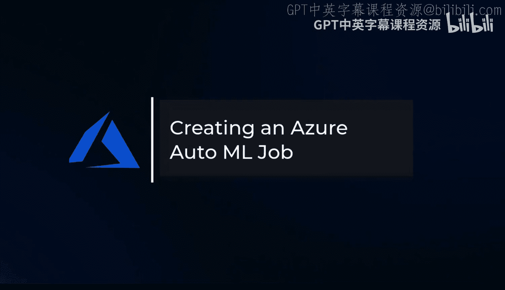
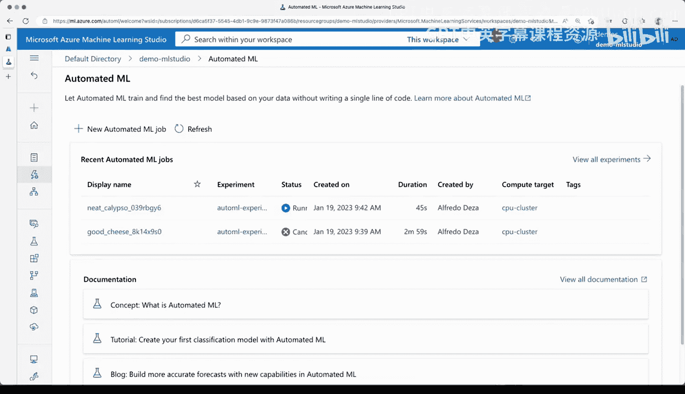

#  131：创建Azure Auto ML作业 🚀

在本节课中，我们将学习如何在Azure Machine Learning Studio中创建一个自动化机器学习（AutoML）作业。我们将从访问平台开始，逐步完成数据资产选择、计算资源配置、任务类型定义等关键步骤，最终启动一个回归预测模型的自动化训练流程。

---

## 访问Azure Machine Learning Studio

首先，点击链接进入Azure Machine Learning Studio。界面会打开一个新标签页。

初次使用这个界面可能会感到有些复杂，但它集成了处理机器学习时所需的大部分功能，便于用户访问。

界面左侧面板提供了多种选项。你可以随时点击“主页”返回初始屏幕。主要功能包括：
*   **Notebooks**：用于编写和运行代码。
*   **Automated ML**：我们本节课将重点使用的自动化机器学习功能。
*   **Designer**：一个拖放式界面，用于构建机器学习流水线（本节课不涉及）。

你可以通过左侧面板导航，或直接点击界面上的“Automated ML”图标或“立即开始”按钮来启动Automated ML。这三种方式都有效。

---

## 启动并创建新的AutoML作业

我将点击“Automated ML”下的“立即开始”按钮，进入创建新运行的流程。

由于我之前没有创建过任何AutoML作业，因此列表是空的。我需要创建一个新作业。

点击“创建新的自动化ML作业”，然后按照向导的步骤（从第1步到第5步）进行操作。我们将跳过第4步，因为本节课不涉及计算机视觉任务。我们将使用一个表格数据集。

---

## 步骤一：选择数据资产

第一步是选择数据资产。Azure最近将“数据集”更名为“数据资产”。我将使用一个逗号分隔值文件。

当前数据资产列表为空，因此我需要创建一个。Azure提供了一个便捷功能，允许你直接在此界面创建，无需跳转到其他页面。

点击“创建”。我将数据集命名为“wine_ratings”，描述为“World wine ratings”。数据源选择“从Web文件”。

为了获取数据文件的直接链接，我打开了一个包含`wine_ratings.csv`文件的GitHub仓库。点击文件后，选择“查看原始内容”，以获得文件的直接URL。这个URL的格式通常是 `https://raw.githubusercontent.com/...`。

复制该URL，回到Azure Machine Learning的创建界面。在数据源处选择“从Web文件”，粘贴URL。我选择让Azure验证数据，然后点击“下一步”。

---

## 配置数据集

数据验证完成后，界面会显示数据预览和一些设置选项。预览中可以看到一些问题，例如有一个无意义的“column1”列，以及包含大量空值的“grapes”列。

文件格式信息显示为CSV，包含表头。我确认有表头后，点击“下一步”。

接下来是数据架构界面。这里可以移除不感兴趣或不需要的列，这对后续处理很重要。
*   移除`column1`（无用）。
*   移除`name`（对于本次预测任务不重要）。
*   移除`grapes`（空值过多）。
*   保留`region`、`variety`和`rating`列作为特征和目标。
*   移除`notes`（文本内容过多，本次不使用）。

点击“下一步”并完成数据集的创建。创建完成后，需要点击“刷新”按钮，新创建的“wine_ratings”数据集才会出现在列表中。选择它，然后点击“下一步”。

---

## 步骤二：配置作业与计算资源

现在需要为AutoML作业创建一个新实验。我将其命名为“Auto ML experiment”。你可以根据项目意义自行命名。

接下来需要选择目标列。目标列是模型将要预测的内容。在本例中，我希望模型根据`region`和`variety`来预测`rating`。因此，目标列选择 **`rating`**。

然后需要选择计算资源。点击下拉菜单，可以看到“计算集群”或“计算实例”选项，但目前列表为空。

我希望使用计算集群来并行化运算。因此，点击“新建”来创建一个集群。在创建界面，需要选择虚拟机类型。
*   **低优先级**：成本极低（例如每小时0.01美元），但资源可用性取决于Azure的闲置容量。
*   **专用**：成本较高，但能保证资源可用。

我选择“专用”以确保稳定性。在推荐的配置中，我选择了一个具有14GB内存的虚拟机类型（每小时约0.29美元）。点击“下一步”。

在高级设置中，我将节点数设为1（由于配额限制，目前只能使用单节点）。虚拟机类型选择CPU集群。其他如虚拟网络、托管身份等高级设置保持默认，然后点击“创建”。集群创建需要一些时间。

集群创建完成后，回到作业配置界面。现在实验名称、目标列均已设置。在“选择Azure ML计算集群”处，选择刚刚创建好的“CPU-cluster”，然后点击“下一步”。

---

## 步骤三：选择任务类型并启动

现在需要选择机器学习任务类型。Azure根据目标列`rating`是连续数值，自动检测并推荐了 **回归** 任务，这完全符合我们的预测目标。

验证类型选择“自动”，并且不指定单独的测试数据资产。点击“完成”以创建新的AutoML作业。

默认情况下，AutoML会尝试多种算法并运行较长时间，以寻找最佳模型。作业启动后，模型结果将陆续显示。

返回“Automated ML”主界面，可以看到作业正在运行。此时，我们等待作业完成即可查看结果。

---

## 总结

本节课中，我们一起学习了在Azure Machine Learning Studio中创建自动化机器学习作业的完整流程。我们逐步完成了从创建数据资产、配置计算集群、定义回归预测任务到最终启动作业的核心步骤。这个过程展示了如何利用云平台的自动化工具，快速构建和部署一个机器学习模型原型。