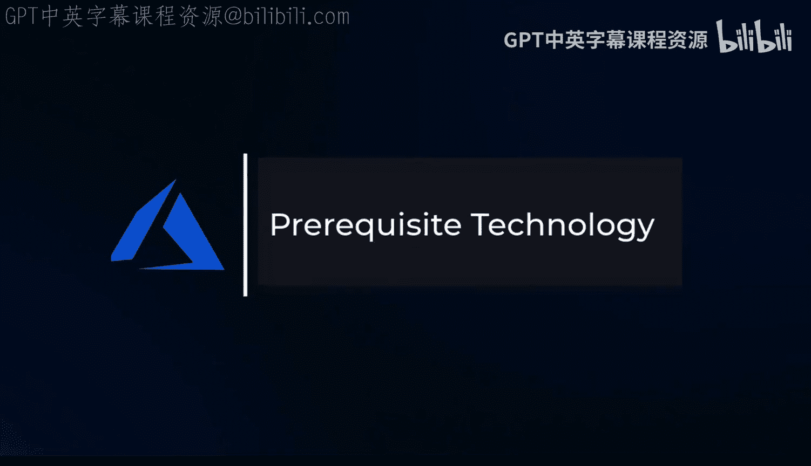
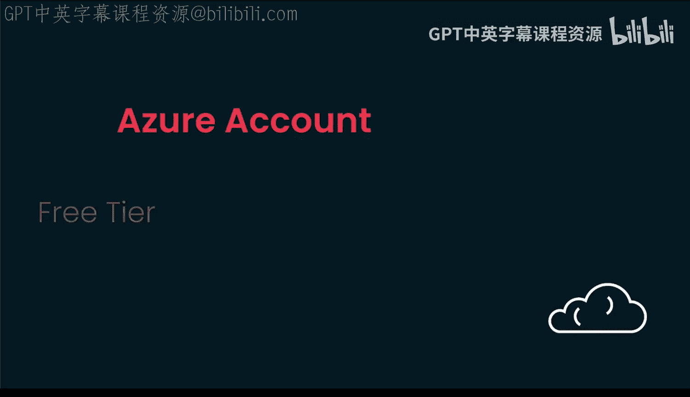
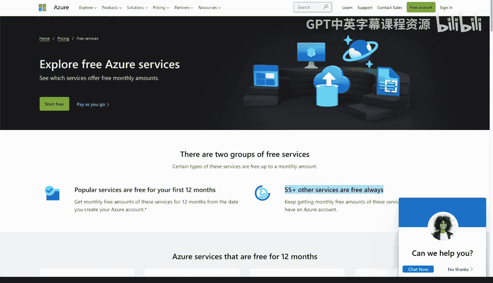
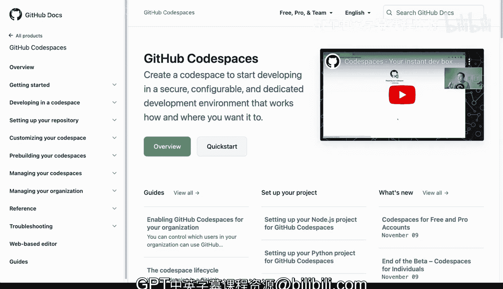

#  133：先修技术 🛠️

在本节课中，我们将学习如何为备考 Azure 助理数据科学家认证 DP-100 做好技术准备。我们将介绍两个核心工具：Azure 免费账户和 GitHub Codespaces。这些工具能帮助你免费或以极低成本，在云端环境中学习和实践机器学习运维。

---

上一节我们明确了学习目标，本节中我们来看看具体需要准备哪些技术工具。以下是两项关键的先修技术。

## Azure 免费账户

首先，你可以从创建一个 Azure 免费账户开始。当你获得免费账户后，主要目标是利用其提供的免费服务。查看可用的服务列表，你会发现大部分考试所需的服务都可以免费使用12个月。

在此之后，你可以根据需要转为“即用即付”模式。因此，在备考初期，使用免费账户是一个理想的起点。

## GitHub 账户与 Codespaces

其次，另一个强大的工具是 GitHub 账户。如果你拥有 GitHub 账户，就可以使用 Codespaces 功能。通过 Codespaces，你可以直接针对 Azure API 进行开发，这是备考的一种非常高效的方式。

让我们看看 Codespaces。你可以创建一个 Codespace，在一个基于云的环境中真正开始开发，并将其与 Azure 深度集成。这里也是存放你代码示例的绝佳场所。

---

本节课中我们一起学习了备考 DP-100 认证的两项先修技术：**Azure 免费账户**和**GitHub Codespaces**。通过利用这些免费或低成本的云端资源，你可以搭建一个实践环境，为深入学习机器学习运维打下坚实基础。