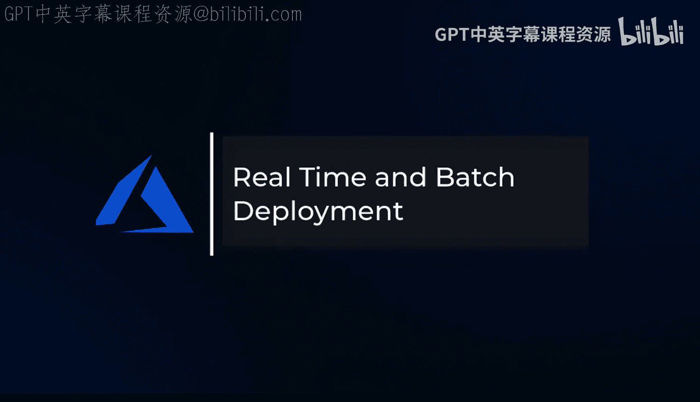
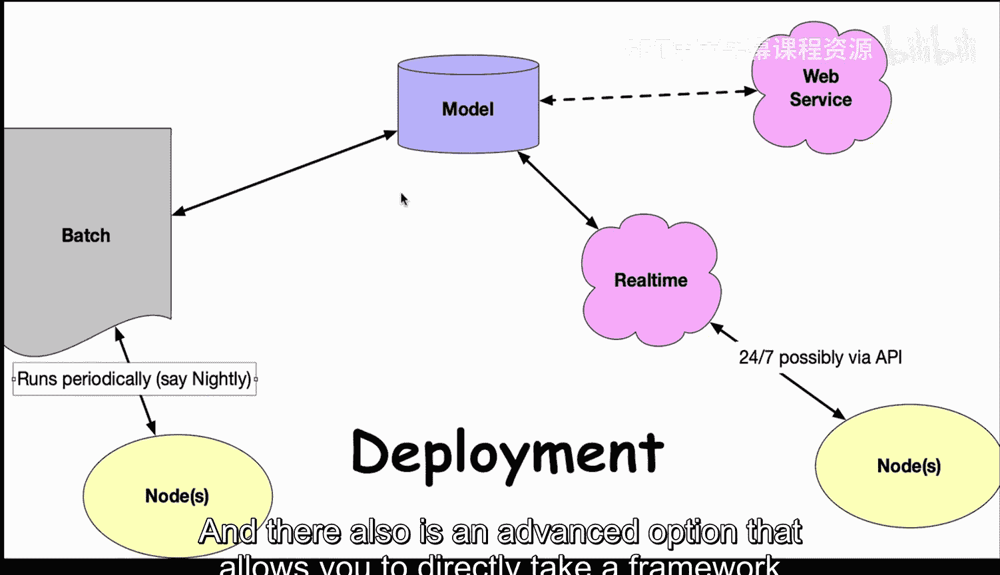

#  134：实时与批处理部署 📊

在本节课中，我们将学习在 Azure ML Studio 中部署机器学习模型的两种主要方式：**实时部署**与**批处理部署**。我们还将了解一种将模型直接打包为 Web 服务的进阶选项。

## 概述

通过 Azure ML Studio 部署模型时，主要有两种选择：批处理部署和实时部署。此外，还可以直接将模型部署为 Web 服务，从而抽象掉模型打包过程中的部分复杂性。

## 批处理部署

上一节我们介绍了部署的基本概念，本节中我们来看看批处理部署的具体含义。

在批处理部署模式下，模型通常是**周期性运行**的。例如，可以设定每晚执行一次信用卡评分任务。

以下是批处理部署的关键特点：
*   模型按预设时间表（如每日、每周）运行。
*   适用于不要求即时响应的任务，如批量数据预测或报表生成。
*   在 Azure ML Studio 中，操作路径为：模型预测界面 -> 选择“部署到批处理”。

## 实时部署

了解了批处理部署后，我们再来看看实时部署有何不同。

在实时部署模式下，模型能够以 **24/7 不间断** 的方式提供服务。你需要部署一个端点，并持续地向这个实时端点发送预测请求。

以下是实时部署的关键特点：
*   模型持续运行，随时准备响应 API 请求。
*   适用于需要即时预测的应用，如欺诈检测或推荐系统。
*   在 Azure ML Studio 中，操作路径为：模型预测界面 -> 选择“部署到实时”。

## 在 Azure ML Studio 中的操作

现在，让我们具体看看在 Azure ML Studio 中如何操作。

如果我们进入 Azure ML Studio 的模型预测界面，会看到几个部署选项：“部署到实时”、“部署到批处理”和“部署到服务”。请注意，“部署到服务”等选项通常仅适用于基于特定框架（如 Scikit-learn 或 PyTorch）的模型。

选择“部署到批处理”后，系统会要求你配置一些选项，完成配置后便会创建相应的服务。

我们可以查看一个现有的端点。在 Azure ML Studio 中，已注册的实时端点会显示在对应区域，已注册的批处理端点也会显示在专属区域。例如，我之前创建的一个批处理端点就显示在这里。

这个批处理端点可以**定期运行**。如果我想针对它创建一个任务，它被设计为按计划运行。这与另一种端点——实时端点——形成对比。实时端点的设置是为了持续运行并接收来自客户端的 API 请求。

## 进阶部署选项

除了上述两种核心部署方式，Azure ML Studio 还提供了一种进阶选项。

这种进阶选项允许你**直接获取一个框架并将其部署到生产环境**，进一步简化了流程。

## 总结

本节课中我们一起学习了在 Azure ML Studio 中部署模型的两种主要模式：**批处理部署**（周期性运行）和**实时部署**（持续服务）。我们还了解了如何在实际界面中操作，并提及了直接将框架模型部署为 Web 服务的进阶可能性。理解这些部署方式的区别，有助于你根据实际应用场景选择最合适的策略。