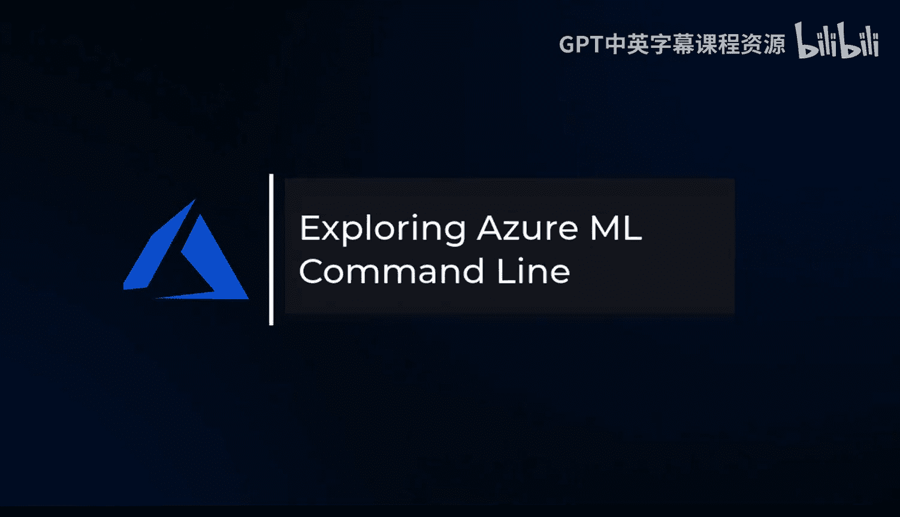
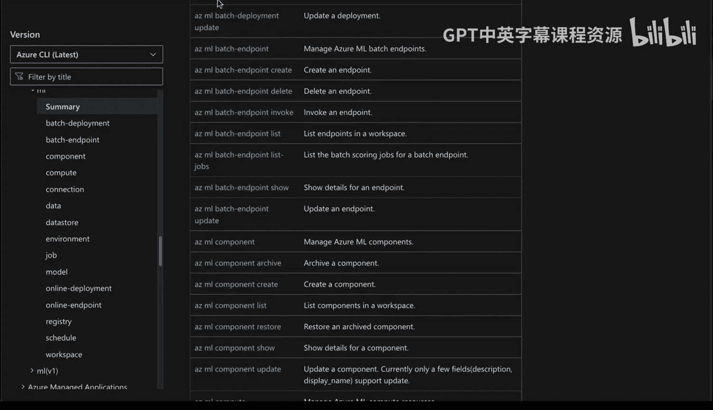
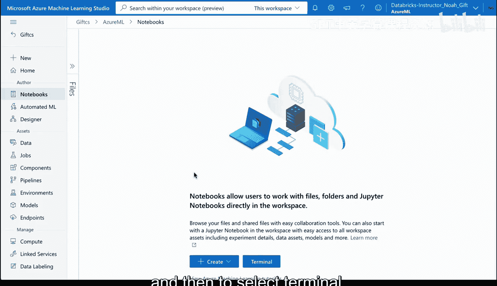
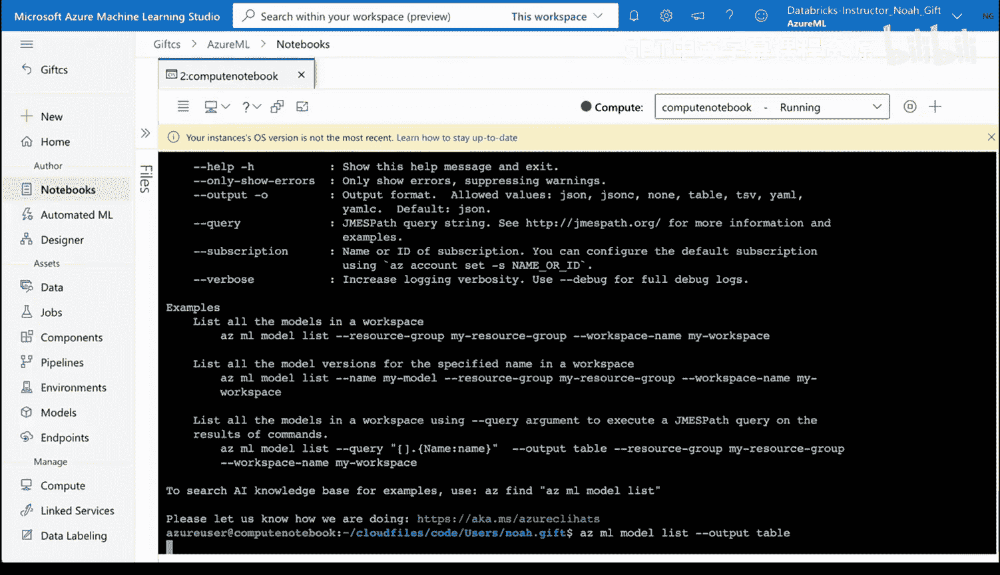

#  138：探索Azure ML命令行




在本节课中，我们将学习如何使用Azure ML命令行界面（CLI）来高效地管理和查询Azure机器学习服务中的各种资源。我们将通过实际操作，了解如何列出数据集、模型等核心组件，并比较CLI与图形界面（GUI）在操作效率上的差异。

## 命令行工具概述

Azure ML CLI扩展版本2提供了丰富的命令，允许你高效地查询整个产品。在许多情况下，使用这些命令进行操作比在图形界面上点击更加简便。

上一节我们介绍了命令行工具的优势，本节中我们来看看如何实际使用它。

## 启动Azure ML终端

要开始使用CLI，一个简单的方法是登录到你的Azure ML工作区，然后选择终端。以下是具体步骤：

1.  打开Azure ML Studio。
2.  登录到你的工作区。
3.  在界面中找到并选择“终端”选项。






选择后，你会看到“欢迎使用Azure机器学习终端”的提示。这个集成的终端环境非常方便，可以让你立即开始使用命令行界面。

## 探索可用命令

开始探索的第一步是查看所有可用的命令。你可以在终端中输入以下命令来获取帮助菜单：

```bash
az ml --help
```

这个命令会列出所有你可以使用的命令组。你会看到诸如 `batch-deployment`、`compute`、`datasets`、`jobs`、`models` 等子组。通过CLI，你能够集成所有这些不同的系统，并快速了解Azure ML Studio中实际发生的情况。

## 操作数据集

让我们首先尝试操作数据集。这是一个很好的起点。要查看与数据相关的具体命令，可以输入：

```bash
az ml data --help
```

这个命令会显示一个菜单，列出可用的不同操作和输出选项。例如，你可以查询不同的数据集以获取其信息。输出格式可以是JSON、表格或YAML文件。

以下是操作数据集的具体步骤列表：

*   **列出数据集**：使用 `az ml data list` 命令。
*   **选择输出格式**：通过 `--output` 参数指定格式，例如 `table` 表示表格。
*   **执行命令**：在终端中运行组合后的命令。

让我们实际操作一下。使用上箭头键调出之前的命令，并将其修改为以表格形式输出：

```bash
az ml data list --output table
```

执行后，你将能看到你名下所有可用的数据集列表。如果你希望对某个数据集进行进一步的操作或查询，可以基于这个列表继续进行。

## 探索模型资源

我们也可以回到初始状态，探索其他类型的资源。例如，如果你想查看系统上已注册或部署了多少模型，同样可以使用CLI。

要查看与模型相关的命令，请输入：

```bash
az ml model --help
```

从这里，我们可以看到可用的不同命令，例如归档模型、创建模型、下载模型、列出模型、恢复、显示详情、更新等。

让我们尝试列出所有已注册的模型。首先查看列表命令的帮助信息：

```bash
az ml model list --help
```

帮助菜单再次显示了相同的格式选项。接着，我们以表格形式列出模型：

```bash
az ml model list --output table
```




执行后，我们可以看到系统中注册的许多不同模型，并可以对它们进行各种操作。

## 总结

本节课中我们一起学习了如何利用Azure ML命令行界面（CLI）来高效地探索和管理资源。我们了解了如何启动集成终端、查看可用命令、以及具体操作数据集和模型列表。通过CLI，你能够快速获取信息并执行操作，这通常是比使用图形界面更直接高效的方式。如果你打算通过命令行深入查询Azure ML，使用计算笔记本环境并打开终端是一个最佳起点。