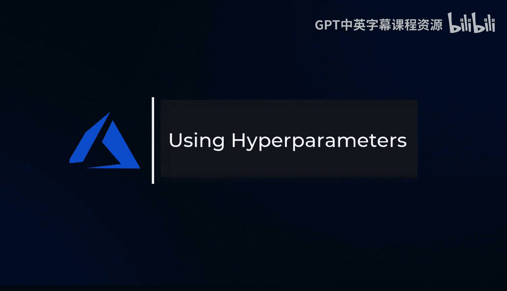
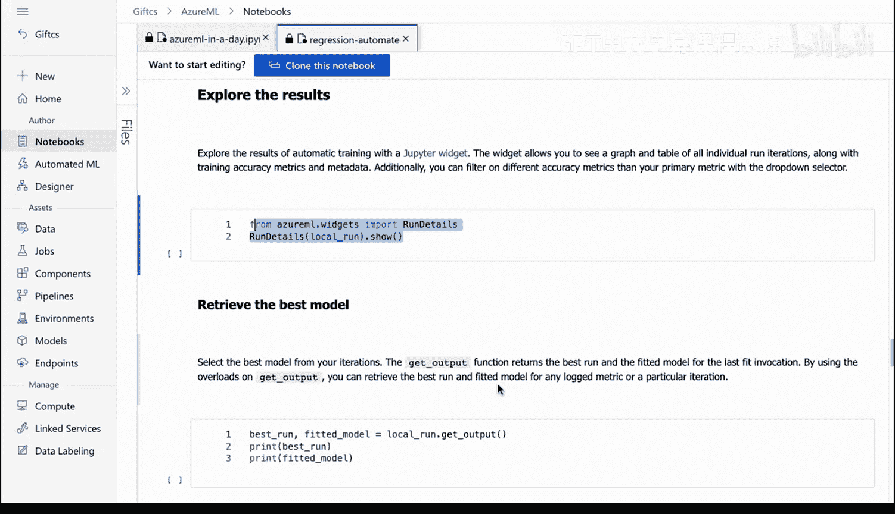

#  140：使用超参数自动调优 🎯



在本节课中，我们将学习如何在Azure机器学习平台上，利用SDK进行自动化的超参数调优。我们将了解其核心设置、工作流程以及如何通过实验选择最佳模型。

---

## 概述

超参数调优是机器学习模型开发中的关键步骤，但手动调整往往耗时且繁琐。Azure机器学习平台提供了自动化工具，可以高效地探索超参数空间并找到最佳配置。本节将基于一个SDK V1的示例笔记本来讲解其实现过程。

## 准备工作

首先，我们需要进行一些基础设置。这包括导入必要的库（如pandas和Azure SDK V1），将数据加载到pandas中进行清洗，并配置工作区。

```python
import pandas as pd
from azureml.core import Workspace

# 配置工作区并加载、清洗数据
ws = Workspace.from_config()
# ... 数据加载与清洗代码
```

完成数据准备后，我们会将数据划分为训练集和测试集。这与传统的机器学习流程并无不同。

## 核心：自动化超参数调优设置

上一节我们完成了数据准备，本节中我们来看看如何设置自动化的模型训练与超参数调优。当我们选择“自动训练模型”选项时，有几个关键的训练设置需要特别注意。

以下是配置自动超参数调优时需要注意的几个核心参数：

*   **迭代超时（分钟）**：`iteration_timeout_minutes`。这定义了每次迭代（即尝试一组特定超参数）允许运行的最长时间。你需要根据模型复杂度和计算资源来决定这个时长。
*   **实验总超时**：`experiment_timeout_minutes`。这是整个超参数调优实验（包含所有迭代任务）允许运行的总时间上限。
*   **早停机制**：`enable_early_stopping`。当模型性能达到一个足够好的分数时，是否可以提前终止实验，以节省计算资源。
*   **优化指标**：`primary_metric`。这是用于评估和选择最佳模型的核心指标。在本教程示例中，使用的是**斯皮尔曼相关系数（spearman correlation）**。
*   **特征工程**：`featurization`。可以设置为`auto`，平台将自动处理缺失值，并将数据转换为文本和数值格式。
*   **日志详细程度**：`verbosity`。控制输出日志的详细级别，便于你监控训练过程。
*   **交叉验证**：`n_cross_validations`。在超参数调优中可以设置的参数之一，用于提高模型评估的稳健性。

## 配置与执行训练任务

将上述所有自动设置组合在一起，我们会将它们分配到一个配置字典中。

```python
automl_settings = {
    "iteration_timeout_minutes": 60,
    "experiment_timeout_minutes": 360,
    "enable_early_stopping": True,
    "primary_metric": 'spearman_correlation',
    "featurization": 'auto',
    "verbosity": logging.INFO,
    "n_cross_validations": 5
}
```

配置完成后，你只需将此字典推送到训练任务中进行配置并启动它。

## 查看结果与部署模型

一旦训练任务开始运行，它将在Azure机器学习工作室中显示为一个实验。实验完成后，你可以返回“实验”选项卡查看所有运行记录，并找到性能最佳的模型。

超参数调优的核心思想在于，它将大量手动、繁琐的工作自动化。你无需亲自专注于搜索过程，而是通过SDK调用，让Azure平台自动遍历并挑选出最佳的超参数组合。这些结果会清晰地展示在实验面板中，你只需查看各项运行的指标，选择正确的实验记录，然后即可部署该模型。

---

## 总结



本节课中我们一起学习了在Azure机器学习中实施自动化超参数调优的完整流程。我们从基础的环境和数据准备开始，重点讲解了超参数调优的关键设置项，如超时控制、优化指标和早停机制。最后，我们看到了如何通过SDK配置并提交任务，以及在实验面板中选取最佳模型进行部署。这大大简化了模型优化的过程，让数据科学家能更专注于业务逻辑和算法创新。