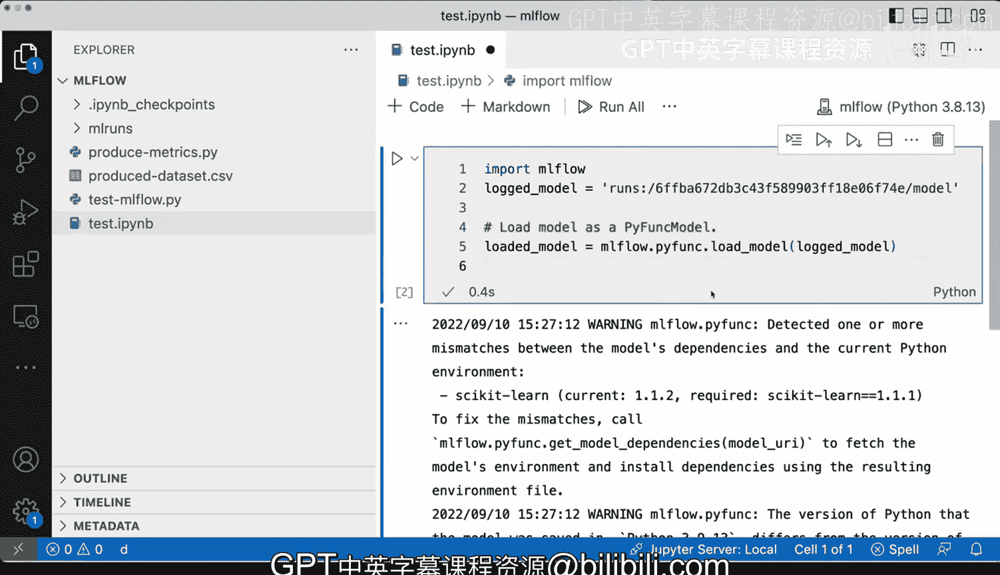

#  146：参数、版本、工件与指标 🔧


在本节课中，我们将深入学习MLflow中的核心概念：参数、工件与指标。我们将通过一个具体的例子，了解如何记录和追踪这些元素，以及它们如何帮助我们管理和复现机器学习实验。

---

上一节我们介绍了MLflow的基本概念，本节中我们来看看如何在实际代码中记录参数、工件和指标，并理解它们之间的区别与联系。

让我们深入探讨参数、工件与指标。我们已经了解了如何生成大量指标并将其记录到用户界面。现在，我将尝试运行一个来自Databricks/MLflow文档的示例代码，然后展示生成的文件内容。执行这段代码时，它会获取项目，但遇到了一个错误。

让我们看看发生了什么。MLflow对某些规则比较严格，其中之一就是不允许更改已记录的参数值。你可以看到，初始值是5，但后续尝试以5.0（浮点数）的形式记录它。这是不被允许的。

异常信息非常有用，它指出这样记录参数是不行的。原因在于，参数通常代表你运行实验的方式，例如在命令行界面中传递的参数。如果你已经以`--log-level=warning`运行了一个命令，之后不太可能将其更改为`debug`，因为实验已经基于`warning`级别运行了。因此，MLflow会在此类情况发生时报错。虽然理论上可以强制覆盖某些参数，但强烈建议不要这样做。正确的方法是从一开始就正确设置参数，并保持其一致性。

让我们看看这个示例的具体内容。我将转到MLflow示例，并查看`train.py`文件。该文件使用著名的葡萄酒质量CSV数据集进行训练。我们关注的是它如何记录参数。代码中传递了值为5的`alpha`参数。这里有一个逻辑：如果`alpha`大于1，则使用其值，否则使用0.5。问题可能出在这里，因为代码抱怨参数值被更改。我们需要确保参数被正确设置。

为了解决这个问题，我对示例进行了修改，强制将`alpha`转换为整数，以避免类型不一致的问题。现在，让我们回到编辑器并再次运行它。

回到Visual Studio Code，我们运行修改后的脚本，指定`alpha`为5。运行完成后，终端会输出一些值。这些值来自`train.py`中的打印语句。然而，将信息打印到终端仅在直接运行时有用；MLflow的优势在于它能自动捕获并记录所有信息，包括指标和模型本身。

在这个例子中，代码使用`log_model`辅助函数（来自`sklearn`）来记录训练好的弹性网络模型。模型在调用`fit`方法后生成，并被MLflow捕获。

现在，让我们在MLflow UI中查看运行结果。刷新页面后，我们可以看到多次运行记录。其中一次运行失败了，这正是之前提到的Databricks示例，它由于参数记录问题而失败。在详情中，我们可以看到参数`alpha`被记录为5，但后续尝试记录为5.0导致了失败。状态显示为“失败”，因此没有生成任何指标或工件。

查看最近一次成功的运行，情况就不同了。参数`alpha`被成功记录为5。我们还可以看到三个指标：MAE、R2和RMSE。点击这些指标，可以看到它们都是固定值（例如RMSE为0.85），这与我们在代码中看到的一致。

为了展示实验追踪的威力，我们可以用不同的参数值多运行几次。例如，用`alpha=3`和`alpha=2`（注意避免使用浮点数以免冲突）再运行两次。完成后，回到UI查看所有运行记录。

以下是多次运行后的关键观察点：

*   **参数变化**：UI清晰地展示了每次运行时`alpha`参数的不同值。
*   **指标对比**：我们可以轻松比较不同参数下模型性能指标（如RMSE）的差异。
*   **工件存储**：成功的运行都保存了完整的模型工件。点击“Artifacts”可以查看所有被捕获的内容，包括MLmodel文件、conda环境配置（conda.yaml）、序列化的模型文件（model.pkl）等。这非常强大，因为它捕获了复现实验或进行预测所需的一切。

例如，我们可以直接加载这个被记录的模型进行预测。以下是如何操作的示例代码：

```python
import mlflow
import pandas as pd

# 根据UI中的路径加载模型
logged_model = 'runs:/<RUN_ID>/model'

# 加载模型为Python函数（pipeline）
loaded_model = mlflow.pyfunc.load_model(logged_model)

# 假设有一个测试DataFrame `test_data`
# predictions = loaded_model.predict(test_data)
```

我们可以在一个Jupyter Notebook中尝试运行类似的代码。虽然可能需要正确定义测试数据，但这个例子很好地展示了如何快速访问并使用MLflow UI中记录的模型。即使本地没有安装pandas，通过`mlflow.pyfunc.load_model`这个辅助函数，我们也能轻松地从MLflow加载模型进行交互。

---



本节课中我们一起学习了如何在MLflow中区分和记录参数、工件与指标。我们通过一个实际例子看到，参数定义了实验配置，指标衡量了模型性能，而工件则保存了实验的完整产出（如模型文件）。正确使用这些功能，能够极大地提升机器学习实验的可追踪性、可复现性和管理效率。记住，从一开始就清晰、一致地定义和记录参数，是保证实验流程顺畅的关键。