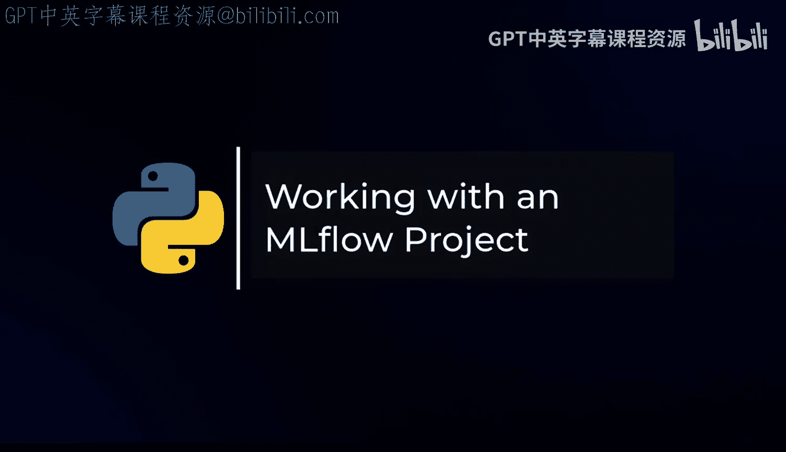
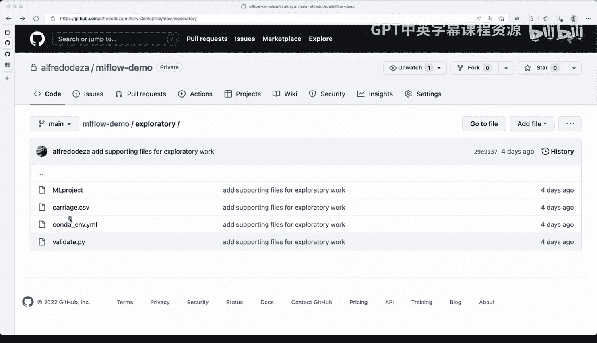
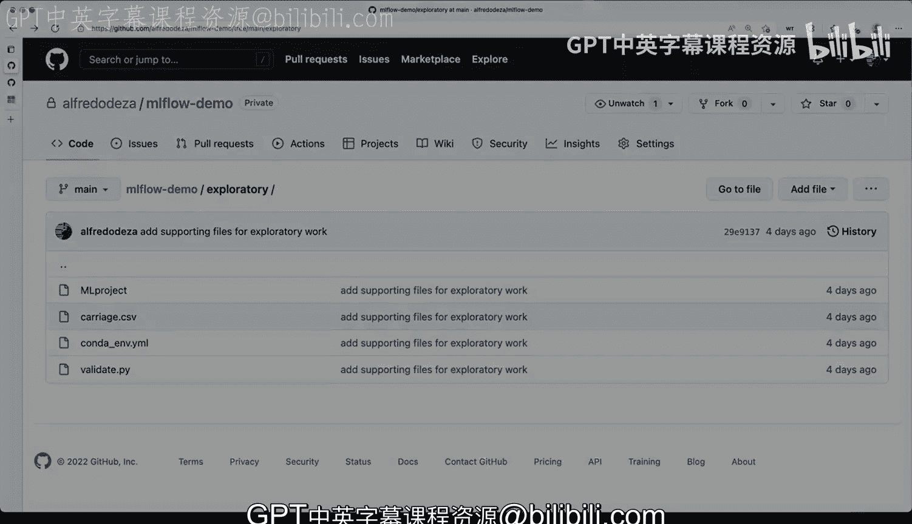

#  147：使用MLflow项目 🚀



在本节课中，我们将学习MLflow项目的核心组成部分。MLflow项目提供了一种标准化的方式来打包和复用机器学习代码，确保实验的可重复性。我们将了解其基本结构，包括项目定义文件、环境配置和入口点脚本。

---

上一节我们介绍了MLflow项目的概念，本节中我们来看看一个MLflow项目的具体构成组件。


以下是MLflow项目的主要组成部分：

*   **项目名称**：在项目定义文件中声明，用于标识项目。
*   **Conda环境**：通过一个YAML文件指定，用于定义代码运行所需的依赖项，确保环境一致性。
*   **入口点**：至少需要定义一个入口点。入口点允许你通过不同的参数来运行脚本，参数可以是路径、数字（如浮点数）等类型。
*   **执行脚本**：通常是Python脚本或Shell脚本。推荐使用Python脚本，以便利用Conda环境中为数据科学预置的丰富库。

---

接下来，我们详细看一下项目定义文件（MLproject）。由于该文件没有`.yaml`或`.yml`扩展名，某些编辑器可能无法提供语法高亮。

以下是项目定义文件的一个示例结构：

```yaml
name: my_project
conda_env: conda.yaml
entry_points:
  main:
    parameters:
      data_file: path
      validation_split: {type: float, default: 0.2}
    command: "python train.py --data-file {data_file} --validation-split {validation_split}"
```

在这个示例中：
*   `name` 字段指定了项目名称。
*   `conda_env` 字段指向定义依赖的Conda环境文件。
*   `entry_points` 下定义了至少一个入口点（例如 `main`），其中包含了参数和要执行的命令。

---

现在，让我们看一个具体的Python脚本示例。这个脚本使用`click`库来创建命令行工具，但其核心逻辑与框架无关，你也可以使用纯Python脚本。

该脚本的主要功能是：
1.  读取一个CSV文件。
2.  根据一个布尔参数决定是否记录指标。
3.  检查数据中是否存在未命名列或全零列，并进行计数报告。
4.  使用MLflow的API记录相关指标。

脚本的关键逻辑部分如下（示意）：
```python
import click
import pandas as pd
import mlflow

@click.command()
@click.option('--data-file', required=True)
@click.option('--log-metrics', is_flag=True)
def main(data_file, log_metrics):
    df = pd.read_csv(data_file)
    # ... 数据验证逻辑 ...
    if log_metrics:
        mlflow.log_metric("unnamed_columns_count", count)
    # ... 其他操作 ...
```

---

最后，我们来看一下Conda环境文件（`conda.yaml`）。这个文件用于声明项目所依赖的所有软件包，是创建可重复环境的关键。

一个典型的环境文件内容如下：
```yaml
name: exploratory
channels:
  - conda-forge
dependencies:
  - python=3.8
  - pandas
  - scikit-learn
  - mlflow
  - click
```
在这个文件中：
*   `name` 指定了Conda环境的名称。
*   `channels` 指定了下载包的渠道（这里使用了`conda-forge`）。
*   `dependencies` 列出了所有必需的依赖包及其版本。

---

本节课中我们一起学习了MLflow项目的基本结构。一个标准的MLflow项目通常包含：一个定义项目属性和入口点的`MLproject`文件、一个指定依赖的`conda.yaml`环境文件，以及一个或多个执行核心逻辑（如数据验证、模型训练）的Python脚本。通过这种方式，你可以将数据验证、模型训练等多种任务以可重复、标准化的形式打包和管理。






