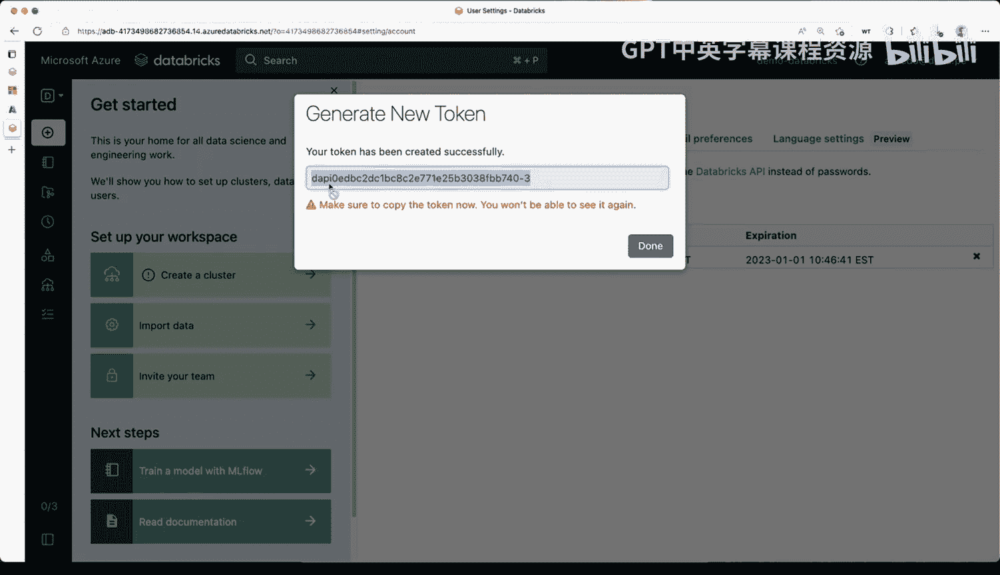
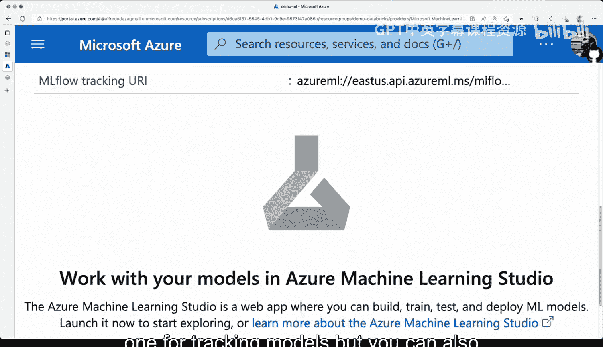
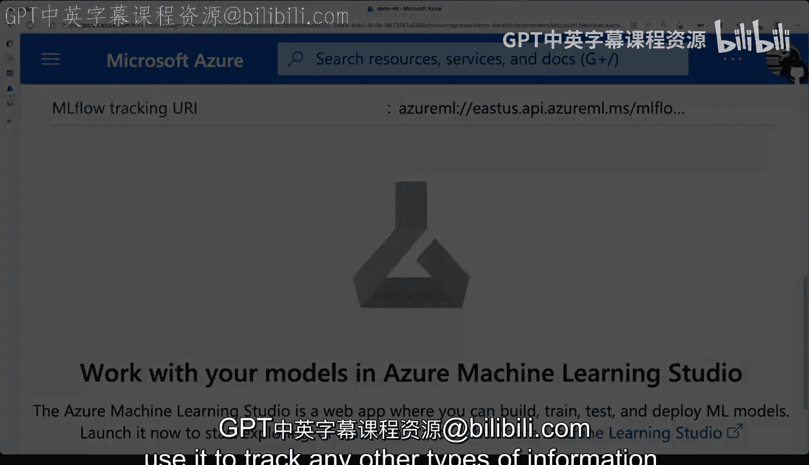

#  150：将MLflow连接至远程服务 🚀


在本节课中，我们将学习如何将MLflow连接到远程的模型跟踪服务器。具体来说，我们将探索两种主流云服务——Databricks和Azure Machine Learning——的连接配置方法。掌握这些连接方式，能让你在本地开发时，将实验记录、参数和模型统一存储到云端，实现协作与可追溯性。

## 连接MLflow与Databricks

上一节我们介绍了MLflow的基本概念，本节中我们来看看如何将其与Databricks服务连接。Databricks提供了托管式的MLflow跟踪服务器。

根据Databricks官方文档，配置的核心在于正确设置环境变量，以允许本地MLflow客户端与远程服务器通信。无论底层是AWS、Azure还是GCP，连接原理相同。

以下是连接所需的关键步骤：

1.  **设置跟踪服务器URI**：你需要导出 `MLFLOW_TRACKING_URI` 环境变量，其值指向你的Databricks工作区。
2.  **配置认证信息**：你有两种主要的认证方式选择。

以下是两种可选的认证配置方法：

*   **使用用户名和密码**：直接设置 `DATABRICKS_USERNAME` 和 `DATABRICKS_PASSWORD` 环境变量。
*   **使用访问令牌（推荐）**：生成一个REST API令牌，然后设置 `DATABRICKS_HOST` 和 `DATABRICKS_TOKEN` 环境变量。

正确设置这些变量后，本地MLflow的运行数据就会发送到Databricks的跟踪服务器。

生成个人访问令牌的过程很直接。按照文档指引，在你的Databricks工作区中，点击左下角的“设置”选项卡，进入“用户设置”。在设置页面中，你可以创建新的令牌。建议为令牌设置一个有效期（例如90天），这是一个良好的安全实践。令牌生成后只会显示一次，请妥善保存。

## 连接MLflow与Azure Machine Learning



接下来，我们看看如何将MLflow连接到另一个流行的服务——Azure Machine Learning。这使你能够利用Azure ML的工作区和模型注册中心。

连接Azure ML同样需要配置MLflow跟踪URI。官方提供了几种获取和设置该URI的方法。

一种方法是手动构建URI字符串。其格式通常如下：
```
azureml://<region>.api.azureml.ms/mlflow/v1.0/subscriptions/<subscription-id>/resourceGroups/<resource-group>/providers/Microsoft.MachineLearningServices/workspaces/<workspace-name>
```
你需要填入你的Azure区域、订阅ID、资源组名称和工作区名称。

另一种更简便的方法是通过Azure门户获取。在Azure Machine Learning工作室中，你可以找到“MLflow跟踪URI”字段，并直接点击链接复制到剪贴板。随后，你可以将其导出为环境变量。

## 总结





本节课中我们一起学习了将MLflow连接到远程跟踪服务器的两种主要方式。我们详细介绍了连接Databricks和Azure Machine Learning所需的配置步骤与认证方法。无论是通过环境变量设置Databricks的访问令牌，还是手动构建或从门户复制Azure ML的跟踪URI，核心目标都是建立本地工具与云端服务之间的桥梁。这为团队协作、实验管理和模型部署奠定了重要基础。