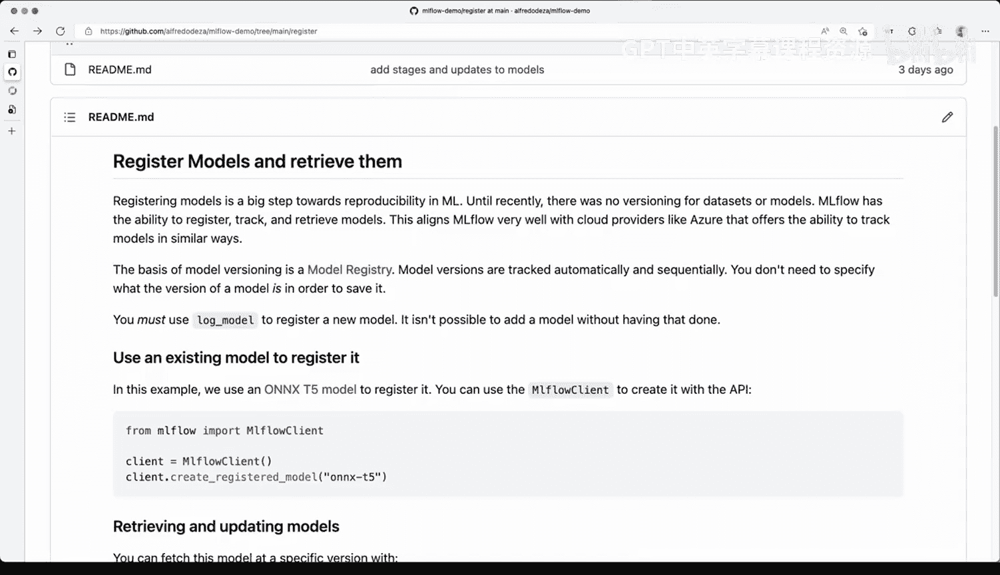
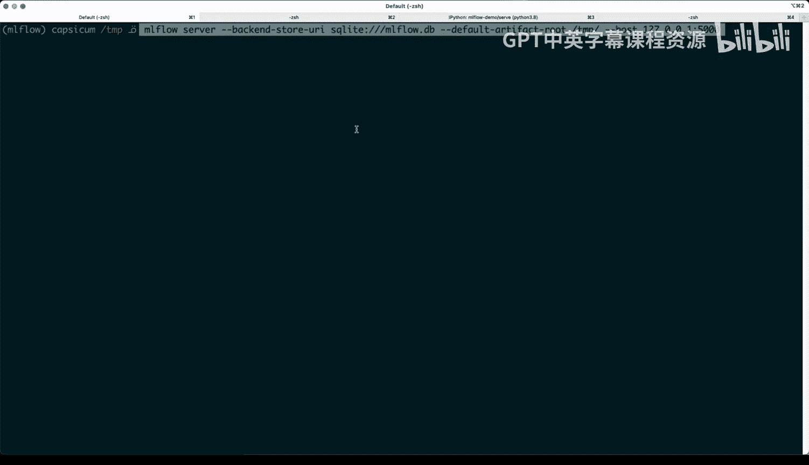
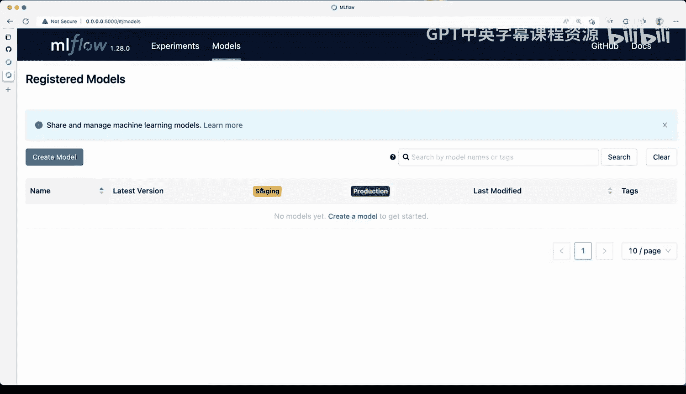
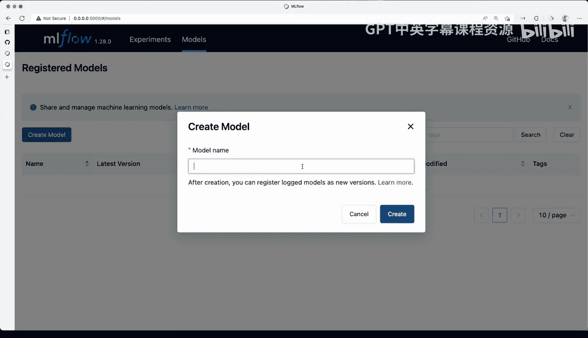
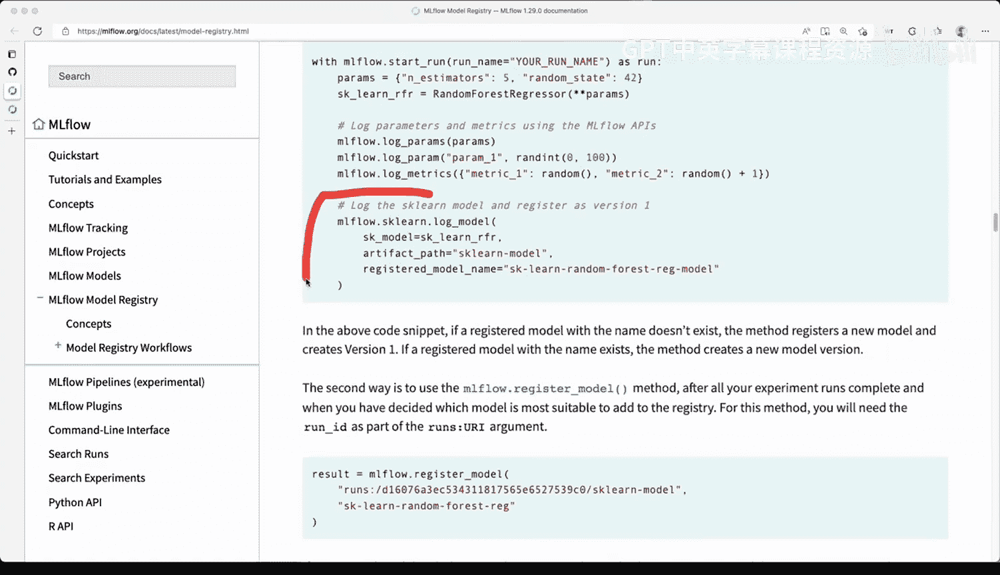

#  152：在MLflow模型中使用注册表 📚


在本节课中，我们将学习如何在MLflow中使用模型注册表。模型注册表是一个核心功能，它允许你注册、版本化和管理机器学习模型。这个功能并非MLflow独有，几乎所有主流云服务商都提供了类似的解决方案。掌握它对于管理持续变化的模型至关重要。

## 概述

模型注册表的核心作用是注册模型并管理其关联的不同版本。这在模型频繁更新的场景下非常有用。本节将介绍使用MLflow实现这一功能的具体方法。

## 注册与检索模型

上一节我们介绍了MLflow的基础，本节中我们来看看如何注册和检索模型。本质上，这个过程涉及训练或创建新模型（或新环境），然后找到一种方法来注册它们。

你可以有多种选择来注册和检索模型。以下是几种主要方式：

1.  **使用现有模型进行注册**：你可以从一个已存在的模型开始注册。这种方式本身提供的信息很少，基本上只是创建一个几乎为空的信息占位符。
2.  **通过API或SDK注册**：如代码所示，你可以通过编程方式（API/SDK）完成注册。
    ```python
    # 示例：通过MLflow客户端API创建空的注册模型占位符
    client.create_registered_model(name="MyModel")
    ```
3.  **通过用户界面(UI)注册**：MLflow也提供了直观的图形界面来操作注册表。

目前我们不会深入讲解如何检索或更新模型，但要创建一个新模型，你必须先产生一个模型“工件”。产生工件的标准方法是在训练时使用 `log_model` 函数。

## 本地运行MLflow服务器

我们已经看到了几种操作方法，但故事还不完整。如果你想在本地尝试这些功能（强烈推荐），你需要运行一个MLflow服务器。具体操作有些技巧，需要按顺序准备几样东西。

以下是启动服务器的完整命令：
```bash
mlflow server \
    --backend-store-uri sqlite:///mlflow.db \
    --default-artifact-root ./mlruns \
    --host 127.0.0.1 \
    --port 5000
```



我们来详细看一下这个命令：
*   `mlflow server` 是你要使用的命令。
*   `--backend-store-uri`：我使用了SQLite，这是一个嵌入式数据库。你的系统上应该可用，否则需要安装`sqlite3`。这里指向当前路径下的一个文件（`mlflow.db`）。
*   `--default-artifact-root`：指向 `./mlruns` 目录，作为存储模型工件的默认根路径。
*   `--host 127.0.0.1` 和 `--port 5000` 指定服务器在本地主机的5000端口运行。



执行命令后，服务器就启动了。现在，如果我在浏览器中访问 `http://127.0.0.1:5000`，就能看到MLflow的用户界面。

## 通过UI创建与交互模型

为了开始使用，我们可以通过UI创建一个模型。例如，你可以创建一个名为“D5_onyx”的模型，并为其添加描述和标签。

这种方式与前面提到的API调用效果完全相同。创建模型后，你就可以开始与它交互，并使用注册表功能。注册后，你会发现有几个不同的操作选项。

## 注册模型与注意事项





你可以使用 `mlflow.register_model` 来注册一个模型。这个函数会创建一个新的注册模型记录。如果模型名称已存在，操作会失败，因为它要求名称唯一。因此，务必注意你使用的名称。

你也可以手动指定运行ID和模型路径来完成注册，但这种方式通常非常繁琐。请确保只在少数特定情况下（例如需要精确定位到某个运行ID及其存储位置时）才使用手动方式。

这就是你与模型注册表交互的方式：首先如所示那样记录（`log`）模型，然后与服务器交互。这个服务器允许你存储模型信息，就像我们之前做的那样。

## 总结



本节课中，我们一起学习了MLflow模型注册表的核心用法。我们了解了注册模型的重要性，探讨了通过API和UI进行注册的方法，并详细介绍了如何在本地启动MLflow服务器来管理模型。关键是要记住，使用 `log_model` 记录模型是注册的前提，而注册表的核心价值在于对模型进行版本控制和生命周期管理。