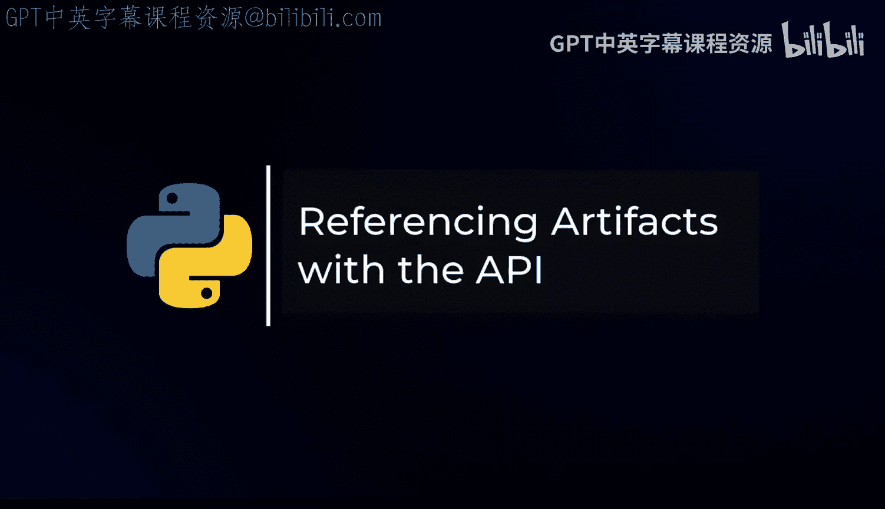
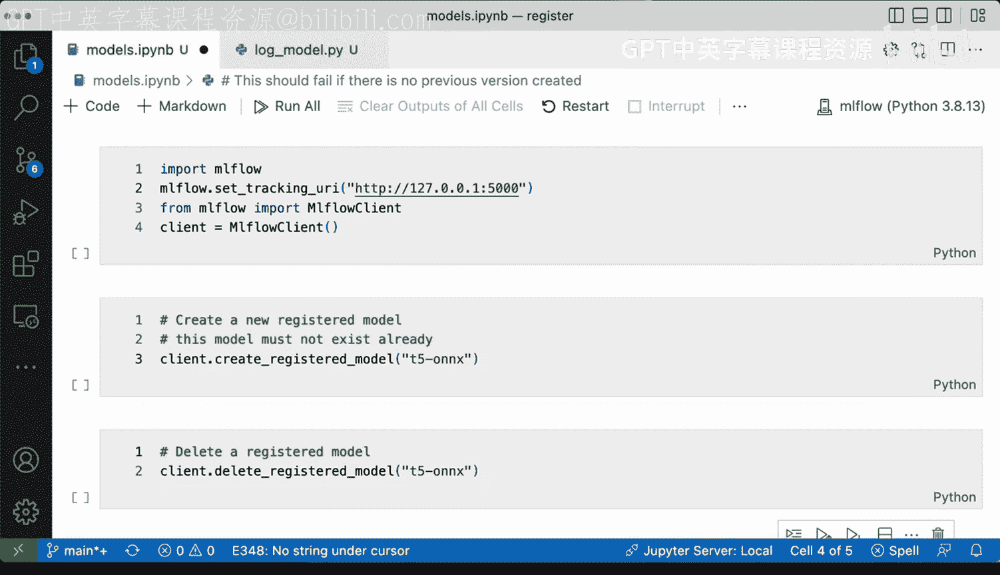
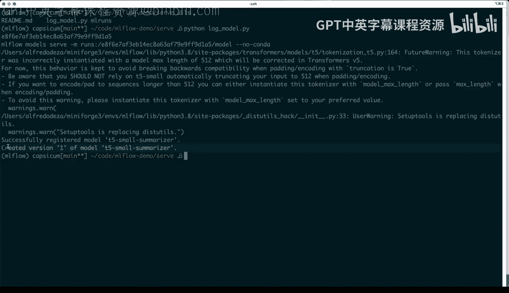
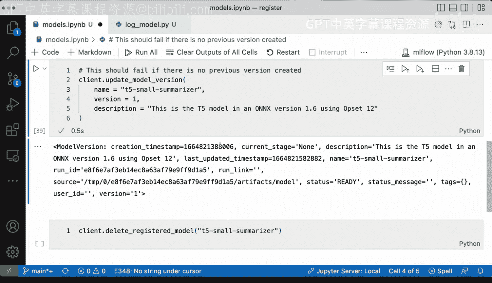

#  153：通过API引用工件 📡



在本节课中，我们将学习如何与存储在远程注册表中的模型进行交互和引用。这是使用MLflow时更深入的一步。我们已经看过如何注册模型，但尚未了解如何检索或更新它们。本节将详细介绍这些操作。

## 模型注册与日志记录

上一节我们介绍了模型的基本概念，本节中我们来看看如何具体记录一个模型。首先，回顾一下记录模型的关键步骤。

我运行了几个实验，这些实验在几分钟前完成，并成功记录了一个实际模型。但有些操作并不直观，可能需要一些时间才能理解。我想通过示例展示这些过程。

打开Visual Studio Code，这里有一个Jupyter笔记本，包含如何注册模型以及如何动态与API交互的示例。但首先，我们看看如何记录模型。

以下是一个简短的脚本，它使用了Hugging Face库。脚本通过`transformers`导入`pipeline`，然后创建一个Python类。这个类告诉MLflow如何与这个Hugging Face模型交互。具体方式是，在构造函数中设置分词器和模型，然后定义一个方法（本例中将英语翻译为德语），构建模型输入和输出，最后启动跟踪运行并记录模型。

记录模型时有几个关键点：
*   **`log_model`方法**：当你记录模型时，你正在生成一个**工件**。你捕获了模型的所有细节。
*   **注册模型名称**：最初我没有设置注册模型名称，导致模型没有出现在注册表中。因此，我决定将其命名为`T5-small-summarizer`，并添加了一些模型细节描述。
*   **跟踪URI**：必须设置**`tracking_uri`**。如果未设置，模型将无法注册，且不会有任何错误提示。因此，请确保`tracking_uri`始终设置为预期的值。
*   **动态交互**：当你想操作模型时，必须确保设置了正确的URI。例如，我动态运行时使用`http://127.0.0.1:5000`（本地运行）。我不确定为何默认不是这个，我认为默认是文件系统，这会导致期望在服务器上运行的内容并未运行。

现在，让我们在终端中快速运行这个记录模型的脚本。

```bash
python log_model.py
```

运行成功，显示“成功注册模型 T5-small-summarizer 并创建版本1”。

## 在Web界面中查看模型

刷新MLflow的Web浏览器界面，可以看到刚刚在16秒前运行的实验，并创建了一个模型。这很好，我们现在有一些版本了。

接下来，点击“Models”选项卡，可以看到`T5-small-summarizer`出现了，并且版本1是“Production”阶段。

如果点击版本1，然后点击“Source Run”，会显示几个非常有趣的部分：
1.  **ML Model**：我们之前看到的已捕获的模型。
2.  **Python Environment**：允许你复制粘贴代码，这些代码可以在Spark DataFrame上运行，以便与模型交互。如果你想在Pandas DataFrame上运行，也完全可以。这是一个非常强大和完整的解决方案。
3.  **其他细节**：它捕获了所有内容，包括参数（本例中未使用）、指标（本例中无）和标签（本例中无）。在“Artifacts”部分，可以看到`requirements.txt`，其中列出了`transformers`、`torch`等各种依赖。

这样，我们就设置好了`T5-small-summarizer`模型。

## 通过API与模型交互

现在，让我们回到Visual Studio Code，开始通过API与模型进行交互。首先，导入MLflow，设置跟踪URI，并创建一个客户端对象。





```python
import mlflow

# 设置跟踪URI
mlflow.set_tracking_uri("http://127.0.0.1:5000")
# 创建客户端
client = mlflow.client.MlflowClient()
```

接下来，我们注册一个新模型。

```python
# 注册一个名为't5-onnx'的新模型
client.create_registered_model("t5-onnx")
```

这个模型之前不存在。注册后，回到Web服务界面，点击“Models”，可以看到`t5-onnx`出现了，但还没有版本。这是因为我们只创建了一个名称。点击它，里面没有太多内容。

我们也可以删除已注册的模型。

```python
# 删除名为't5-onnx'的注册模型
client.delete_registered_model("t5-onnx")
```

执行后，刷新界面，可以看到`t5-onnx`已经消失。

现在，让我们对`T5-small-summarizer`进行一些操作。在Web界面点击它，可以看到版本1的描述为空，阶段为“None”。我们将通过API更新这些信息。

以下是更新模型版本描述的代码：

```python
# 更新模型版本的描述
client.update_model_version(
    name="T5-small-summarizer",
    version=1,
    description="This is the T5 model in ONNX version 1.6 using OpSet 12."
)
```

运行这个代码单元，API调用完成。回到Web界面，甚至无需重新加载，描述就已经更新了。现在版本1的描述显示为“This is the T5 model in ONNX version 1.6 using OpSet 12.”

## 总结



本节课中我们一起学习了如何通过MLflow API与远程注册表中的模型进行交互。我们回顾了记录模型时的关键设置，如指定模型名称和确保`tracking_uri`正确配置。然后，我们演示了如何在Web界面中查看注册的模型及其详细信息。最后，我们通过编写Python代码，使用`MlflowClient`来动态注册新模型、删除模型以及更新现有模型版本的描述信息。虽然这里没有涵盖所有可能的API操作，但这些基础知识应该能帮助你顺利开始使用MLflow管理你的机器学习模型生命周期。