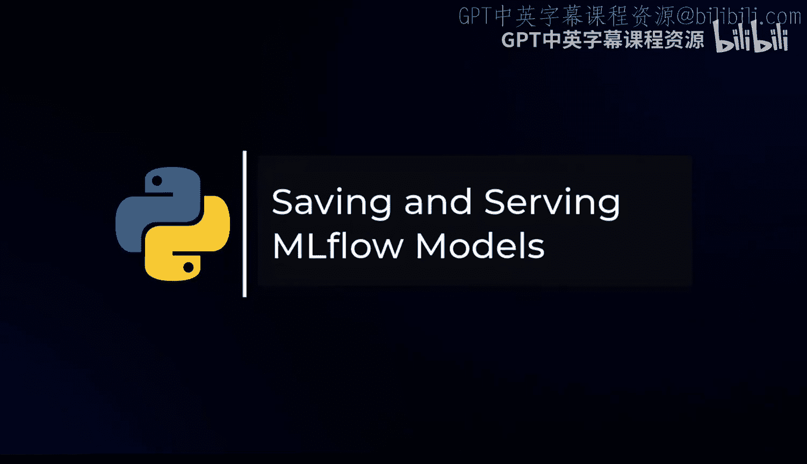
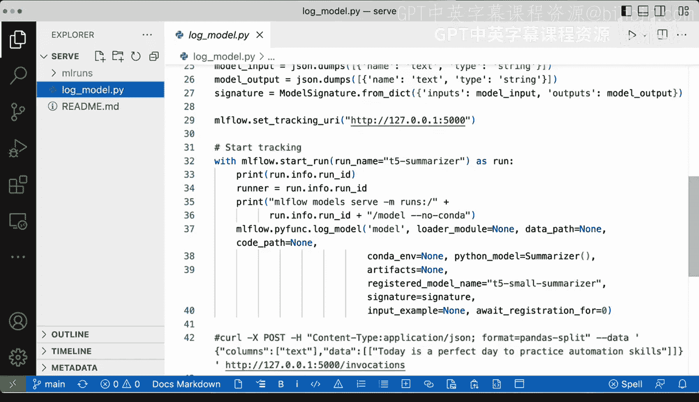
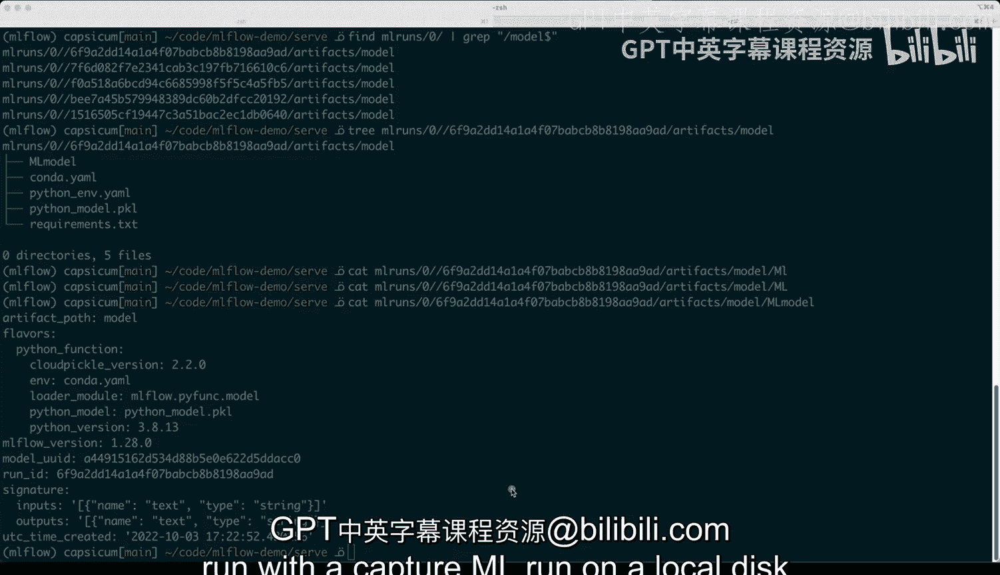

#  154：保存与部署MLflow模型



在本节课中，我们将学习如何与已注册的MLflow模型进行交互，特别是如何通过本地服务（serving）的方式来部署和使用模型。我们将从运行一个本地服务开始，并通过API调用进行预测。

## 模型服务概述

上一节我们介绍了如何注册模型。本节中，我们来看看如何通过MLflow的本地服务功能来部署模型，并通过HTTP请求与之交互。我们将使用一个基于Hugging Face API的翻译模型作为示例。

## 模型脚本回顾

首先，我们回顾一下用于记录模型的脚本。该脚本定义了一个继承自`mlflow.pyfunc.PythonModel`的类，这使得MLflow知道如何与之交互。

以下是核心的模型类定义：

```python
class Summarizer(mlflow.pyfunc.PythonModel):
    def load_context(self, context):
        # 加载模型和分词器
        self.model = AutoModelForSeq2SeqLM.from_pretrained("t5-small")
        self.tokenizer = AutoTokenizer.from_pretrained("t5-small")

    def predict(self, context, model_input):
        # 定义预测逻辑：将英文翻译为德文
        inputs = self.tokenizer(model_input["text"].tolist(), return_tensors="pt", padding=True)
        outputs = self.model.generate(**inputs)
        return self.tokenizer.batch_decode(outputs, skip_special_tokens=True)
```

在这个类中，我们定义了`load_context`方法来加载预训练模型和分词器，并在`predict`方法中实现了从英文到德文的翻译逻辑。脚本运行后，模型被记录并注册为`T5-small-sumr`。

## 启动本地模型服务



现在，我们将学习如何从本地存储的MLflow运行记录中启动一个模型服务。

以下是启动服务所需的步骤：

1.  **打开终端**：确保已安装MLflow。
2.  **定位模型运行ID**：使用`mlflow runs list`命令查看本地存储的运行记录，并找到目标模型的运行ID。
3.  **启动服务**：使用`mlflow models serve`命令，指定模型路径和端口号。

例如，命令格式如下：
```bash
mlflow models serve -m runs:/<RUN_ID>/model -p 5001
```
请注意，如果默认端口5000已被占用（例如被MLflow跟踪UI使用），则需要像示例中一样指定另一个端口，如5001。

服务成功启动后，终端会显示服务正在运行。该服务提供了一个名为`/invocations`的单一API端点用于预测。

## 通过API调用模型

模型服务启动后，我们可以通过发送HTTP请求到`/invocations`端点来进行预测。

以下是调用API的`curl`命令示例：

```bash
curl -X POST http://127.0.0.1:5001/invocations \
  -H 'Content-Type: application/json' \
  -d '{
    "dataframe_split": {
      "columns": ["text"],
      "data": [["Today is a perfect day to practice automation skills."]]
    }
  }'
```

关键点说明：
*   **URL路径**：必须使用`/invocations`路径。
*   **数据格式**：请求体需要遵循特定的格式。这里使用了`pandas split`格式，通过`dataframe_split`键来传递数据，其中`columns`指定列名，`data`是一个二维数组，包含要翻译的文本。
*   **模型输入**：输入数据需要与模型定义时预期的输入签名（即`text`列）相匹配。

执行命令后，服务会返回翻译结果（本例中为德文）。如果输入其他英文句子，模型会返回相应的德文翻译。

## 模型服务的内部结构

当我们取消服务并查看本地运行目录时，可以了解MLflow模型服务的内部结构。

每个成功记录模型的运行目录都包含一系列标准化文件，这些文件是MLflow能够服务模型的关键。以下是主要文件：

*   `MLmodel`：这是一个YAML文件，定义了模型的元数据，包括环境要求、签名（输入/输出格式）以及指向其他组件的路径。
*   `conda.yaml`：指定了运行模型所需的Conda环境依赖。
*   `requirements.txt`：列出了所需的Python包。
*   `python_model.pkl`：存储了序列化的Python模型对象（即我们定义的`Summarizer`类实例）。
*   其他可能存在的模型二进制文件。

通过查看`MLmodel`文件的内容，我们可以确认模型签名、创建时间戳等关键信息。正是这些元数据使得MLflow能够统一地加载和服务各种类型的模型。

## 总结



本节课中我们一起学习了如何部署和使用MLflow模型。我们首先回顾了模型记录脚本的结构，然后逐步演示了如何从本地运行记录中启动一个模型服务，并通过正确的API格式发送请求进行预测。最后，我们探讨了支持模型服务的内部文件结构，了解了`MLmodel`等元数据文件的重要性。掌握这些步骤，你就能将训练好的模型快速转化为可访问的API服务。