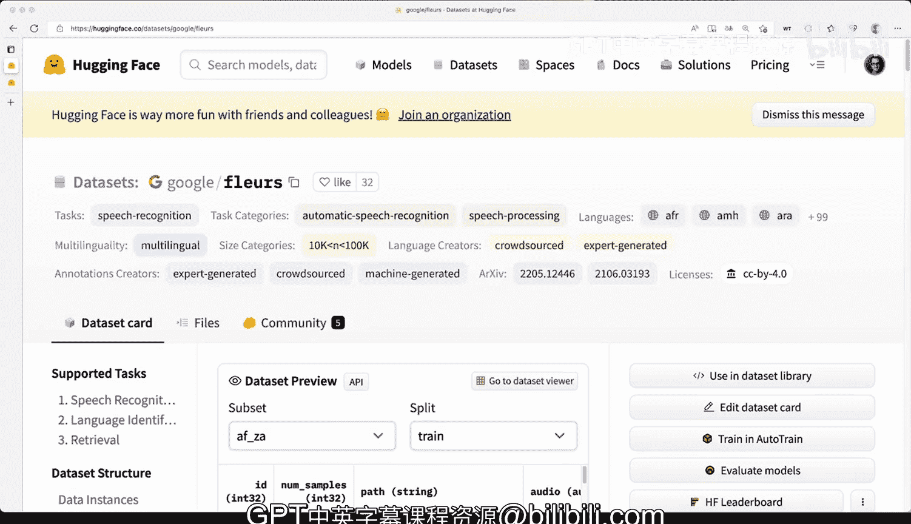

#  156：Hugging Face Hub 概述 🧠


在本节课中，我们将要学习 Hugging Face Hub 的核心概念与基本操作。Hugging Face Hub 是一个用于托管和共享机器学习模型、数据集及应用的平台，其交互方式与 GitHub 类似。我们将逐一介绍其主要组件和功能。

## 概述

Hugging Face Hub 允许你与仓库、模型、数据集、空间（Spaces）甚至组织（Organizations）和端点（Endpoints）进行交互。接下来，我们将通过平台界面来了解这些核心功能。

## 模型仓库

上一节我们介绍了 Hub 的基本概念，本节中我们来看看如何创建和管理模型仓库。

在 Hugging Face Hub 的主页，点击右上角的“New”按钮，会出现三个主要选项。选择“Model”选项，即可创建一个新的模型仓库。这个过程与在 GitHub 上创建新仓库非常相似。

以下是创建新模型时需要填写的关键信息：
*   **所有者**：指定仓库的所有者，可以是个人账户或所属的组织。
*   **模型名称**：为你的模型命名，例如 `example-model-name`。
*   **许可证**：为模型选择一个开源许可证，例如 `MIT`。
*   **可见性**：选择仓库是公开（Public）还是私有（Private）。

创建完成后，该模型就可以通过 Hugging Face 库或网页界面被任何人使用。

## 数据集与空间

了解了模型仓库后，我们来看看 Hub 上另外两个重要组件：数据集和空间。

“Data”选项的界面与创建模型类似，用于托管和共享数据集。所有这些组件（模型、数据）本质上都是 Git 仓库，支持拉取请求（Pull Request）、修改，甚至可以克隆到本地进行交互。

若要将仓库克隆到本地，需要使用 Git LFS（大文件存储）。较新版本的 Git 命令行工具通常已包含 LFS。克隆命令的基本格式如下：
```bash
git clone https://huggingface.co/username/model-name
```

“Space”功能允许你托管自己的交互式机器学习应用。它提供了几种框架选项：
*   **Streamlit**：用于快速创建数据应用的框架。
*   **Gradio**：用于构建机器学习演示界面的库。
*   **Static**：托管静态网页。

选择任一选项，你都可以构建并部署一个交互式应用，用于展示模型的功能。

## 组织管理

最后，我们来了解一下组织功能，这对于团队协作非常重要。

“组织”功能适用于团队或公司场景。当多名机器学习工程师需要协作时，可以创建一个组织，其管理方式与 GitHub 组织类似。例如，公司可以创建一个组织（如“Google”），并将项目置于该组织下，然后为团队成员分配访问权限，以便共同贡献。

## 总结



本节课中，我们一起学习了 Hugging Face Hub 的概述。我们讨论了它的几个核心组件：**模型仓库**、**数据集**、**空间**和**组织**。Hub 本质上是一个基于 Git 的协作平台，专门为机器学习资产设计，使得托管、共享和协作变得简单高效。