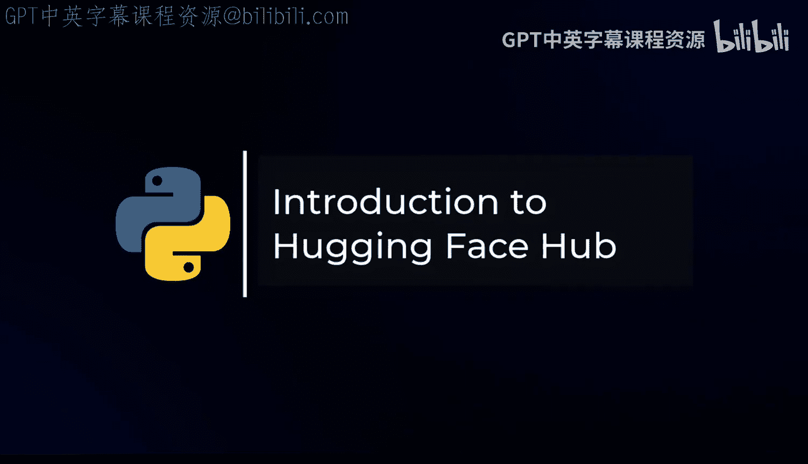
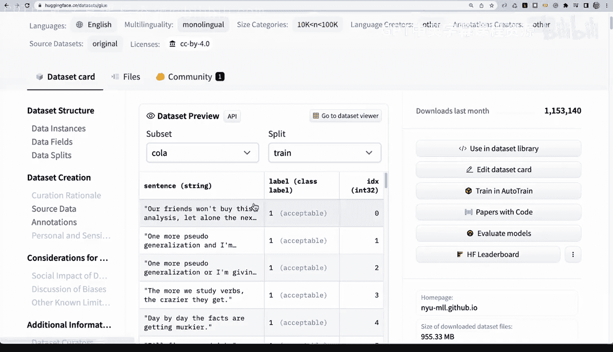
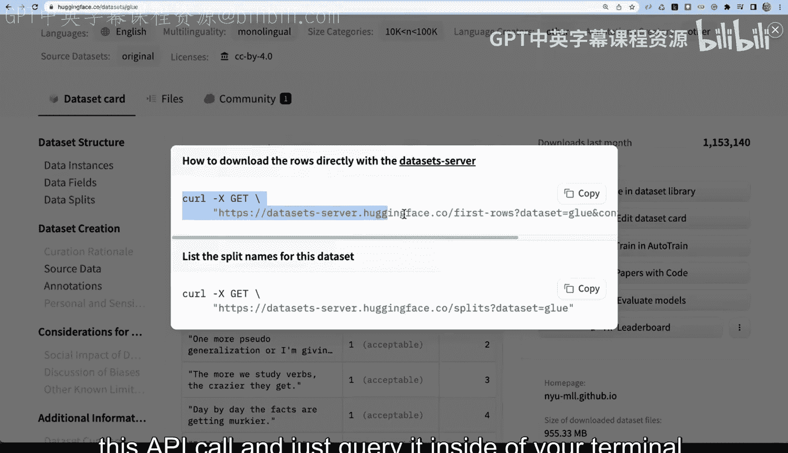
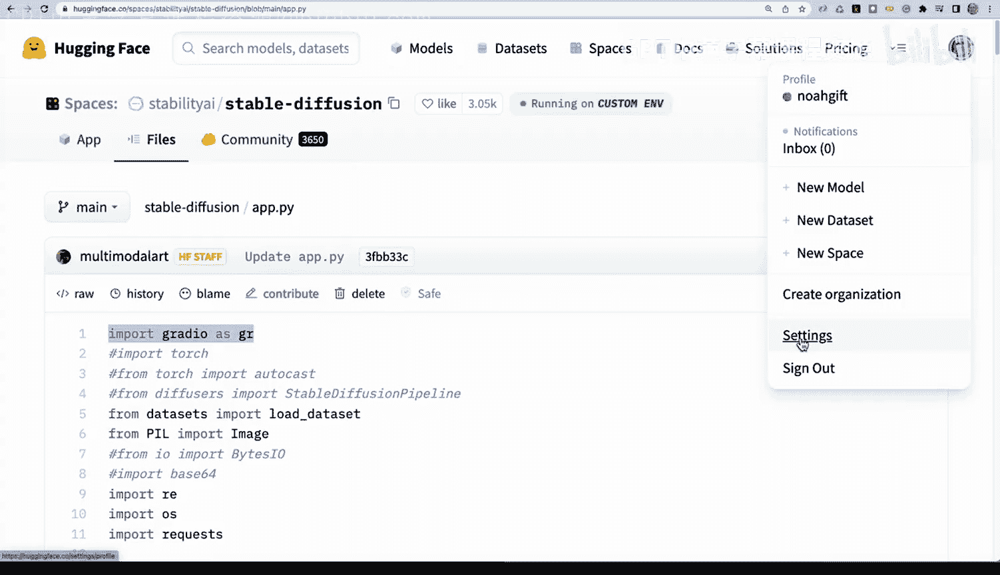

#  157：Hugging Face Hub 介绍 🚀

在本节课中，我们将要学习 Hugging Face Hub 的核心组成部分。Hugging Face Hub 是一个集成了模型、数据集和机器学习应用（Spaces）的平台，旨在简化机器学习项目的开发与部署流程。我们将逐一了解其关键功能，并学习如何开始使用。

## 账户与访问令牌 🔑

Hugging Face Hub 的核心始于一个用户账户。首先，你需要登录并创建一个账户。在个人资料页面，你可以进行各种设置。

在设置中，除了填写全名和主页等信息外，最重要的一步是创建一个访问令牌。访问令牌允许你以编程方式与 Hugging Face Hub 交互。

这意味着你可以：
*   从 GitHub Actions 将构建产物推送到 Hugging Face。
*   在开发环境中读取和写入数据，例如数据集。
*   配置一个 Spaces 应用。

因此，使用 Hugging Face Hub 的第一步是确保你拥有一个账户，并已创建一个访问令牌，且将该令牌保存在安全的地方。

## 模型库 🤖

接下来需要了解的是模型库。模型是当前 Hugging Face 平台的核心组成部分。

模型库包含数以万计的预训练模型，涵盖多种任务。你可以看到诸如图像分类、翻译等任务分类。进一步浏览，你还能找到更高级的类别，例如计算机视觉或自然语言处理。

**核心概念：模型分类**
模型按任务分类，例如：
*   **计算机视觉**：处理图像的模型。
*   **自然语言处理**：如翻译或文本生成的模型。
*   **音频**：如自动语音识别的模型。

在浏览模型时，平台提供了按下载量排序等功能，这有助于你在处理特定类别任务时，快速找到并尝试可能适合的模型。例如，近期热门的 OpenAI Whisper 模型也可以在 Hub 上找到并使用，用于项目内的转录任务。

## 数据集 📊

了解模型后，下一个重要部分是数据集。平台上也托管着大量的数据集。

这些数据集之所以重要，是因为它们可用于微调。这意味着你可以利用这些数据定制预训练模型，使其针对你正在解决的具体问题更加精确。

以下是数据集的一些典型用途：
*   **语言建模**
*   **多类别分类**

访问数据集页面时，你可以查看其结构信息、预览数据，甚至可以直接复制提供的 API 调用代码在终端中查询数据。此外，你还可以在 Hugging Face 环境中直接使用这些数据进行训练。

总的来说，数据集是 Hugging Face 平台最有用的功能之一。你同样可以上传自己的数据集到平台。

## 应用空间（Spaces） 🎨

最后一个关键组件是应用空间（Spaces）。Spaces 是创建和分享机器学习应用的一种便捷方式。

创建一个 Space 非常简单：只需点击“创建新空间”，然后为其命名并选择你想要使用的技术栈，例如 Streamlit、Gradio 或静态 HTML。你还可以选择许可证以便分享。

浏览他人创建的 Spaces 是熟悉各种工具和概念的好方法。例如，你可以查看 Stable Diffusion 的演示，了解其应用文件结构，学习他们是如何使用 Gradio 来构建空间应用的。

**核心概念：Spaces 技术栈**
创建 Space 时可选择的技术包括：
*   `Streamlit`
*   `Gradio`
*   `Static`

因此，Hugging Face Hub 是一个集模型、数据集和应用空间于一体的平台。要以编程方式使用它，你需要创建一个个人资料，并在设置中配置好 API 密钥。我们将在后续内容中深入探讨这一点。

---

本节课中，我们一起学习了 Hugging Face Hub 的四大核心功能：**账户与令牌管理**、**海量的模型库**、**丰富的数据集**以及**便捷的应用空间（Spaces）**。理解这些组成部分是有效利用该平台进行机器学习运维和开发的第一步。