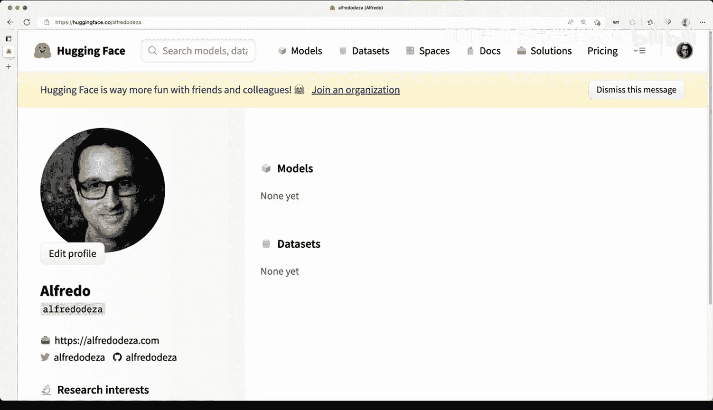
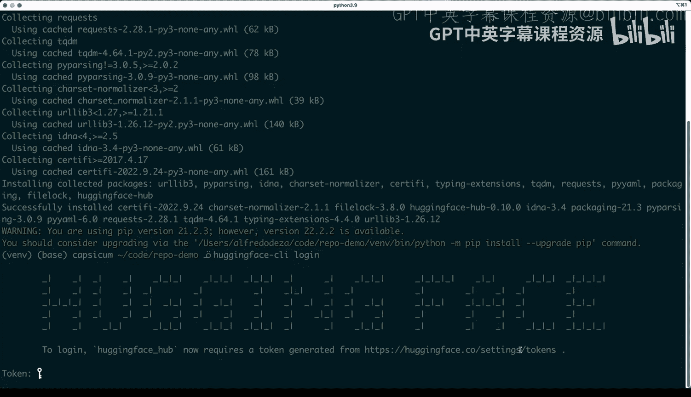
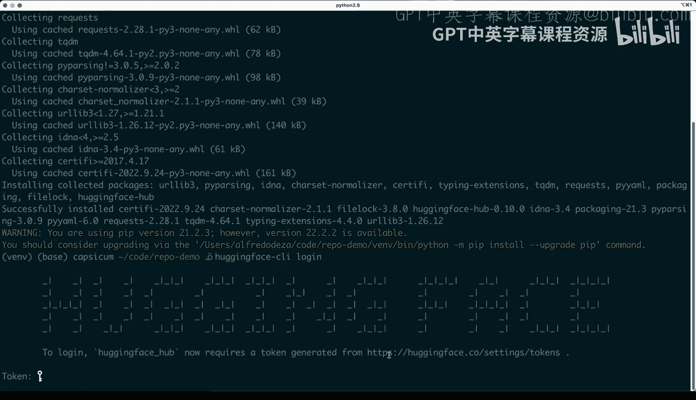
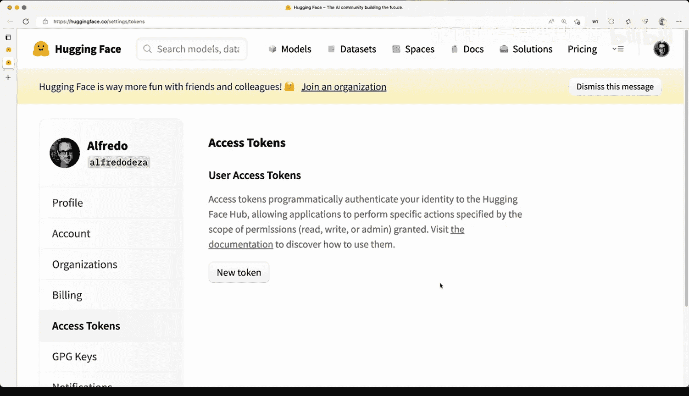
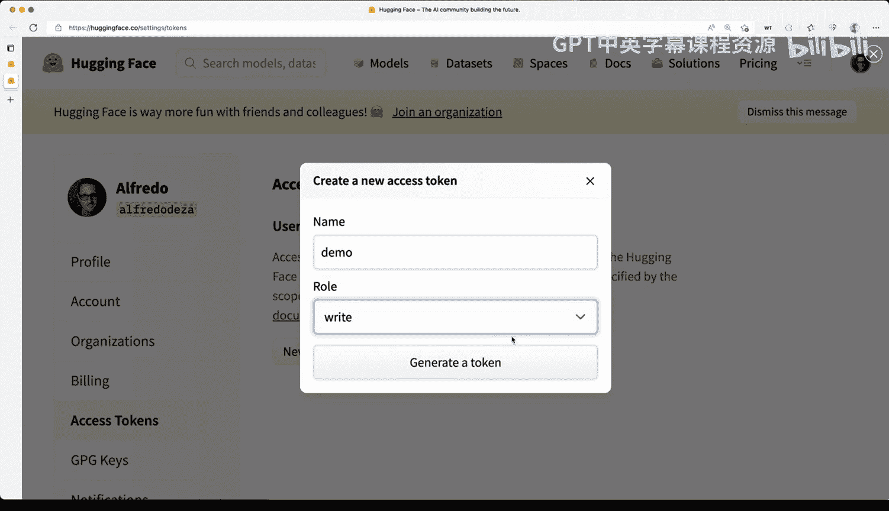
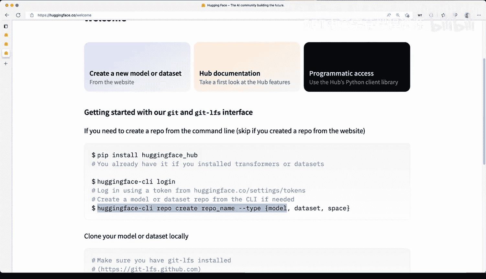
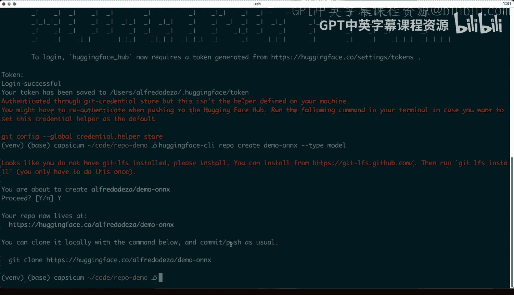
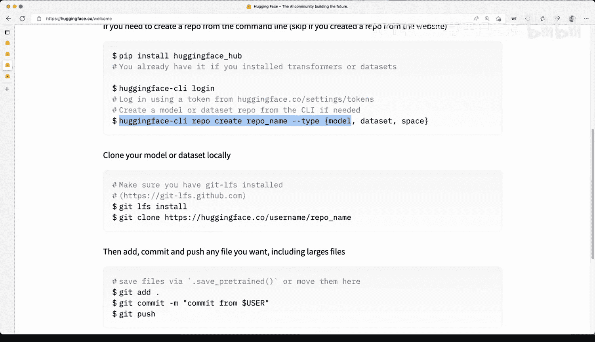
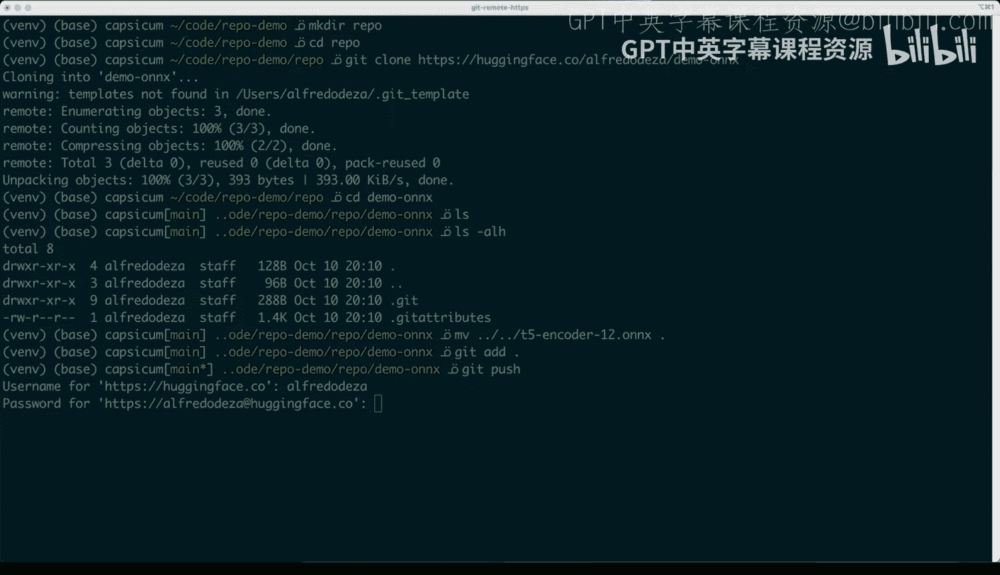
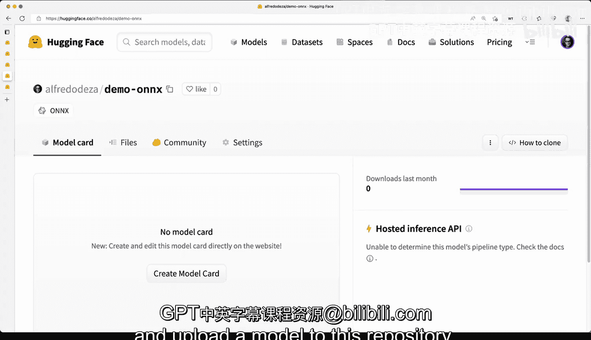

#  158：使用Hugging Face仓库 🚀


在本节课中，我们将学习如何创建Hugging Face仓库、生成并使用访问令牌，以及如何上传模型文件。整个过程将通过命令行工具完成，帮助你掌握模型托管和分享的基础操作。

## 概述



我们将从登录Hugging Face账户开始，通过命令行创建模型仓库，并最终上传一个预训练模型。以下是实现这一目标的主要步骤。

## 开始使用Hugging Face仓库






首先，我们打开Hugging Face的默认页面并登录。目前账户中没有任何模型或数据集。页面上提供了创建选项，但我们将遵循官方文档，使用命令行工具来创建仓库。

## 设置环境与安装工具

上一节我们介绍了目标，本节中我们来看看具体的环境配置。为了开始操作，需要创建一个新的虚拟环境并安装必要的库。





以下是具体步骤：
1.  打开终端。
2.  创建一个新的虚拟环境，可以命名为 `vm`。
3.  激活该虚拟环境。
4.  根据Hugging Face的说明，安装 `huggingface-hub` 库及其依赖。

安装命令如下：
```bash
pip install huggingface-hub
```

## 登录与令牌生成

环境设置完成后，下一步是登录Hugging Face账户。登录过程需要使用访问令牌。

以下是登录和生成令牌的步骤：
1.  在终端运行 `huggingface-cli login` 命令。
2.  系统会提示需要一个令牌，需要访问指定URL来生成。
3.  在Hugging Face网站设置中，创建一个新令牌。为演示目的，可以命名为“demo”，并赋予读写权限。
4.  生成令牌后，复制它。
5.  回到终端，粘贴令牌并回车完成认证。令牌会保存在本地。



## 创建模型仓库



成功登录后，我们现在可以创建模型仓库了。我们将使用命令行工具，而不是网站界面。

创建仓库的命令格式如下：
```bash
huggingface-cli repo create --type model <仓库名称>
```
例如，我们创建一个名为 `demo-onnx` 的模型仓库。执行命令后，确认创建，仓库即被成功创建。此时在网站上查看，仓库是空的，没有模型卡片和文件。

## 克隆仓库与添加模型



仓库创建好后，我们需要将模型文件添加进去。首先，将新创建的仓库克隆到本地。

以下是操作步骤：
1.  使用 `git clone` 命令克隆 `demo-onnx` 仓库到本地。
2.  进入克隆下来的本地仓库目录，目前里面是空的（除了一个初始文件）。
3.  将准备好的预训练模型文件（例如一个T5-large模型）添加到这个目录中。
4.  使用 `git add` 和 `git commit` 命令将文件添加到本地版本库。
5.  使用 `git push` 命令将更改推送到Hugging Face远程仓库。推送时可能需要再次进行身份验证，使用之前生成的令牌作为密码即可。



## 通过网页界面上传文件

除了命令行，也可以通过网页界面上传文件。这对于大文件或图形化操作更为方便。

以下是网页上传的步骤：
1.  在Hugging Face网站进入你的仓库页面。
2.  点击“上传文件”按钮。
3.  从操作系统中将模型文件拖拽到上传区域。
4.  选择提交到主分支，并填写提交信息。
5.  点击“提交更改”开始上传。对于大模型文件，上传可能需要一些时间。

## 完善模型卡片

文件上传成功后，为了让其他人更容易理解和使用你的模型，需要完善模型卡片。

模型卡片本质上是一个 `README.md` 文件，用于展示模型的文档、使用说明和相关链接。你可以参考其他热门模型（如Stable Diffusion）的模型卡片，编辑自己仓库的 `README.md` 文件，添加必要的描述信息。

## 总结



本节课中我们一起学习了使用Hugging Face托管模型的全流程。我们从设置环境、安装 `huggingface-hub` 工具开始，接着学习了如何生成访问令牌并登录。然后，我们通过命令行创建了一个模型仓库，并演示了如何通过命令行和网页界面两种方式将模型文件上传到仓库中。最后，我们了解了完善模型卡片的重要性，它是分享和复用模型的关键文档。掌握这些步骤，你就能有效地利用Hugging Face平台来管理和分发机器学习模型。