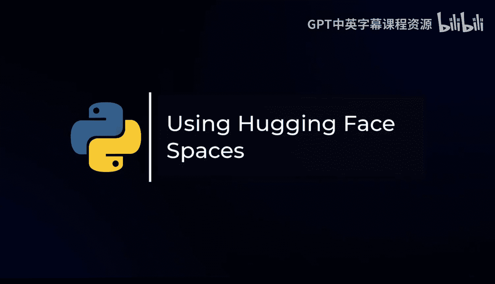
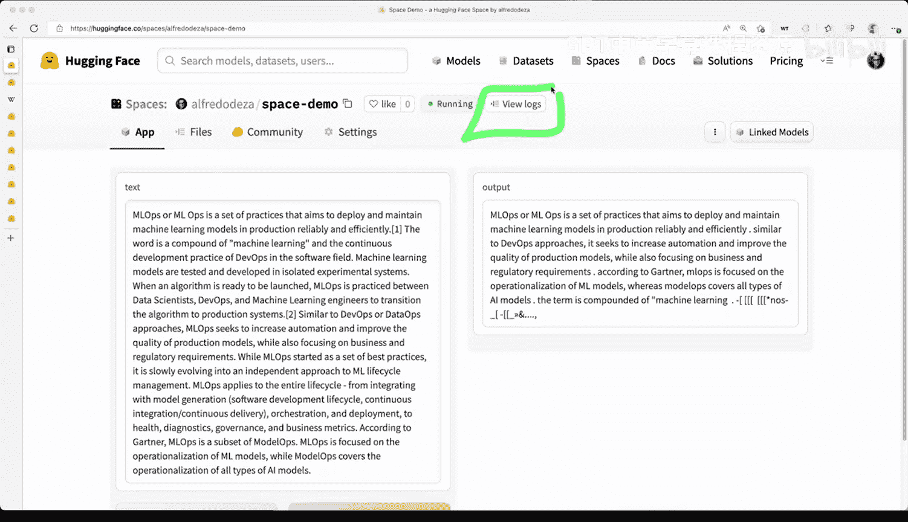

#  159：使用Hugging Face Spaces创建交互式ML演示



## 概述
在本节课中，我们将学习如何使用Hugging Face Spaces平台创建一个交互式的机器学习演示应用。我们将通过一个文本摘要的实际例子，了解从创建空间、编写应用代码到部署和测试的完整流程。

## 什么是Hugging Face Spaces？
上一节我们介绍了Hugging Face平台的基本概念，本节中我们来看看其核心功能之一——Spaces。Hugging Face Spaces允许用户创建和托管交互式的机器学习演示应用。它本质上是一个基于Git的仓库，可以自动构建和部署你的应用。

要创建一个新的Space，请点击平台上的“New”按钮。这将引导你创建一个新的交互式机器学习演示。

## 创建新Space
以下是创建新Space时需要配置的几个关键选项：

*   **名称**：为你的Space设置一个唯一的名称。
*   **许可证**：选择适合你项目的开源许可证，例如MIT。
*   **Space SDK**：选择构建应用的前端框架。主要有三个选项：
    *   **Gradio**：用于快速创建交互式界面的Python库。
    *   **Streamlit**：另一个用于创建数据应用的主流框架。
    *   **Static**：用于托管静态网页。

在本教程中，我们将选择Gradio来构建我们的交互式应用。创建完成后，系统会自动生成一个Git仓库作为你的Space。

## 应用的核心文件
每个Space应用都需要一些核心文件来运行。最重要的两个文件是应用入口文件和依赖声明文件。

### 1. 应用入口文件 (`app.py`)
`app.py` 文件是你的应用主程序，是必需的入口点。对于Gradio应用，其基本结构如下：

```python
import gradio as gr

# 定义处理输入的函数
def process(input_text):
    # 你的处理逻辑
    result = "处理后的结果"
    return result

# 创建Gradio界面
iface = gr.Interface(fn=process,
                     inputs=gr.Textbox(lines=10, placeholder="请输入文本..."),
                     outputs="text")
# 启动应用
iface.launch()
```

### 2. 依赖文件 (`requirements.txt`)
`requirements.txt` 文件用于声明你的Python应用所依赖的第三方库。Hugging Face Spaces会根据这个文件自动安装所有依赖。文件内容示例如下：

```
transformers==4.21.2
tensorflow==2.9.1
```

## 构建文本摘要演示
现在，让我们动手构建一个具体的文本摘要应用。我们将使用Hugging Face的`transformers`库中的预训练模型。

首先，在Space的文件管理中创建 `app.py` 文件，并写入以下代码：

```python
from transformers import pipeline
import gradio as gr

# 加载摘要pipeline，使用T5模型
summarizer = pipeline("summarization", model="t5-small")

def summarize(text):
    # 可选的文本清洗步骤
    text = text.replace('"', '').replace('&', 'and')
    # 调用模型进行摘要，设置最小长度
    result = summarizer(text, max_length=230, min_length=180, do_sample=False)
    # 返回摘要文本
    return result[0]['summary_text']

# 创建Gradio界面
# inputs: 定义一个10行的文本输入框
# outputs: 定义一个文本输出框
demo = gr.Interface(fn=summarize,
                    inputs=gr.Textbox(lines=10, placeholder="请输入需要摘要的文本..."),
                    outputs="text")

# 启动应用
demo.launch()
```

接下来，创建 `requirements.txt` 文件，确保模型和框架能够正确运行：

```
transformers==4.21.2
tensorflow==2.9.1
```

提交这两个文件后，Space会自动开始构建过程。你可以在“Logs”选项卡中查看实时构建日志，这类似于Docker容器的构建输出。

## 配置与运行
构建成功后，即可访问你的演示应用。在应用界面，你会看到一个文本输入框和一个提交按钮。输入一段长文本并点击“Submit”，模型就会生成摘要。

需要注意的是，应用的运行速度取决于你选择的硬件配置。Hugging Face Spaces提供不同级别的计算资源：
*   **CPU Basic**：免费，但处理速度较慢，适合轻量级演示。
*   **GPU Upgrade**（如T4 Small）：按小时计费，能显著提升模型推理速度，适合对响应时间要求高的应用。

如果你的应用预期会接收大量公开访问，请考虑选择合适的付费层级以保证性能。



## 总结
本节课中我们一起学习了如何使用Hugging Face Spaces创建和部署交互式机器学习演示。我们完成了从创建Space、编写Gradio应用代码、管理Python依赖，到最终部署和测试的完整流程。通过这个文本摘要的例子，你可以看到Spaces如何让机器学习模型的展示和分享变得非常简单直观。你可以利用这个平台为任何模型快速构建一个前端界面，与他人分享你的工作成果。