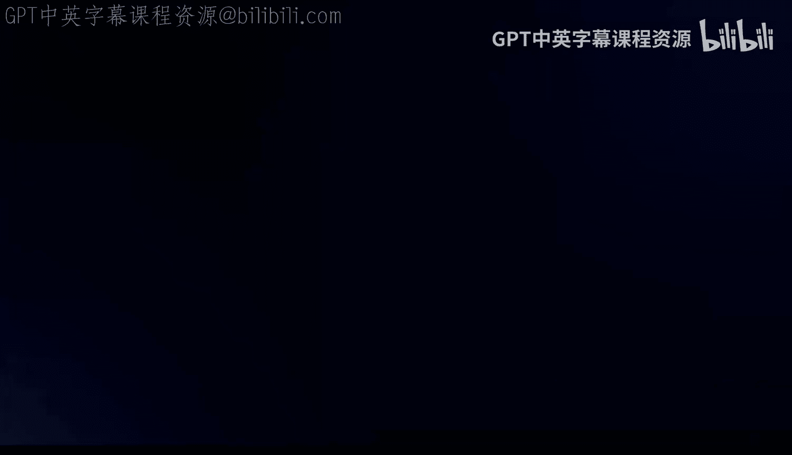
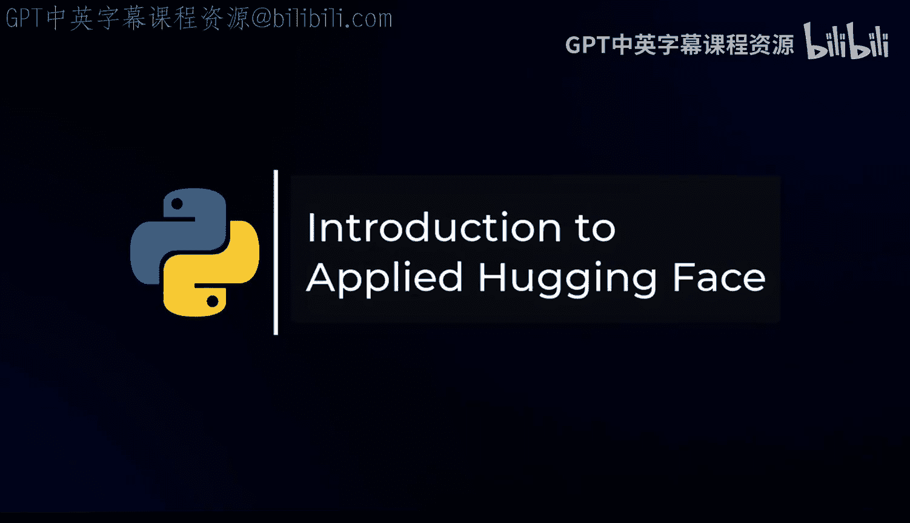

#  160：应用Hugging Face入门 🚀

在本节课中，我们将学习如何开始使用Hugging Face平台。Hugging Face是一个流行的平台，用于处理大型数据集、预训练模型以及展示这些模型的应用。课程将分为三个主要部分：数据与模型的上传下载、模型的微调训练，以及使用Spaces功能来演示机器学习项目。

## 课程内容概述

我的名字是Noah Gi，我将向你介绍Hugging Face。这是一个非常流行的新平台，用于处理大型数据集、预训练模型，并演示这些模型的应用。本课程的亮点在于，我们将涵盖三个不同的类别。

## 第一部分：数据与模型管理

在第一部分课程中，我们将讨论如何将数据和模型上传到Hugging Face，以及如何将它们下载到开发环境中，例如支持GPU的GitHub Codespaces。

上一节我们介绍了课程的整体结构，本节中我们来看看具体如何操作。

以下是数据与模型管理的关键步骤：
*   将数据上传至Hugging Face数据集仓库。
*   将预训练模型上传至Hugging Face模型仓库。
*   在开发环境中（如GPU支持的GitHub Codespaces）下载并使用这些资源。

## 第二部分：模型微调与训练

接下来，在第二部分，我们将介绍如何对模型进行微调和训练。具体来说，我们将从全球顶尖的AI和机器学习公司获取最新的模型，例如摘要生成模型，然后使用自定义数据对这些模型进行微调。之后，将微调后的模型存回你的Hugging Face模型仓库，以便未来使用。

在未来的课程中，我们还将讨论如何利用GitHub Codespaces或其他支持GPU的环境来加速这个迁移学习过程。

## 第三部分：使用Spaces进行演示

最后，在第三部分，我们将讨论Spaces功能。这是一个极佳的方式来展示你利用机器学习构建的项目作品集，包括使用Streamlit和Gradio。这两个都是构建产品演示的优秀平台。

## 总结

本节课中，我们一起学习了Hugging Face平台的入门知识。我们概述了如何管理数据与模型、对预训练模型进行微调，以及使用Spaces功能来创建和展示机器学习应用。让我们开始吧，接下来有很多内容需要学习。