#  161：使用GPU支持的GitHub Codespaces 🚀

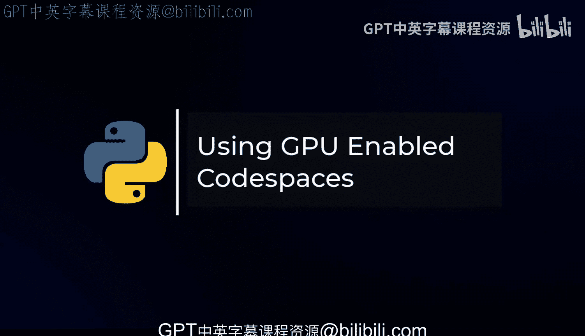

在本节课中，我们将学习如何利用GitHub Codespaces创建一个支持GPU的云端开发环境。这个环境非常适合学生和开发者，因为它提供了比个人笔记本电脑更强大的计算资源，并且可以快速启动预配置的容器。

GitHub Codespaces是一个临时的云端开发环境，你可以直接在其中进行编码。在许多情况下，它比你的笔记本电脑更强大，并且能够创建预构建的容器镜像，这些镜像可以非常快速地启动。你还可以充分利用Visual Studio Code的全部功能。

接下来，我们来看看我在杜克大学课堂上是如何使用这个功能的。

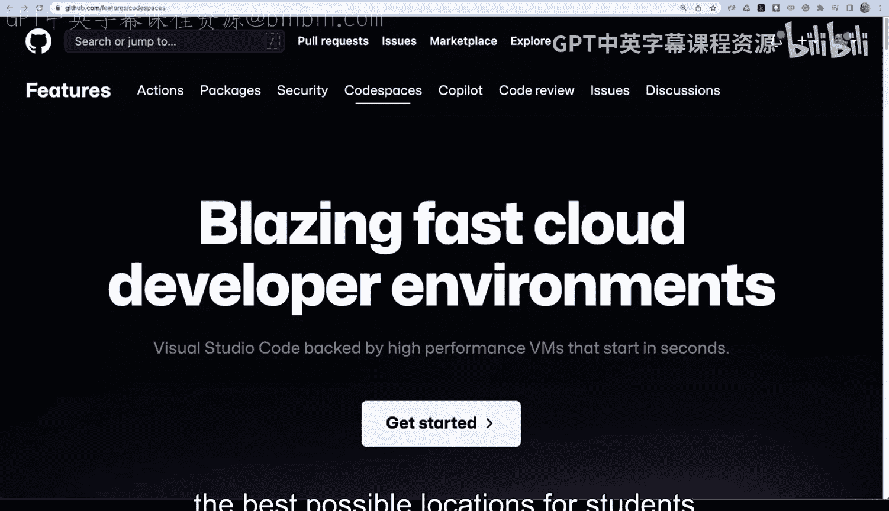

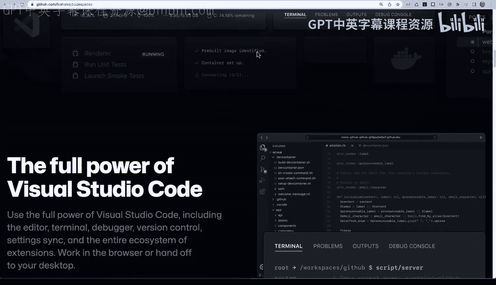

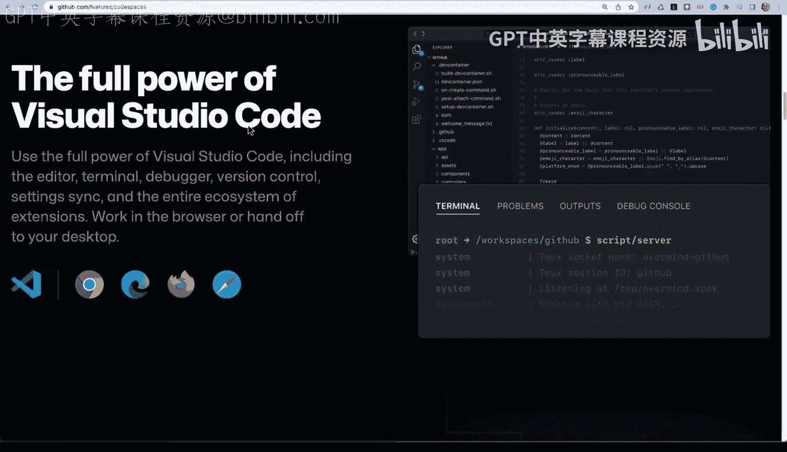

## 创建模板仓库与开发容器 🛠️

我创建了一个名为“MLOps模板”的组织仓库，并使用了“公共模板”功能。

以下是创建和配置模板的关键步骤：

1.  **进入仓库设置**：在仓库页面，点击“Settings”（设置）。
2.  **启用模板仓库**：向下滚动，找到“Template repository”（模板仓库）选项并勾选，将其设为模板仓库。

这个功能之所以强大，是因为我在仓库中配置了一个 `.devcontainer` 环境。这允许我自定义开发环境，并预加载我在Dockerfile中指定的所有内容。

我的配置主要包括：
*   **基础镜像**：使用标准的GitHub通用开发容器。
*   **系统包安装**：安装如 `ffmpeg`、`python3.8`、`gcc` 等必要的系统包。
*   **Python环境与包管理**：通过 `Makefile` 来安装项目所需的所有Python包。
*   **环境配置**：配置Visual Studio Code环境，并启用NVIDIA CUDA驱动，以便后续使用GPU功能。

完成所有设置后，我可以通过这个模板来启动一个新的Codespace实例，或者用它来创建一个全新的代码仓库。

## 启动GPU支持的Codespace实例 ⚡

现在，让我们实际操作一下。首先，我们可以直接基于模板仓库启动一个Codespace。

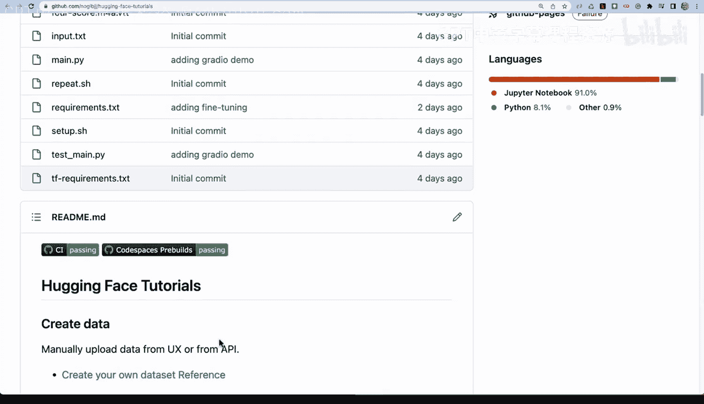

1.  点击仓库页面的“Code”（代码）按钮。
2.  在下拉菜单中选择“Create codespace on main”（在主分支上创建代码空间）。
3.  在创建时，我们可以自定义机器类型。这里提供了多种选项，包括非常适合CPU任务的强大16核机器。
4.  对于处理Hugging Face模型的任务（如推理、训练、微调），我推荐选择 **GPU机型**。例如，一个配置为 **6核CPU、1个GPU、112GB内存和128GB存储** 的机器，这在大学教学环境中非常适用。

选择好配置后，点击启动，系统就会开始创建这个云端开发环境。

实际上，我已经使用这个模板创建了一个名为“Hugging Face Tutorials”的新仓库，这也是本课程将要使用的环境。并且，我已经提前启动了这个环境。

## 探索预配置的开发环境 🔍

让我们进入这个已经启动的Codespace，看看里面有什么。

首先，我设置了一个虚拟环境。这确保了项目使用特定版本的Python，并且所有依赖都已预先安装好，无需再次手动安装。

我的 `requirements.txt` 文件固定了许多必要的包，例如：
*   `fastapi`
*   `jupyter`
*   `transformers` (来自Hugging Face)
*   `datasets` (来自Hugging Face)
*   `tokenizers` (来自Hugging Face)
*   以及像 `rouge-score` 这样的评估指标包。

此外，还有一个 `utilities`（工具）目录，用于测试机器的GPU功能。

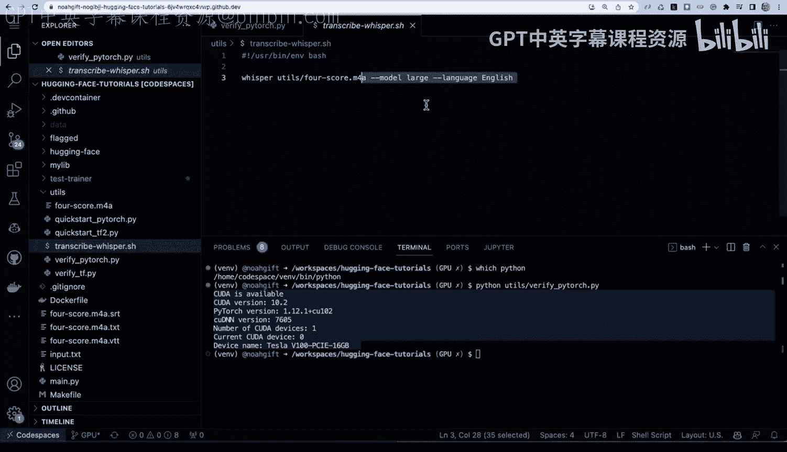

## 验证GPU与运行示例任务 ✅

为了验证GPU是否正常工作，我创建了一个名为 `verify_pytorch.py` 的脚本。它的作用是检查NVIDIA CUDA SDK是否可用。

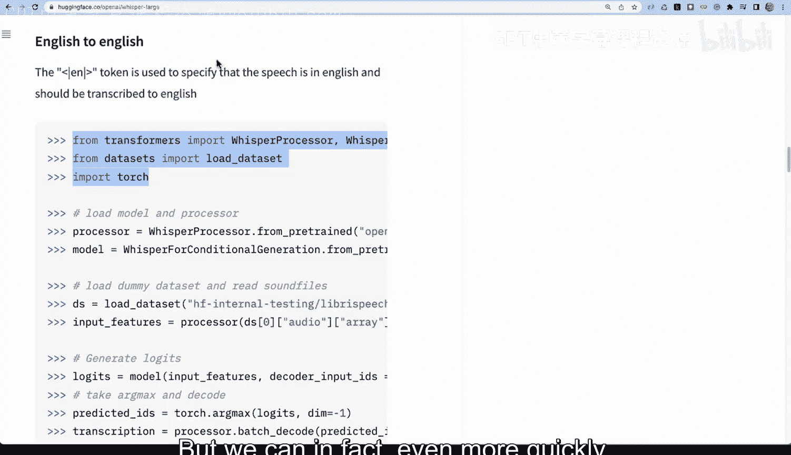

在终端中，我们可以运行：
```bash
python utilities/verify_pytorch.py
```
任何使用我这个模板的人都可以运行这个脚本。如果输出显示CUDA可用，就证明GPU环境配置成功。

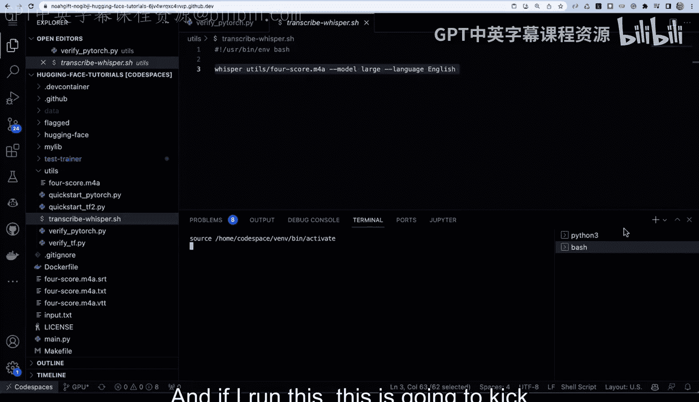

接下来，我们运行一个实际的GPU任务来测试。在 `utilities` 目录中，我上传了一个音频文件，它是《葛底斯堡演说》的朗诵录音。

我将使用OpenAI开源的 **Whisper** 工具进行自动语音识别（ASR），将其转写成文本。Whisper是一个强大的开源ASR系统，它包含编码器和解码器模块，能够完成高质量的转录和语种翻译。该模型也可以在Hugging Face上找到。

由于Whisper已经安装在系统中，我们可以直接运行以下命令进行转录：
```bash
whisper utilities/gettysburg.wav --model large
```
在运行这个任务的同时，我们可以打开另一个终端窗口来监控GPU的使用情况。运行命令：
```bash
nvidia-smi -l 1
```
这个命令会启动一个监控工具，每秒刷新一次，让我们可以看到转录过程中的GPU使用率。

当Whisper开始工作时，它会加载一个大型语言模型来处理音频文件。我们可以观察到GPU使用率会出现明显的波动和峰值，这表明GPU正在全力工作，将音频数据转换为文本格式。任务完成后，GPU的使用率会回落到零。

这个演示清楚地展示了使用GPU环境的一个核心优势：我可以无缝地与Hugging Face生态系统协同工作，直接使用各种预训练模型进行复杂的计算任务。

此外，如果我进入IPython环境，也可以直接按照Hugging Face或OpenAI提供的指导，一步步地操作和使用这些模型。

## 总结 📝

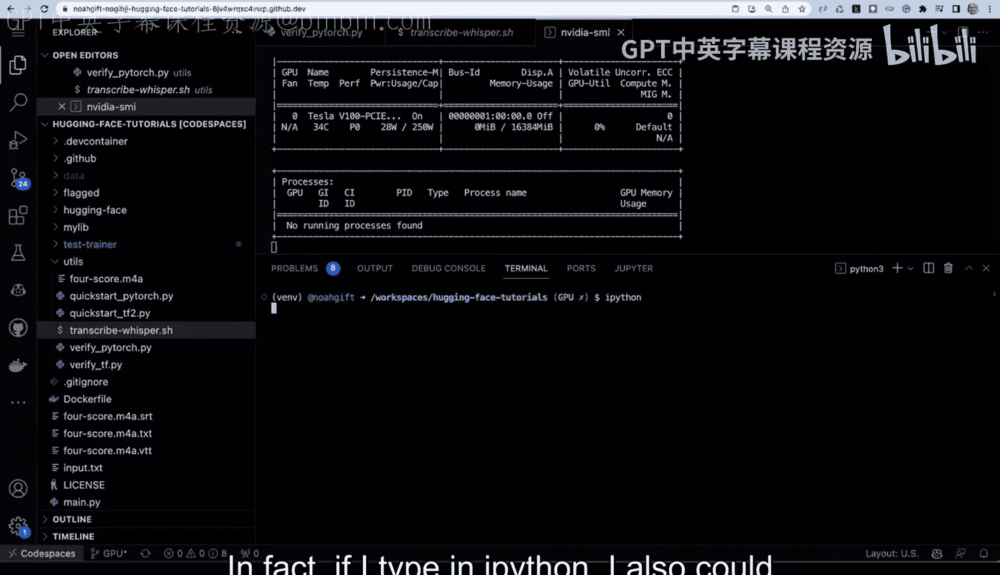

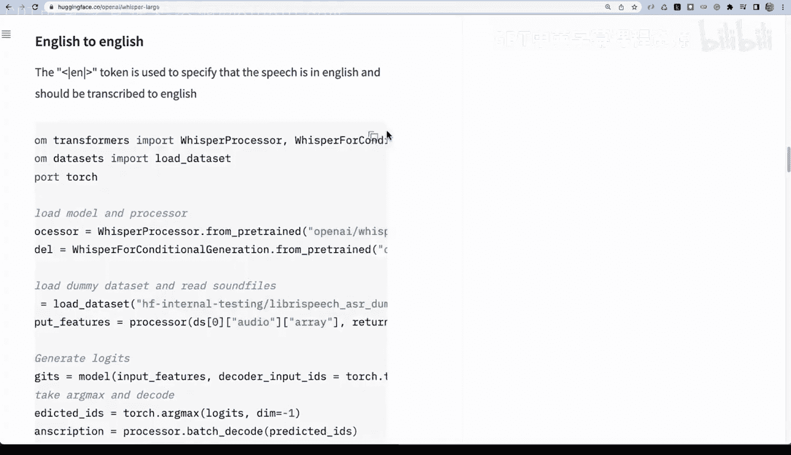

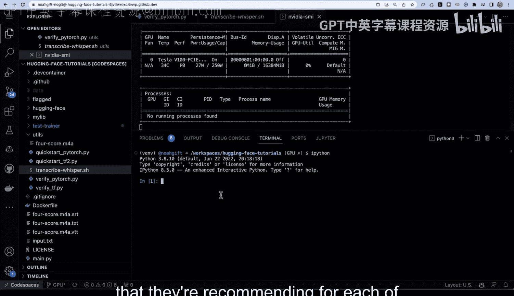

本节课我们一起学习了如何利用GitHub Codespaces创建和配置一个支持GPU的云端开发环境。我们涵盖了从创建模板仓库、配置开发容器（`.devcontainer`），到启动特定GPU机型Codespace的完整流程。我们还通过验证PyTorch的CUDA可用性和运行Whisper语音转录任务，实际测试了GPU环境的工作情况。这套方法为学习和运行需要GPU加速的机器学习项目（特别是使用Hugging Face等大型预训练模型）提供了一个强大、便捷且可复现的解决方案。