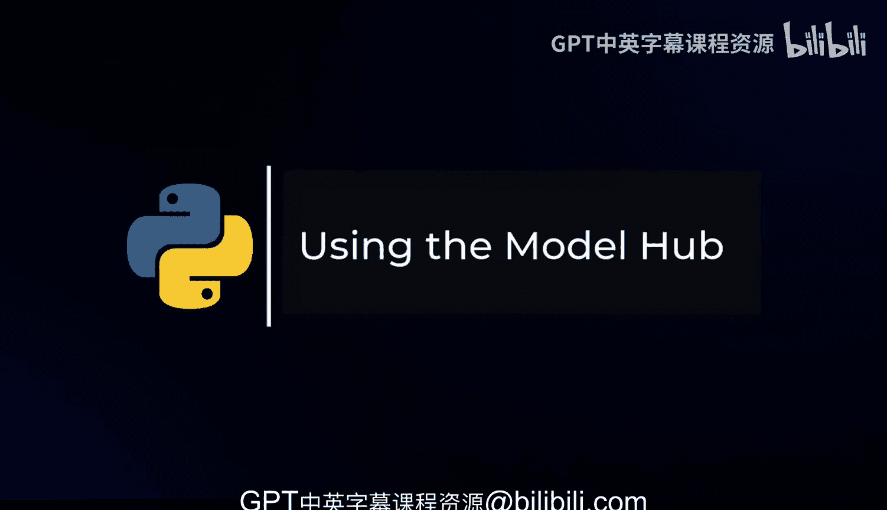
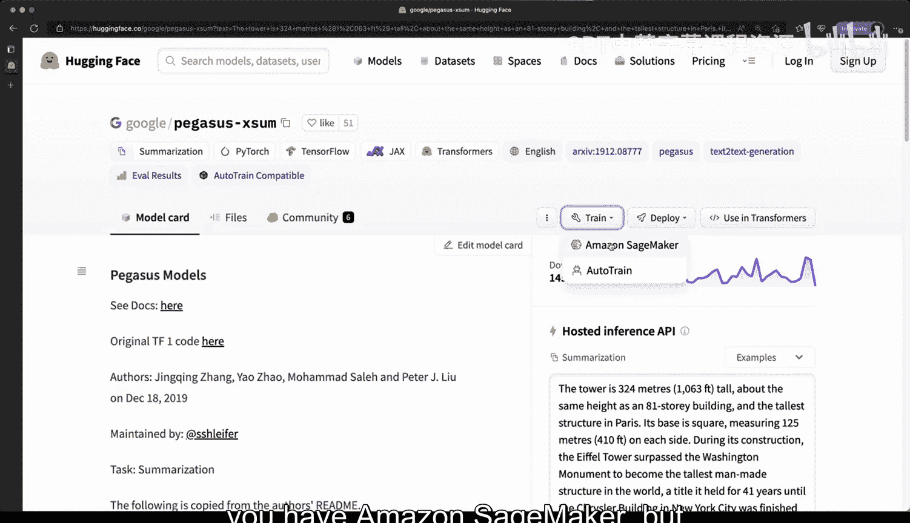
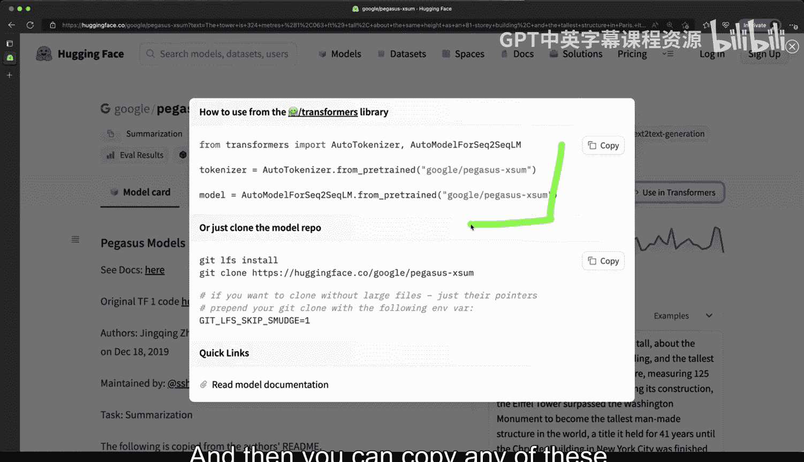
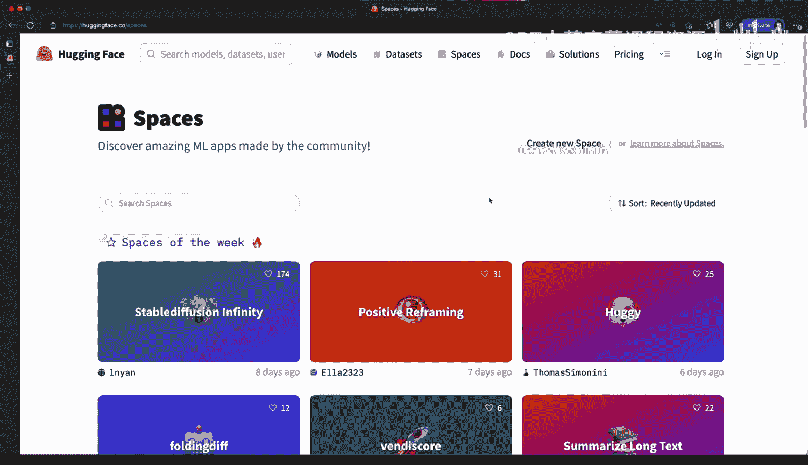
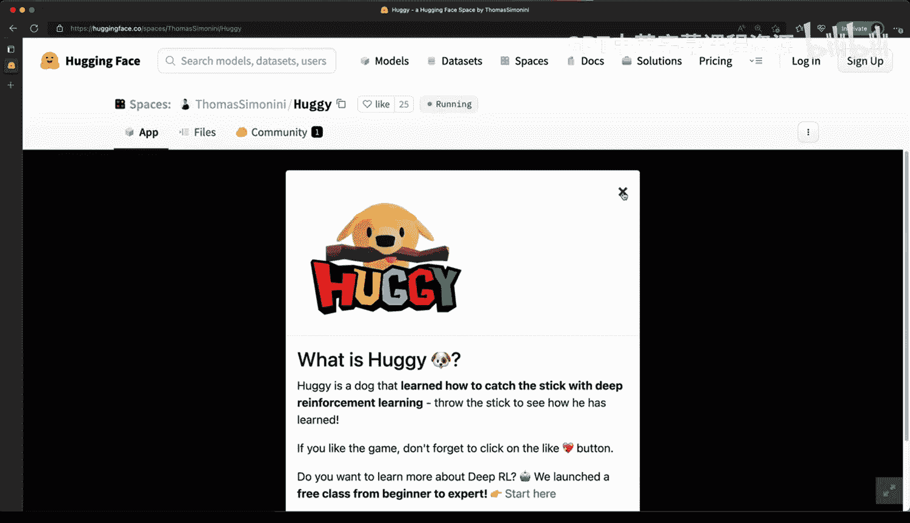
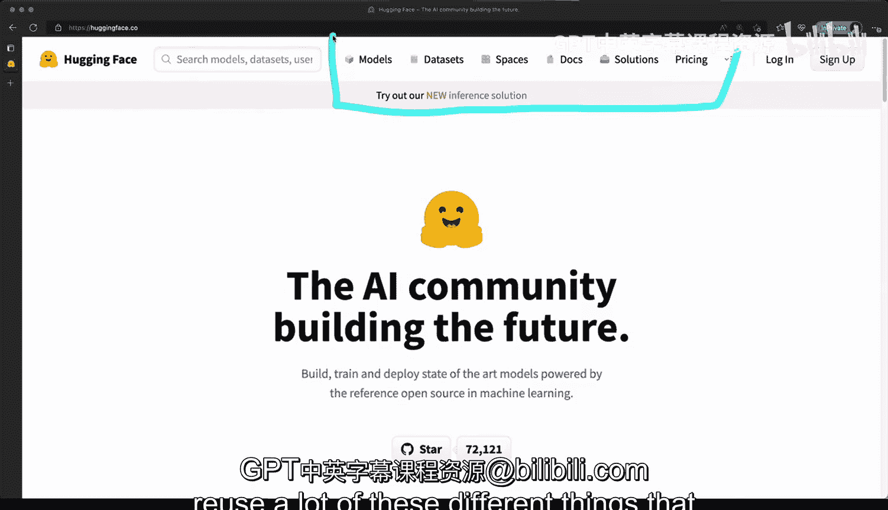

#  163：使用模型中心

在本节课中，我们将学习 Hugging Face 模型中心（Model Hub）的核心功能与使用方法。模型中心不仅包含预训练模型，还集成了数据集（Datasets）和应用演示空间（Spaces），是一个一站式的机器学习资源平台。我们将逐一探索这些组件，了解如何查找、筛选、测试模型，以及如何利用数据集和交互式应用。

## 模型（Models）概览与筛选

首先，我们对模型中心进行快速概览。它提供的功能远不止我们之前看到的模型、数据和空间。我们已经介绍过其中一些，现在再整体回顾一下 Hugging Face 提供的资源。我们从“模型”部分开始。

在模型页面左侧，您会看到几个筛选部分：**任务（Tasks）**、**库（Library）**、**数据（Datas）**和**语言（Languages）**。这些都是标签或分类，可以帮助您精确筛选出想要使用的模型。

例如，如果我进入“语言”部分，选择“西班牙语”，页面上的所有模型就会立即被筛选，只显示支持西班牙语的模型。这是一个非常实用的功能。您可以继续叠加筛选条件，比如再选择“文本摘要（Summarization）”。现在，筛选条件就变成了“西班牙语”和“文本摘要”，页面将只显示同时满足这两个条件的模型，例如“`mrm8488/bert2bert_shared-spanish-finetuned-summarization`”。点击筛选标签旁的“X”可以取消该条件，恢复显示所有适用于“文本摘要”的模型。

## 模型详情页与交互

接下来，点击任意一个模型进入其详情页。我们已经初步了解过模型卡片（Model Card），它允许创建者通过 `README` 文件详细描述模型，就像 GitHub 仓库一样。一些模型还提供了“托管推理 API（Hosted Inference API）”，允许用户直接在线与模型交互。

例如，在这个摘要模型页面，我们可以看到一个交互窗口。输入文本后点击“Compute”，就能立即看到模型的摘要结果。响应速度很快，可能是因为结果已被缓存。

此外，您还可以部署这些模型。部署选项包括使用 **Amazon SageMaker**，或者在您自己的账户上使用 **推理 API**。

另一个重要功能是代码示例。页面提供了 **Transformers** 库的使用代码片段，您可以复制粘贴到自己的项目中进行推理。如果您想克隆模型仓库，请记住，Hugging Face 的模型通常需要 **Git LFS** 支持，请确保已启用。

## 探索数据集（Datasets）

除了模型，模型中心还提供数据集。我们已经接触过一些，现在来看看数据集页面有趣的任务分类。

例如，在“文本生成”任务类别下，我们搜索“wiki text”数据集。数据集页面提供“数据预览（Data Preview）”功能，并且能够按**训练集（train）**、**测试集（test）**和**验证集（validation）**进行划分，这非常实用，因为您通常需要不同的数据子集进行训练、测试和验证。

在后续更动手的示例中，我们将介绍如何通过 Python 的 `datasets` 库来加载并使用这些特定的数据划分，甚至创建数据子集。

让我们看一下“代码（Code）”和“数据浏览器（Data Viewer）”部分。这里提供了许多代码片段，帮助您了解如何加载和查看数据。查看“训练”分片，这里的信息更为详尽，让您对数据有一个直观的感受。页面还展示了不同的数据子集类型（例如“raw v1”）。

就像 GitHub 仓库一样，您可以浏览文件的提交历史。数据集页面通常包含 `README`、`dataset_infos.json` 等文件。查看 `dataset_infos.json` 文件，可以看到数据集的描述信息，这是 Hugging Face 在后台用于优化展示的数据。此外，还有一个 Python 文件（例如 `wiki_text.py`），它定义了 `datasets` 库中用于加载该数据集的类。从这里，您可以了解到支持的语言、数据来源等信息，查看数据来源总是一个好习惯。

## 应用演示空间（Spaces）

最后，我们来看“空间（Spaces）”。我们已经见过一些例子。空间允许您轻松构建和分享交互式机器学习应用。

例如，有些空间用于演示“Bleu 评分”，有些则提供更交互式的体验，比如音乐生成。您可以像我们之前看到的那样，非常轻松地构建这类应用。

## 总结

本节课中，我们一起深入探索了 Hugging Face 模型中心。**Hugging Face Hub** 指的就是模型、数据集和空间这些组件协同工作，为您提供的一站式服务平台。通过它，您可以：
*   **体验演示**：在线与模型交互。
*   **进行交互**：使用托管 API 或复制代码到本地运行。
*   **做出贡献**：上传自己的模型、数据集或应用。
*   **复用资源**：充分利用平台上丰富的现有资源。

简而言之，Hugging Face Hub 极大地简化了机器学习资源的发现、测试和集成过程。