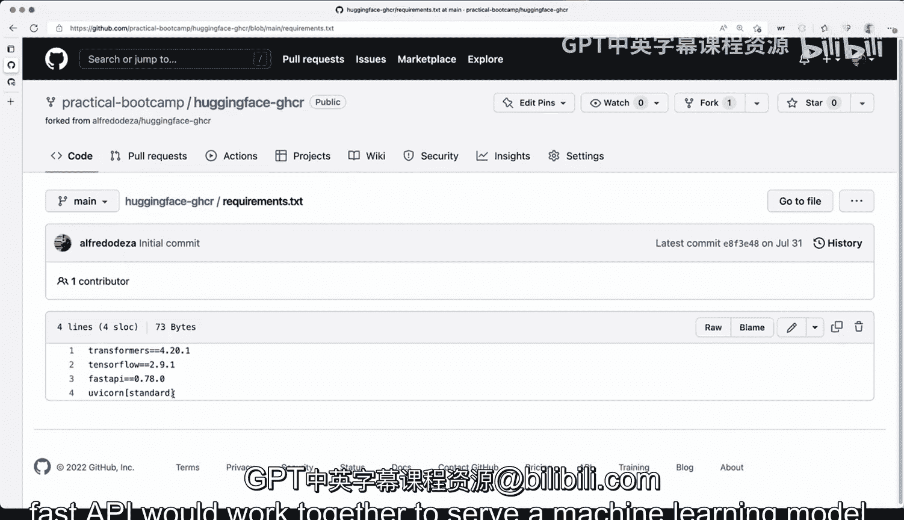

#  169：Hugging Face与FastAPI集成 🚀


在本节课中，我们将学习如何将Hugging Face的预训练模型与FastAPI框架结合，创建一个能够通过HTTP接口提供服务的机器学习API。我们将通过一个简单的文本生成示例，了解整个集成过程的核心步骤。

---

## 概述

我们将创建一个Web应用，其核心功能是接收一段文本输入，使用Hugging Face的GPT-2模型生成后续文本，并通过FastAPI提供的API端点返回结果。整个过程涉及模型加载、API定义和请求处理。

---

## 代码结构解析

首先，我们来看一下项目的主要目录和文件。为了简化，我们专注于 `web_app` 目录下的一个文件：`main.py`。这个文件包含了集成Hugging Face与FastAPI的所有必要代码。

### 导入必要的库

我们首先需要导入项目依赖的各个模块。

```python
from transformers import pipeline
from fastapi import FastAPI
from fastapi.responses import HTMLResponse
from pydantic import BaseModel
```

*   `pipeline` 来自 `transformers` 库，它提供了一个高级抽象，让我们能够轻松使用各种预训练模型，而无需关心不同模型背后的复杂细节。
*   `FastAPI` 用于创建我们的Web应用框架。
*   `HTMLResponse` 允许我们返回HTML内容（用于简单的根路径响应）。
*   `BaseModel` 来自 `pydantic`，用于定义API请求体的数据模式，确保输入数据的类型安全。

### 初始化模型与FastAPI应用

导入库之后，我们需要初始化文本生成器和FastAPI应用实例。

```python
generator = pipeline('text-generation', model='gpt2')
app = FastAPI()
```

*   `generator = pipeline('text-generation', model='gpt2')`：这行代码创建了一个文本生成管道。它会动态下载Hugging Face上的GPT-2模型。`pipeline` 函数封装了模型加载、预处理和后处理的所有步骤。
*   `app = FastAPI()`：这行代码实例化了我们的FastAPI应用。

### 定义请求数据模型

为了规范API的输入，我们需要定义一个数据模型来描述客户端应发送的JSON数据结构。

```python
class TextRequest(BaseModel):
    text: str
```

这里定义了一个 `TextRequest` 类，它继承自 `BaseModel`。它只有一个字段 `text`，类型为字符串 (`str`)。这表示我们的API端点期望接收一个JSON对象，其中包含一个名为 `text` 的键。

### 创建API端点

现在，我们可以开始定义具体的API端点了。我们的应用将有两个端点：一个根路径 `/` 用于提供简单的前端界面，另一个 `/generate` 用于处理文本生成请求。

#### 根路径端点

首先，我们定义一个访问应用根路径时触发的端点。

```python
@app.get("/")
async def root():
    return HTMLResponse("""
    <html>
        <body>
            <form action="/generate" method="post">
                <input type="text" name="text" value="Once upon a time">
                <input type="submit" value="Generate">
            </form>
        </body>
    </html>
    """)
```

*   `@app.get("/")` 是一个装饰器，它将下面的函数 `root` 注册为处理 `GET` 请求到 `/` 路径的路由。
*   该函数返回一个 `HTMLResponse`，其中包含一个非常简单的HTML表单。用户可以通过这个表单输入文本并提交到 `/generate` 端点。

#### 文本生成端点

接下来，我们定义核心的文本生成端点。

```python
@app.post("/generate")
async def generate(request: TextRequest):
    results = generator(request.text)
    return results[0]
```

*   `@app.post("/generate")` 装饰器将函数 `generate` 注册为处理 `POST` 请求到 `/generate` 路径的路由。
*   `request: TextRequest` 参数声明了这个端点期望接收的数据格式，即我们之前定义的 `TextRequest` 模型。FastAPI会自动验证传入的JSON数据并将其转换为 `TextRequest` 对象。
*   `results = generator(request.text)`：这行代码使用加载好的GPT-2生成器，对请求中的 `text` 字段进行文本生成。
*   `return results[0]`：`generator` 返回的是一个列表，其中包含生成的文本序列。这里我们返回列表中的第一个（也是通常唯一的一个）结果。

---

## 项目依赖

为了运行这个应用，我们需要确保环境中安装了正确的依赖包。这些依赖通常列在一个 `requirements.txt` 文件中。

以下是核心依赖：
*   `transformers`：Hugging Face的库，用于加载和使用预训练模型。
*   `torch` 或 `tensorflow`：深度学习框架。`transformers` 库需要其中之一作为后端来运行模型。示例中使用了TensorFlow。
*   `fastapi`：用于构建API的Web框架。
*   `uvicorn`：一个轻量级的ASGI服务器，是运行FastAPI应用的推荐选择。

一个示例的 `requirements.txt` 文件内容如下：
```
transformers
tensorflow
fastapi
uvicorn
```

---

## 总结



本节课中，我们一起学习了如何将Hugging Face的机器学习模型与FastAPI框架进行集成。我们通过创建一个文本生成API，详细讲解了从导入库、初始化模型、定义数据模式到创建API端点的完整流程。这种模式可以扩展到其他类型的模型（如文本分类、问答等），为部署机器学习服务提供了一个简洁而强大的基础。