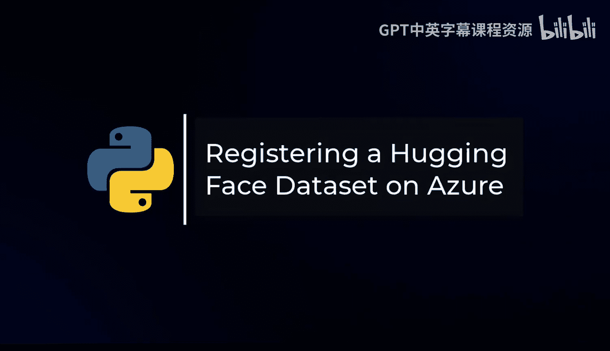
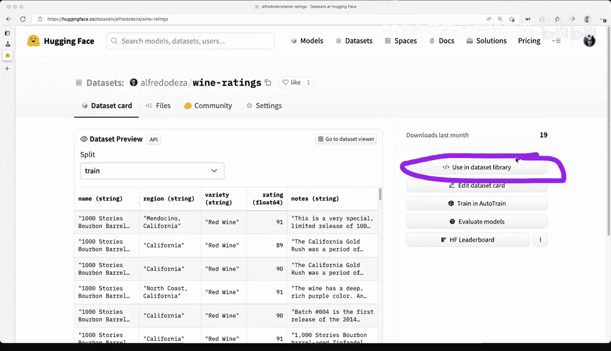
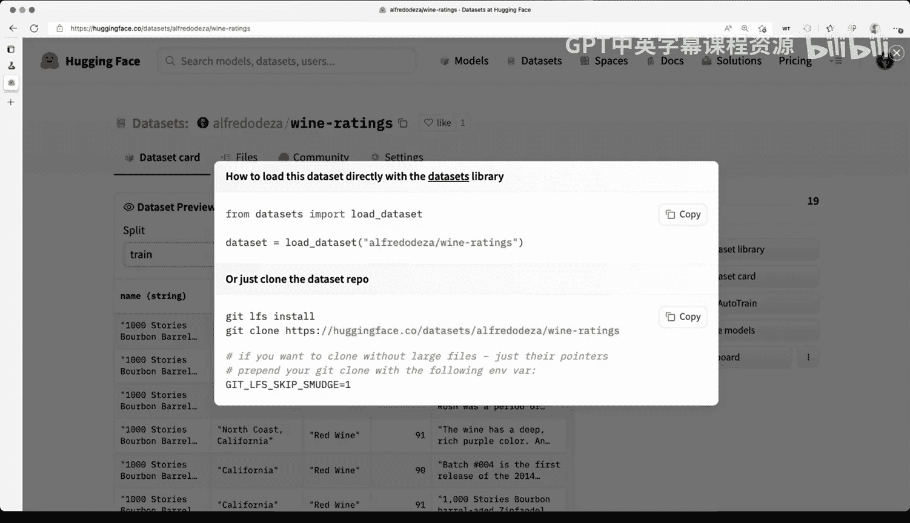
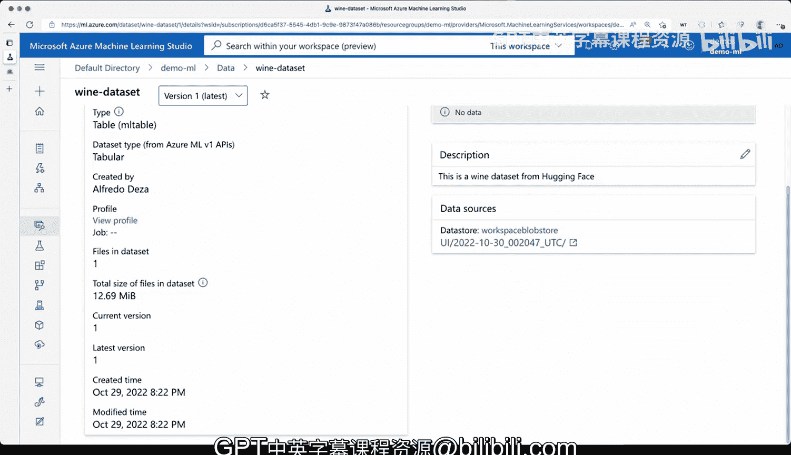

#  174：在Azure注册Hugging Face数据集 📥

在本节课中，我们将学习如何从Hugging Face平台下载一个数据集，并将其上传并注册到Azure机器学习工作室中。整个过程将涉及使用Python库、处理数据以及通过Azure的图形界面完成数据资产注册。

---

现在，让我们看看如何为这个操作从Hugging Face下载一个数据集。

我们将使用Hugging Face的`datasets`库。这里可以看到，我将使用我账户中的`winebradance`数据集。我将点击这个数据集，它非常方便。我真的很喜欢它。它包含了我们所需的所有示例。

我们本质上需要从`datasets`导入`load_dataset`来获取这些数据。你必须确保已经通过`pip install datasets`安装了`datasets`库。我已经完成了这一步。

我将复制这段代码，并使用Jupyter笔记本来加载数据，使其正常工作。我将转到Visual Studio Code，我已经安装了`datasets`，并确保它能正常工作。我将粘贴`from datasets import load_dataset`。

然后我将执行第3行代码，并确保它已加载。好的，这样它下载了一个CSV数据。

现在我将创建一个新的单元格，让我们看看这个数据集包含什么内容。

我将运行这段代码。正如预期，我们将有三种不同类型的数据。我确实想要完整的训练集。

为了获取它，我必须指定`train`。我将设置`train_dataset = dataset['train']`。然后运行它。很好。

现在如果我查看`train_dataset`并运行这些代码，你会看到我现在拥有了所有的3200行数据。我想要什么？我想在本地下载它。

这里有很多信息。我想将其转换为pandas格式。所以我会说`df`，代表数据框。我将把它发送到pandas看看结果。很好，这可行。

现在我可以运行`df.describe()`。是的，让我们看看结果。很好。3200行，这正是我想要的。

接下来我要做的是将其保存为CSV文件。好的，我将再次点击代码。我将执行`df.to_csv('wine_ratings.csv', index=False)`。这将创建一个CSV文件在那里。好的。

我喜欢用pandas做这个。如果你想使用其他方法，那也可以。但在这里，使用pandas会很方便。

我将执行这些代码，你可以在这里看到我的`wine_ratings.csv`文件已经在这里了，里面包含了各种不同的数据。

我们要做什么？我们要在Azure上注册这个文件。为此，我们将转到网页浏览器。

然后，我将前往Azure机器学习工作室，接着导航到“数据”部分。我将点击“创建”，然后说“wine_dataset”，这是一个来自Hugging Face的葡萄酒数据集。

类型将是“表格型”。我点击“下一步”，然后我们将选择从我的本地驱动器上传。所以选择“本地文件”，然后“下一步”。

存储设置这里没问题，Azure Blob存储就可以。我点击“下一步”。现在我说，是的，如果路径已存在也没关系。然后我点击“上传”。

这将弹出一个小的窗口。我将选择`wine_ratings.csv`文件。我知道这个文件很小，但这是必要的步骤。我打开它并上传。那是12兆字节。我点击“下一步”。

然后它会在后台进行一些验证。验证完成了，是的，格式是CSV，UTF-8编码，完美。我不希望跳过任何列标题，所有文件都有相同的标题。那很好。

我们有名称为、地区、品种、评分等列，这正是数据集的内容。如果你记得，我回到这里点击查看，名称、地区、品种、评分和一些备注，完全一样。没有任何变化。所以我点击“下一步”。

现在在这里，Azure在后台对列名和我们正在处理的数据类型进行了大量验证。这更像是十进制数，我原本期待的是浮点数，但带点的十进制数听起来很好，很完美。所以它能够正确识别。例如，如果这是布尔值，你可以在这里更改它。这很完美。点击“下一步”。

最后，我点击“创建”。这样它将创建一个数据资产，我仍然称之为数据集，这没问题。这里的关键点是，我们有版本控制。你可以在这里看到“文件在data1中，当前版本是1”。这意味着每次我向这个数据推送新版本时，都会上传并记录。这在以编程方式进行时更有意义，例如使用Azure CI/CD或某些API，你可能以编程方式执行此操作并进行更改。但我想通过用户界面向你展示，以便你能更轻松地理解你将看到的一些内容，而不是我运行一堆命令让事情发生。

不过，这也可以通过Python API以及其他受支持的语言SDK以编程方式访问。所以，如果我这里有100个版本，你可以指定要版本10而不是版本100，那也会起作用。

就是这样。这就是你如何下载Hugging Face数据集到本地，然后将其上传到Azure机器学习工作室的方法。

---

本节课中，我们一起学习了从Hugging Face下载数据集、使用pandas进行基本处理、以及通过Azure机器学习工作室的界面将数据注册为可版本控制的数据资产的全过程。这为后续的机器学习工作流提供了可靠的数据基础。