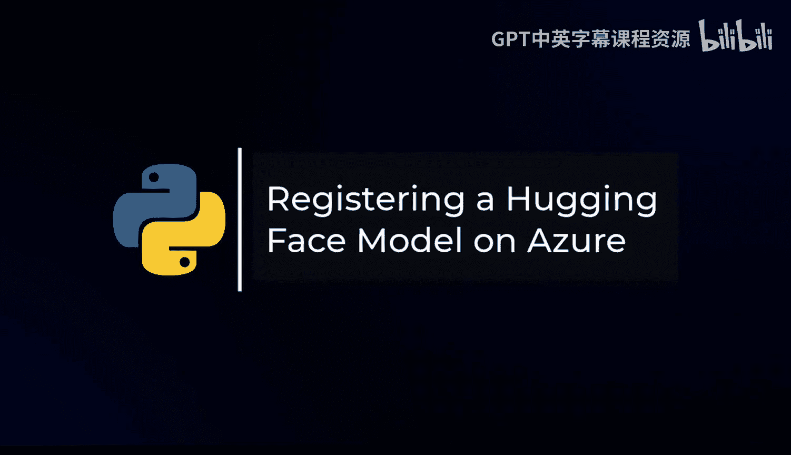
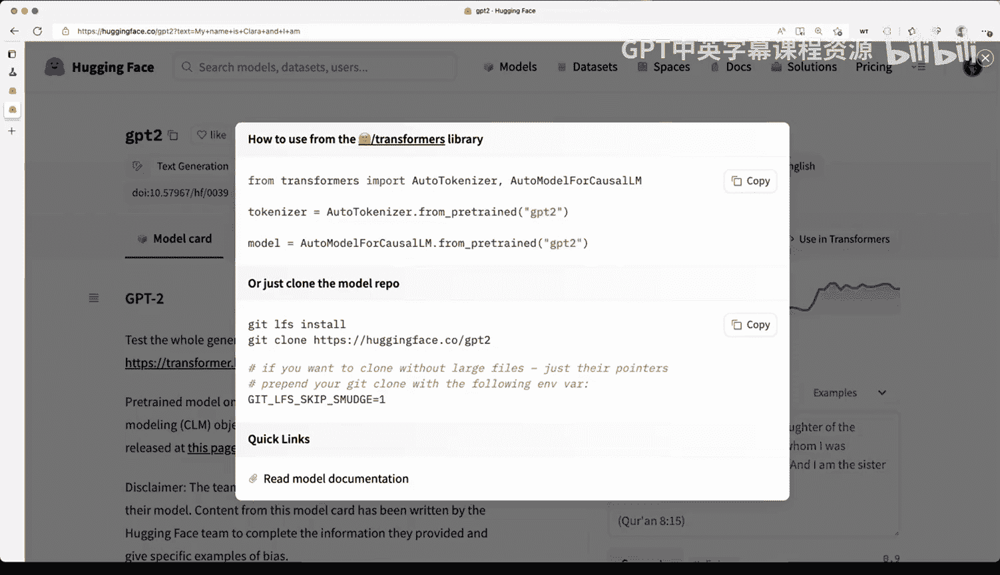
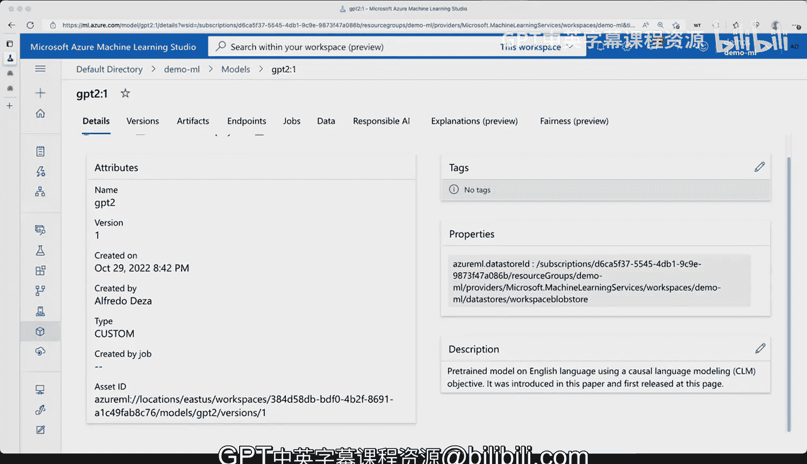

#  175：在Azure注册Hugging Face模型



## 概述
在本节课中，我们将学习如何将一个Hugging Face模型下载到本地，然后将其注册到Azure机器学习工作室中。这个过程涉及使用`transformers`库下载模型，以及通过Azure机器学习工作室的界面手动上传和注册模型资产。

---

## 从Hugging Face下载模型



上一节我们介绍了课程目标。本节中，我们来看看如何从Hugging Face Hub获取模型。

首先，在Hugging Face的Web UI中找到目标模型（例如GPT-2）。为了了解如何在代码中使用它，我们可以查看其API。在模型页面上，通常会有一个“Use in Transformers”的卡片，其中提供了加载模型的示例代码。

以下是加载模型和分词器的核心代码：
```python
from transformers import AutoTokenizer, AutoModelForCausalLM

tokenizer = AutoTokenizer.from_pretrained("gpt2")
model = AutoModelForCausalLM.from_pretrained("gpt2")
```
运行这段代码后，`transformers`库会自动从Hugging Face Hub下载模型文件并缓存到本地系统。如果是首次运行，下载可能需要一些时间。

模型下载完成后，我们可以使用以下方法将其保存到指定的本地目录：
```python
model.save_pretrained("./gpt2")
```
执行此命令后，会在`./gpt2`目录下生成两个关键文件：
*   `config.json`：包含模型的配置和元数据。
*   `pytorch_model.bin`：这是模型的可加载权重文件，供PyTorch使用。

至此，我们已经成功将模型文件保存到了本地。

---

## 在Azure机器学习工作室中注册模型

我们已经将模型下载到本地。接下来，我们将学习如何将其作为一个资产注册到Azure机器学习工作室中。

打开Azure机器学习工作室，导航到“模型”部分。我们将通过图形界面手动注册模型。

以下是注册模型的具体步骤：
1.  点击“注册模型”。
2.  选择“从本地文件”注册。
3.  模型类型可以保持为“未指定类型”。
4.  在“选择模型文件或文件夹”时，浏览并选择之前保存的`pytorch_model.bin`文件（约486MB）。
5.  点击“下一步”。
6.  为模型命名（例如“GPT-2”），并添加可选的描述信息。
7.  版本号通常会自动设置为“1”，可以保持默认。
8.  点击“下一步”并完成注册。

上传过程可能需要一些时间，因为需要传输较大的模型文件。注册成功后，模型会出现在模型列表中，并拥有一个唯一的资产ID。

---

## 注册模型的意义与用途

我们已经完成了模型的注册。现在，我们来探讨一下将模型注册到Azure机器学习工作室的好处。

将模型作为资产进行管理，为机器学习运维（MLOps）带来了诸多便利：

以下是注册模型后的主要优势：
*   **版本控制**：可以轻松管理模型的不同版本（如v1, v2, v3），便于追踪和回滚。
*   **部署**：可以直接将注册的模型部署为实时端点或批处理端点，用于推理服务。
*   **共享与协作**：模型资产可以在团队内共享，方便协作开发。
*   **分析与评估**：可以利用工作室的工具进行模型性能分析、公平性评估等。
*   **自动化集成**：通过资产ID，可以在代码或自动化流水线（如Azure DevOps）中精确地引用和检索特定版本的模型。

此方法不仅适用于Hugging Face模型，也适用于ONNX或其他格式的模型。

---



## 总结
本节课中我们一起学习了将Hugging Face模型集成到Azure机器学习平台的完整流程。我们首先使用`transformers`库将模型下载到本地并保存，然后通过Azure机器学习工作室的界面手动上传和注册了该模型。最后，我们讨论了将模型作为版本化资产进行管理在MLOps实践中的重要意义，包括版本控制、部署和协作等方面的优势。