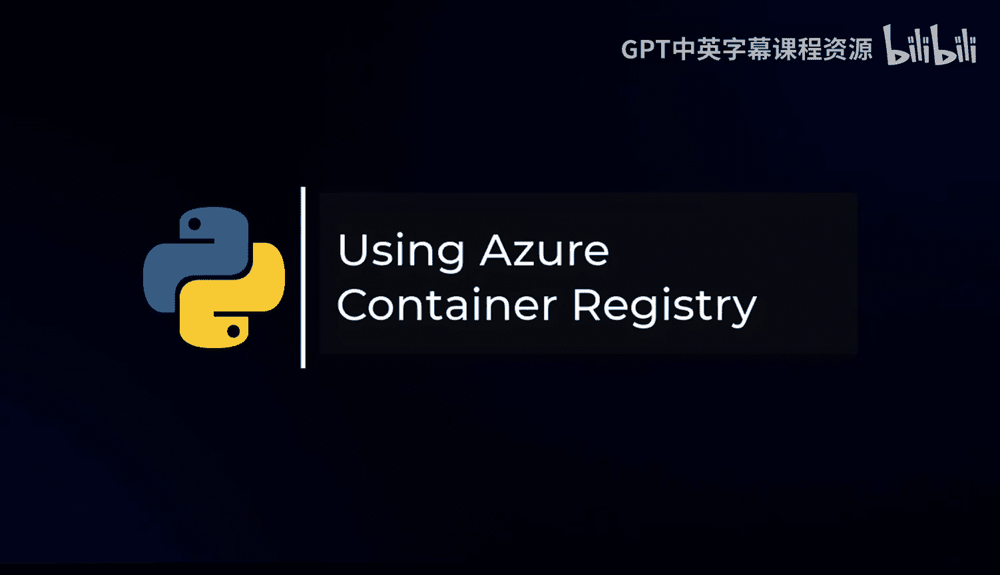
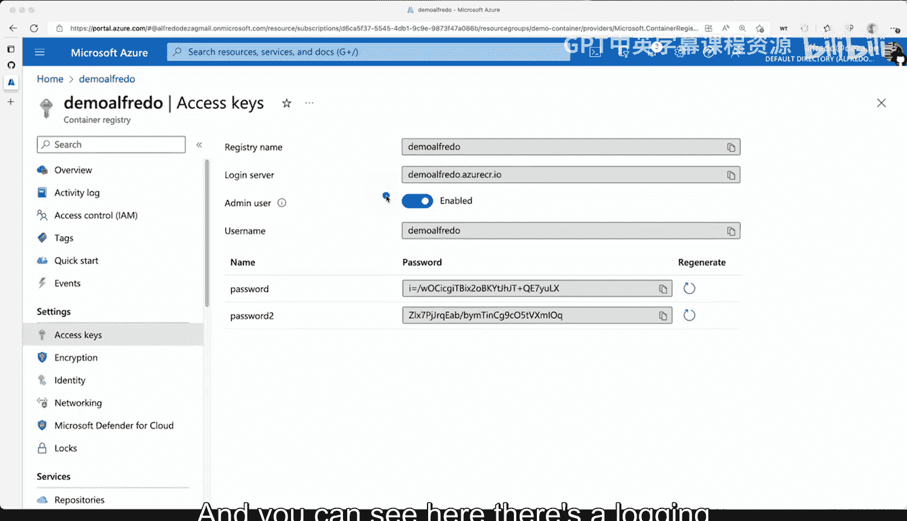
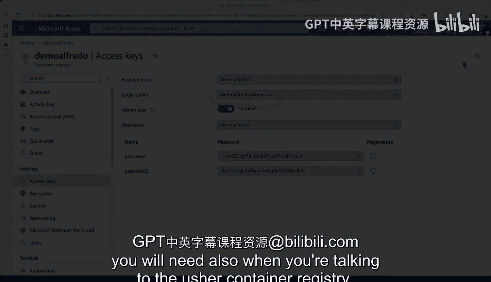

#  179：使用Azure容器注册表

在本节课中，我们将学习如何创建并使用Azure容器注册表。Azure容器注册表是一个托管的Docker注册表服务，用于存储和管理容器镜像。我们将逐步完成在Azure门户中创建注册表、配置访问密钥，并了解后续在GitHub Actions等自动化流程中如何使用它。

---

## 创建Azure容器注册表

上一节我们介绍了Azure容器注册表的概念，本节中我们来看看如何实际创建一个。

首先，需要登录到Azure门户。在门户中，我们可以搜索并选择“容器注册表”服务来开始创建过程。

以下是创建新容器注册表的步骤：

1.  在Azure门户中，搜索并选择“容器注册表”。
2.  点击“+ 创建”按钮以开始创建新的注册表。
3.  在创建向导中，需要选择订阅。本示例使用一个特定的订阅。
4.  创建一个新的资源组，将其命名为 `demoContainer`。此资源组将用于后续创建的其他Azure服务，以便部署容器。
5.  为注册表设置一个唯一的名称。本示例使用 `demoAlfredo`。请注意，资源名称只能包含字母数字字符，因此移除了连字符以确保合规。
6.  选择区域。本示例选择“美国东部”区域。
7.  对于“可用性区域”，本示例不需要，因此保持默认。
8.  在“SKU”层选择上，“标准”层已足够。Azure也提供“基本”和“高级”层以满足不同需求。
9.  完成所有配置后，点击“查看 + 创建”按钮。
10. 验证通过后，点击“创建”按钮。部署过程将开始，这可能需要一些时间。

部署完成后，可以导航到新创建的资源。

---

## 配置访问密钥

创建注册表后，我们需要配置访问密钥，以便能够登录并向其推送容器镜像。

以下是配置和管理访问密钥的步骤：

1.  在容器注册表的资源页面，导航到“访问密钥”设置部分。
2.  为了能够推送镜像，需要启用“管理员用户”选项。这是使用Azure容器注册表推送镜像时的要求。
3.  启用后，系统会显示用户名和两个密码。用户名通常是注册表名称的一部分（例如 `Alfredo`）。
4.  可以使用其中一个密码进行身份验证。系统提供两个密码是为了方便在不中断服务的情况下轮换密钥。
5.  这些密码可以随时重新生成。
6.  此处显示的用户名和密码，以及“登录服务器”的地址，是后续登录和向该注册表进行身份验证所必需的信息。

**重要提示**：为了在自动化流程（如GitHub Actions）中使用此注册表，需要将这里的**用户名**和**密码**添加为GitHub仓库的加密密钥。

---

## 总结

本节课中我们一起学习了Azure容器注册表的核心操作。我们首先在Azure门户中创建了一个新的容器注册表，并为其指定了资源组和唯一名称。然后，我们配置了访问密钥，启用了管理员用户，并获取了登录所需的用户名、密码和服务器地址。这些凭证是后续通过Docker命令行或CI/CD工具（如GitHub Actions）向该注册表推送和拉取容器镜像的基础。