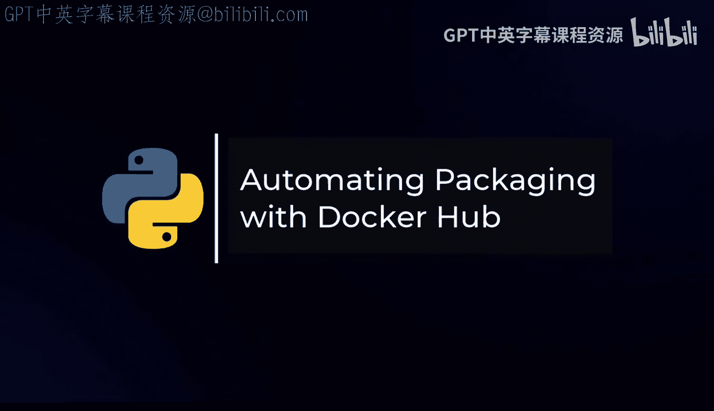
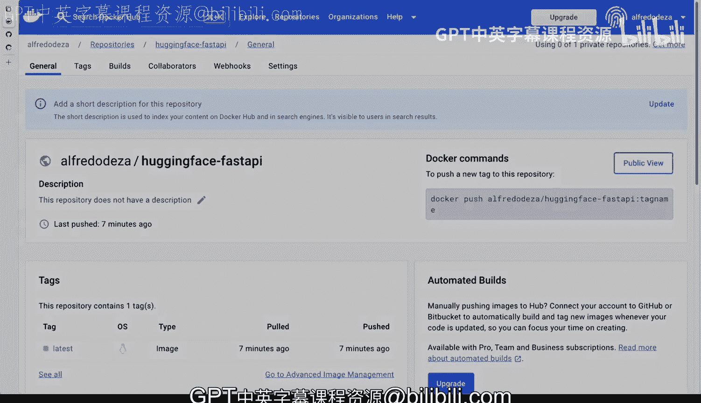

#  181：通过Docker Hub实现自动化打包 🐳



在本节课中，我们将学习如何利用GitHub Actions工作流，自动将机器学习模型打包成Docker镜像，并推送到Docker Hub仓库。这个过程是实现持续集成与持续部署（CI/CD）的关键步骤。

## 概述

我们将配置一个GitHub Actions工作流，使其在代码推送到主分支时自动触发。该工作流会执行以下核心操作：检出代码、登录Docker Hub、构建Docker镜像，最后将镜像推送到指定的Docker Hub仓库。

## 工作流配置详解

上一节我们介绍了自动化打包的目标，本节中我们来看看如何具体配置GitHub Actions工作流文件。

工作流配置文件通常位于仓库的 `.github/workflows/` 目录下。以下是一个名为 `docker-image.yml` 的配置示例：

```yaml
name: Docker Image CI

on:
  push:
    branches: [ main ]
  workflow_dispatch:

jobs:
  build:
    runs-on: ubuntu-latest
    steps:
      - name: Checkout repository
        uses: actions/checkout@v2

      - name: Log in to Docker Hub
        uses: docker/login-action@v1
        with:
          username: ${{ secrets.DOCKERHUB_USERNAME }}
          password: ${{ secrets.DOCKERHUB_TOKEN }}

      - name: Build and push Docker image
        uses: docker/build-push-action@v2
        with:
          context: .
          push: true
          tags: yourusername/huggingface-fastapi:latest
```

以下是该配置文件各部分的详细说明：

*   **触发器 (`on`)**：定义了工作流何时运行。`push` 到 `main` 分支会触发。`workflow_dispatch` 允许在GitHub界面上手动触发。
*   **检出代码 (`actions/checkout`)**：这是一个标准步骤，用于将仓库的代码拉取到工作流运行环境中。
*   **登录Docker Hub (`docker/login-action`)**：此步骤使用存储在GitHub仓库机密中的用户名和令牌进行身份验证。
*   **构建与推送 (`docker/build-push-action`)**：这是核心步骤。`context: .` 指定使用根目录的Dockerfile。`push: true` 表示构建后自动推送。`tags` 指定了镜像在Docker Hub上的完整名称和标签。

## 获取并配置Docker Hub凭证

为了安全地进行身份验证，我们需要在Docker Hub生成访问令牌，并将其存储在GitHub仓库中。

### 生成Docker Hub访问令牌

首先，你需要在Docker Hub网站上创建访问令牌。

1.  访问 [hub.docker.com](https://hub.docker.com) 并登录。
2.  点击右上角头像，进入 **“Account Settings”**。
3.  在左侧菜单选择 **“Security”**。
4.  在 **“Access Tokens”** 部分，点击 **“New Access Token”**。
5.  为令牌添加描述（例如“GitHub Actions for ML”），并设置权限为 **“Read, Write, Delete”**。
6.  点击生成后，**立即复制**生成的令牌字符串并妥善保存。

### 在GitHub仓库中添加机密

接下来，将Docker Hub用户名和刚才生成的令牌添加到GitHub仓库的机密中。

1.  进入你的GitHub仓库页面。
2.  点击 **“Settings”** 选项卡。
3.  在左侧边栏找到 **“Secrets and variables”**，然后选择 **“Actions”**。
4.  点击 **“New repository secret”** 按钮。
5.  创建两个机密：
    *   **名称**: `DOCKERHUB_USERNAME`， **值**: 你的Docker Hub用户名。
    *   **名称**: `DOCKERHUB_TOKEN`， **值**: 你刚才复制的访问令牌。

**关键点**：务必确保你在工作流YAML文件中引用的机密名称（例如 `secrets.DOCKERHUB_USERNAME`）与这里设置的名称完全一致。

## 手动触发与验证

配置完成后，你可以立即测试工作流。

1.  进入GitHub仓库的 **“Actions”** 选项卡。
2.  在左侧列表中找到你配置的工作流（例如“Docker Image CI”）。
3.  由于我们配置了 `workflow_dispatch`，你会看到 **“Run workflow”** 按钮。点击它并再次确认运行。
4.  工作流开始执行。你可以点击进入查看实时日志。
5.  执行成功后（通常需要2-3分钟），返回你的Docker Hub仓库页面。你应该能看到一个带有指定标签（如 `huggingface-fastapi:latest`）的新镜像，其更新时间与工作流完成时间吻合。

## 总结



本节课中我们一起学习了如何搭建一个完整的自动化Docker镜像打包与推送流水线。我们首先分析了GitHub Actions工作流配置文件的结构和核心步骤，然后详细讲解了如何安全地生成并使用Docker Hub访问令牌，最后通过手动触发验证了整个流程。通过此设置，你的模型代码每次更新并推送到主分支时，都会自动生成最新的可部署Docker镜像，极大地提升了机器学习项目的运维效率。