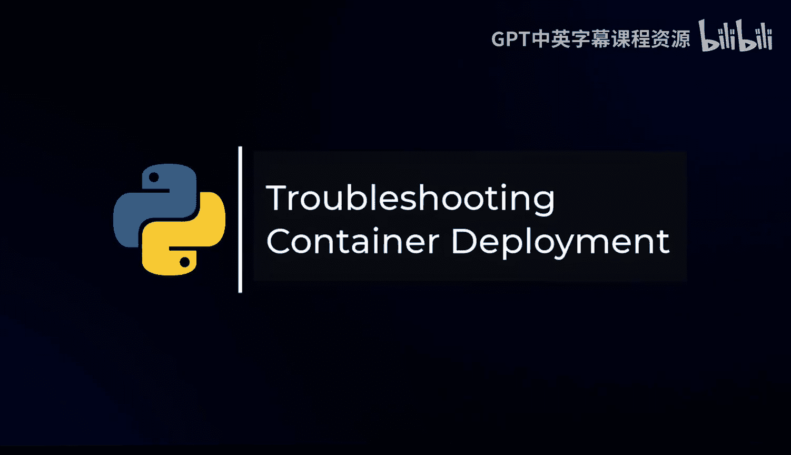
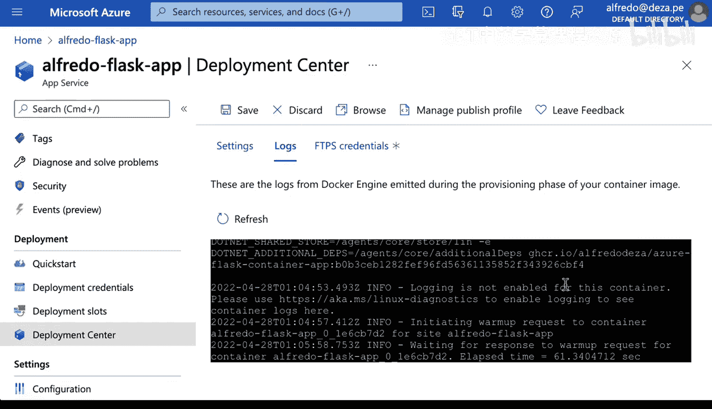
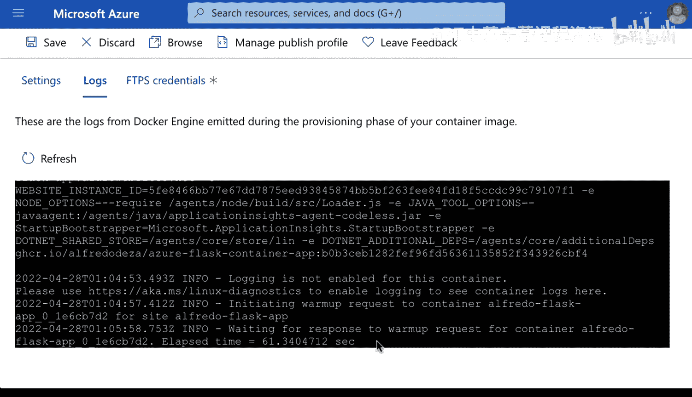

#  185：容器部署故障排查 🔍



在本节课中，我们将学习如何排查容器部署中的常见故障。我们将通过一个具体案例，演示当容器配置了错误的端口时会发生什么，以及如何通过检查日志来定位问题。

---

## 概述

在上一节中，我们处理了因语法错误导致容器无法启动的问题。本节中，我们来看看另一种常见情况：容器配置了错误的端口。我们将模拟这一场景，观察其现象，并学习如何通过Azure门户的日志来诊断问题。

## 故障模拟：配置错误端口

首先，我们修复之前引入的语法错误，然后将容器暴露的端口从默认的80更改为8000。以下是更改的核心代码部分：

```dockerfile
# 在Dockerfile或应用配置中，将端口从80改为8000
EXPOSE 8000
```

或者，在应用配置文件（如`app.py`或`Dockerfile`的CMD指令）中确保应用监听在8000端口。

提交这些更改后，我们的自动化流程（CI/CD）会构建新的容器镜像，将其推送到GitHub容器仓库，并通知Azure拉取这个新容器并尝试再次运行。

## 观察部署结果



自动化操作成功完成后，系统会提供一个URL。点击该URL，我们会发现页面持续加载，但没有任何响应。这表明服务没有在预期的端口上成功运行。

## 诊断问题：检查日志

当应用无响应时，我们需要回到Azure门户进行诊断。

以下是诊断步骤：
1.  进入Azure门户，找到你的应用服务。
2.  导航到“部署中心”。
3.  点击进入并检查部署日志。

将日志窗口放大后，可以清晰地看到关键信息。日志显示容器正在“等待响应以进行预热”，并且已经等待了超过60秒。更关键的是，日志中有一行提示：**Do run port 80**。

这个信息至关重要。它表明Azure应用服务默认期望容器在80端口上提供服务，而我们的容器却配置在了8000端口。由于端口不匹配，Azure的健康检查无法收到响应，导致部署状态一直卡在“等待”中，最终会超时失败。

## 与语法错误故障的对比

回顾之前遇到的语法错误问题，其排查方式有所不同。我们需要在冗长的日志中向上滚动查找。在接近顶部的位置，可以找到之前引入语法错误的具体报错信息。虽然日志记录了错误，但在大量输出中定位它有一定难度。

总结来说，我们目前遇到了两种会导致部署失败的常见问题：
1.  **错误端口**：容器监听端口与平台期望端口不匹配，导致健康检查失败。
2.  **无效代码**：如语法错误，导致容器在启动阶段就直接崩溃。

## 总结



本节课我们一起学习了容器部署中的两种故障排查。我们模拟了配置错误端口的情况，发现服务会无响应，并通过检查Azure部署日志找到了“Do run port 80”的关键线索。这与直接导致容器启动失败的语法错误形成了对比。对于这类端口错误，预防措施是在代码中或通过测试确保容器暴露的端口与云平台（如Azure App Service）的期望端口一致。掌握查看和分析部署日志的技能，是快速定位和解决这类运维问题的关键。