#  187：执行模型微调 🚀

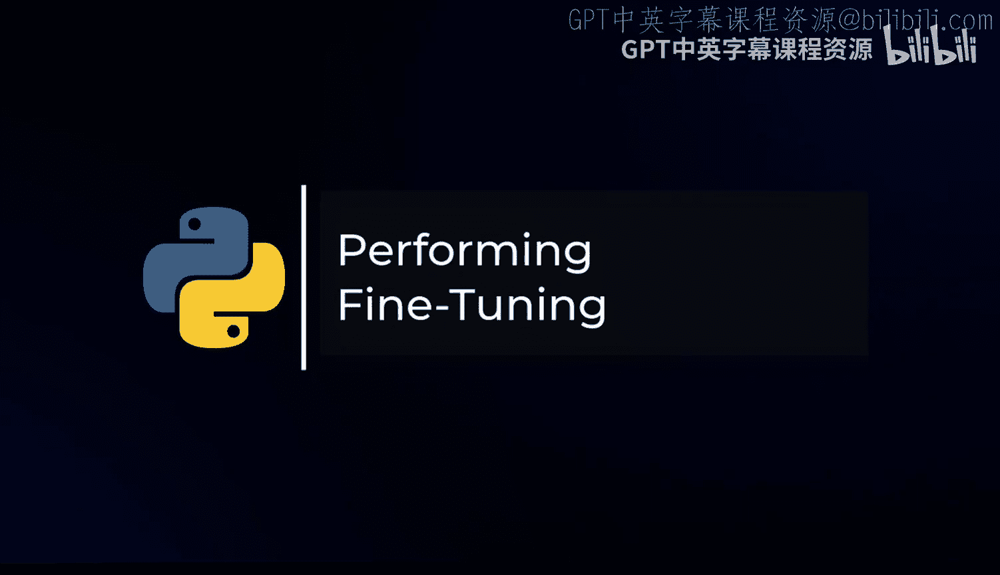

在本节课中，我们将学习如何利用Hugging Face的官方教程，在两种不同的计算环境中执行模型微调任务，并对比其性能差异。

## 概述

模型微调是机器学习中的一个关键步骤，它允许我们在预训练模型的基础上，使用特定领域的数据进行进一步训练，从而提升模型在特定任务上的性能。本节将指导你如何实际操作一个微调流程。

上一节我们介绍了模型微调的基本概念，本节中我们来看看如何具体实施。

## 访问官方教程与代码

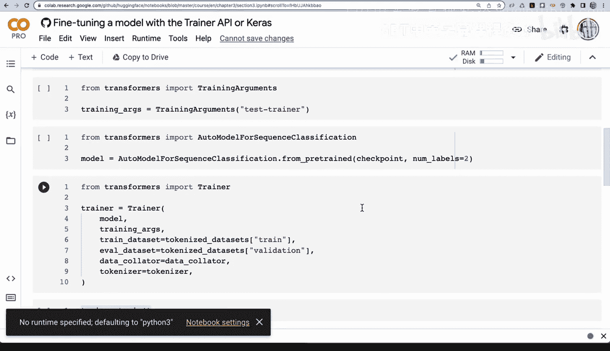

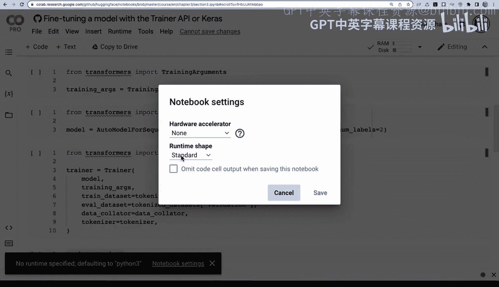

首先，查看Hugging Face的官方文档和配套课程。该课程包含许多有用的内容，但我们将重点关注“微调预训练模型”这一部分，以了解如何自行实现。

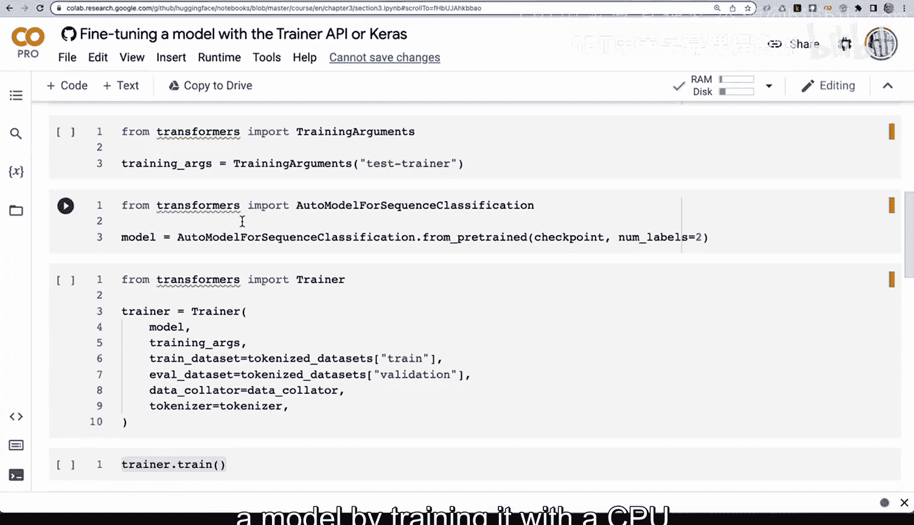

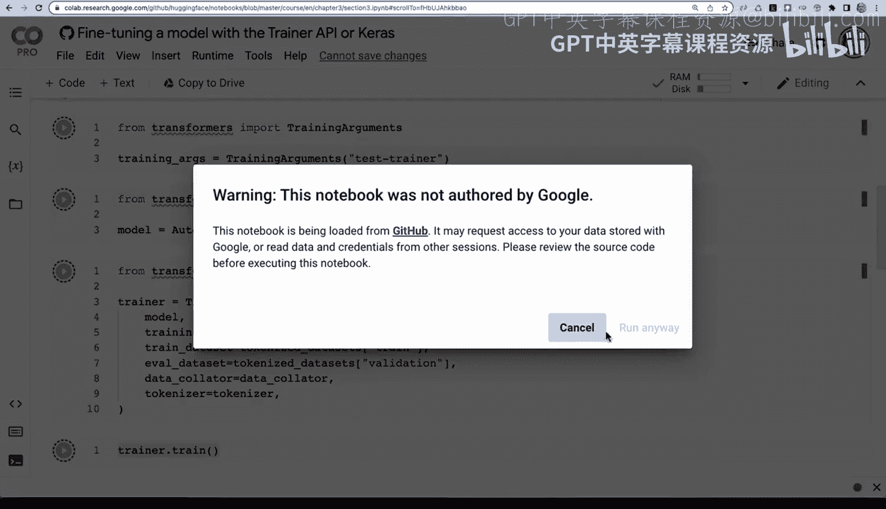

选择课程中的相应按钮，它会打开一个Colab笔记本。该笔记本提供了清晰的章节概述，代码量并不大。主要步骤包括：
*   安装必要的软件。
*   定义数据分词函数。
*   配置训练器。
*   执行训练以完成微调，并展示过程。

## 在Colab CPU环境中进行基准测试

如果想自行运行此代码并追求更高的准确率，可以使用Colab环境。默认情况下，它会连接到一个基于CPU的运行环境。我们可以通过“更改运行时类型”来确认没有启用硬件加速。

这提供了一个很好的基准测试机会，让我们了解在仅使用CPU的普通硬件上微调模型所需的时间。

以下是执行步骤：
1.  运行“运行时”菜单下的“全部运行”命令。
2.  首先会启动安装过程。由于软件并非预装在Colab机器上，这可能需要一些时间。
3.  安装完成后，代码会加载数据集，这也可能需要一些时间。
4.  接着，代码会设置训练任务，获取预训练模型。
5.  最后，进入实际的微调步骤。

这是一个很好的基准，展示了在只有CPU的Colab笔记本上微调模型的情况。我们可以看到，训练开始了三个周期，但每一步都耗时较长。根据进度推断，完成整个训练可能需要20到30分钟。

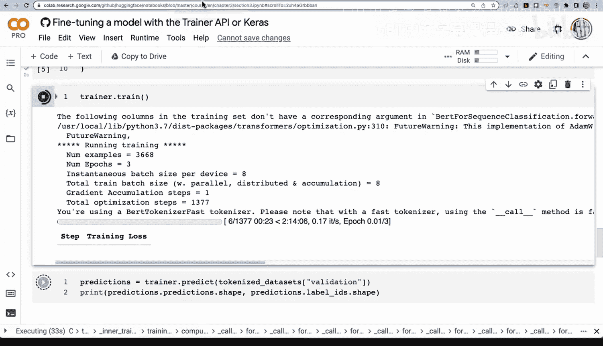

## 在启用GPU的代码空间中加速微调

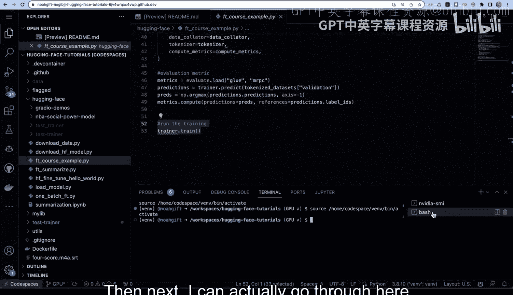

现在，让我们回到代码，看看在启用了GPU的Github代码空间中运行相同代码的效果。基本流程是复现相同的代码逻辑。

核心代码结构如下：
```python
from datasets import load_dataset
# 导入所需的transformer组件，例如训练参数
# 下载要使用的数据（本例中是GLUE数据）
# 创建分词函数
# 设置模型所需的所有参数
# 创建计算评估指标的函数
# 配置训练器，指定使用的数据
# 设置评估指标
# 运行训练
```

我们可以执行`nvidia-smi -l 1`命令来启动GPU监控。然后，在屏幕上方的终端中运行训练任务。

执行命令：
```bash
python huggingface_ft_fine_tuning_course_example.py
```

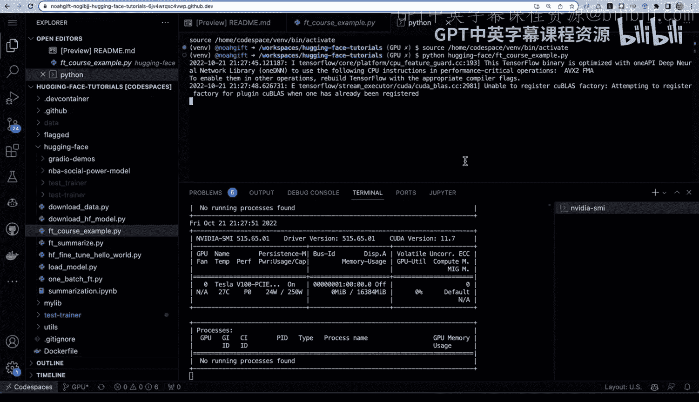

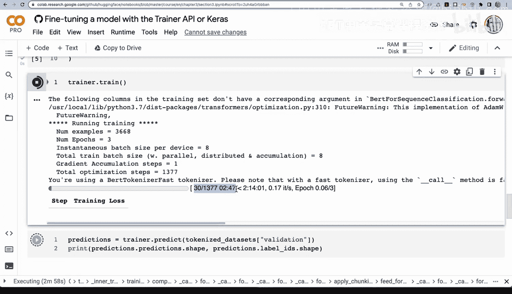

我们将官方文档的示例代码在此特定环境中运行。虽然下载数据等步骤仍需时间，但由于可用的GPU资源，训练过程将显著加快。

可以看到，训练正在非常快速地进行。GPU监控显示GPU已被调用，负载很高（例如Tesla V100）。与此同时，之前在Colab CPU上运行的训练任务进度仍然缓慢。

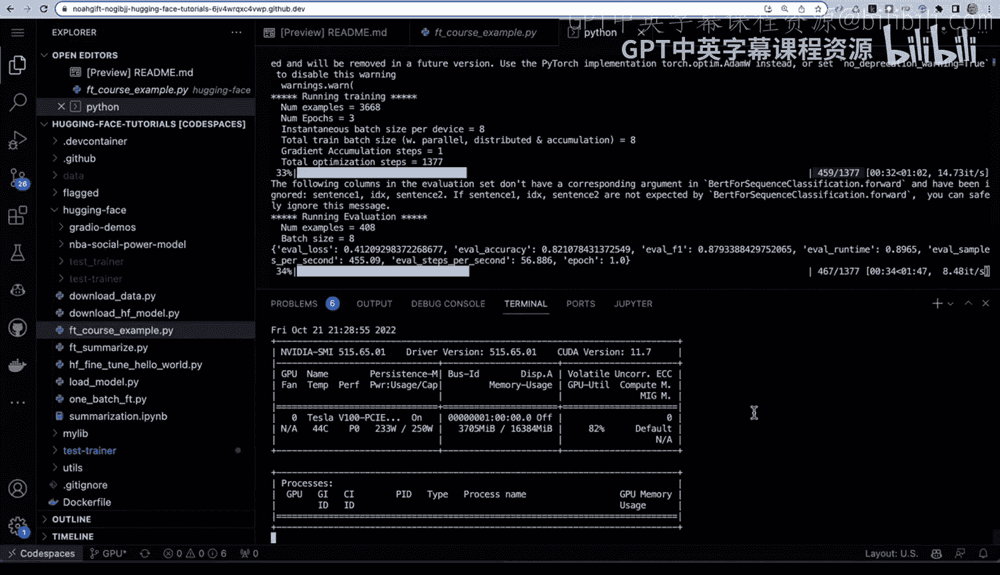

在训练微调任务时，我们可以获取所关心的评估指标（例如F1分数），并希望这个分数越来越好。随着指标的提升，我们就能构建出使用自定义数据的优质微调模型。

这是一个展示拥有自有GPU资源进行微调的优势的好例子：你可以获得更高的准确率。代码中可能有一个基线准确率，而微调后我们得到了改进的新准确率。

此外，我们还可以在代码的`TrainingArguments`中稍作调整，设置将模型推送到Hugging Face平台，保存为一个新的托管模型。这与Hugging Face上其他用户的做法类似。例如，在Hugging Face模型库中查看文本摘要模型，会发现许多模型都是基于原始架构（如Facebook的模型）进行微调后发布到特定目录下的。你也可以通过微调来做同样的事情。

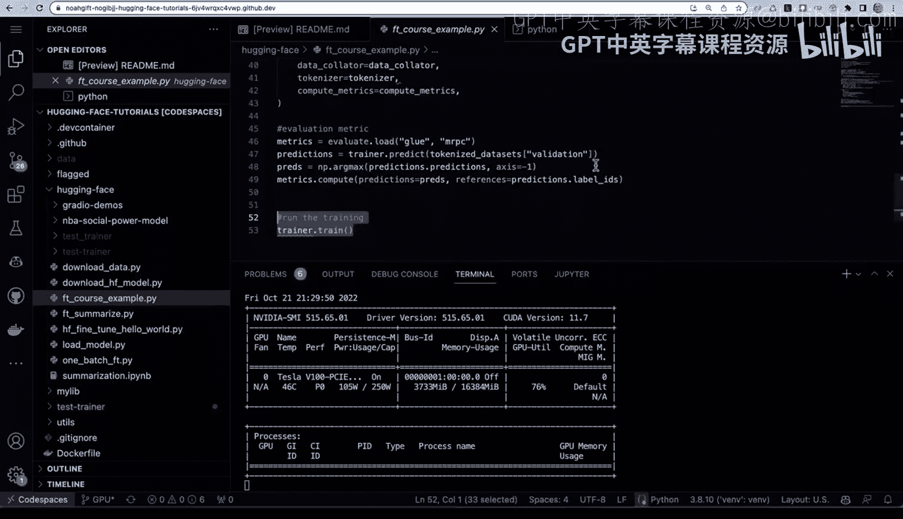

使用这些GPU资源，训练任务很快就能完成。这是在自有模型上进行微调实验的绝佳方式。

## 总结

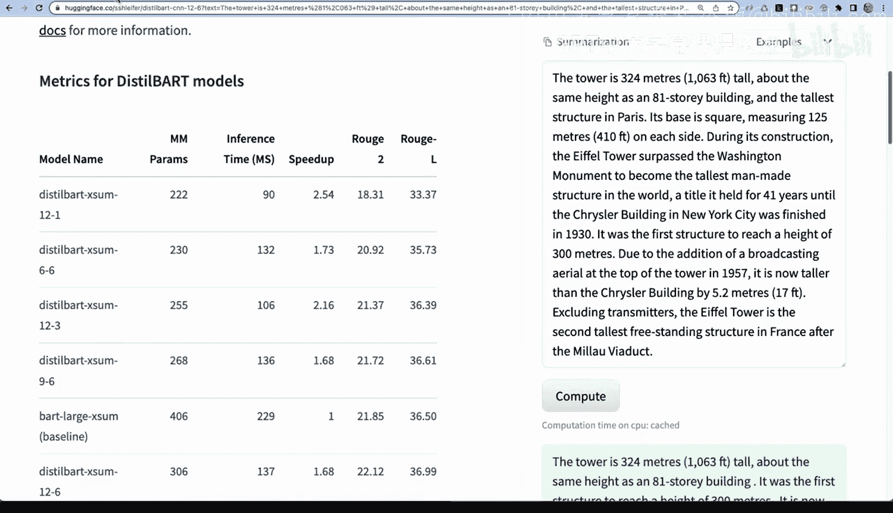

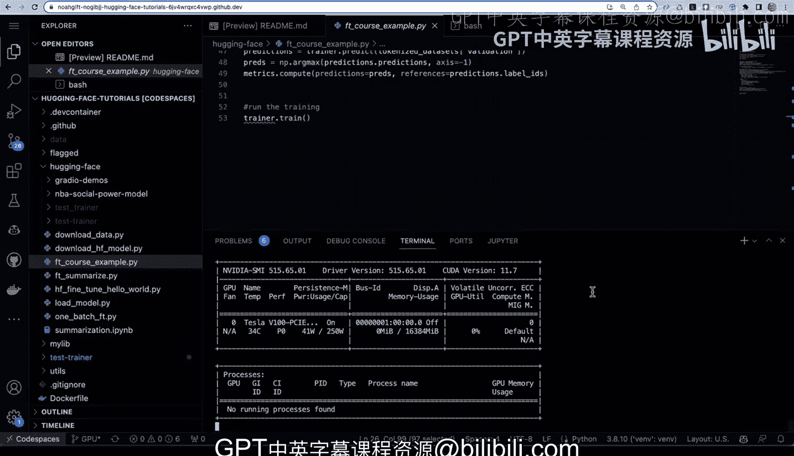

本节课中我们一起学习了模型微调的实际操作。我们对比了在Colab的CPU环境和启用GPU的代码空间中进行微调的性能差异，直观地展示了GPU对于加速训练过程的重要性。同时，我们也了解了如何将微调后的模型推送到Hugging Face平台进行托管和分享。