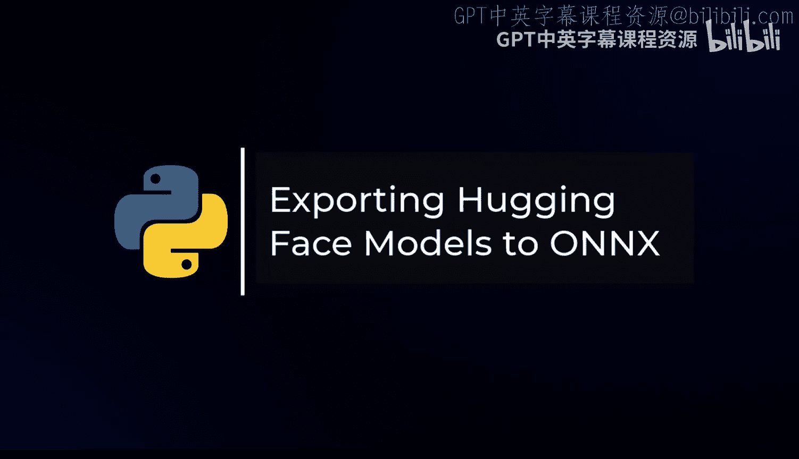
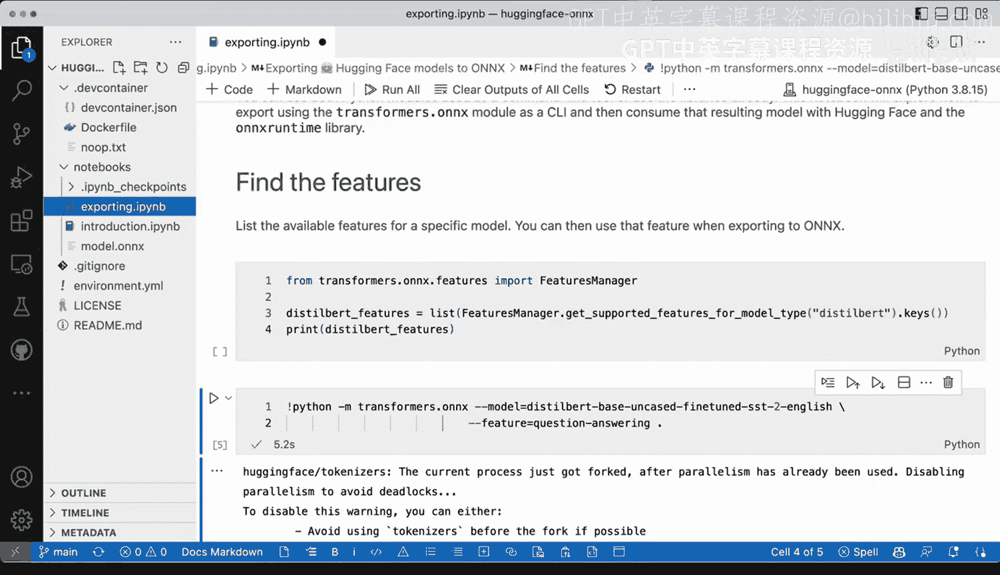

#  189：将Hugging Face模型导出为ONNX格式



## 概述
在本节课程中，我们将学习如何将Hugging Face平台上的预训练模型导出为ONNX格式。ONNX是一种开放的模型格式，旨在提高模型在不同框架和硬件平台之间的互操作性。我们将通过一个具体的例子，演示使用命令行工具将`distilbert-base-cased`模型转换为仅用于“问答”任务的ONNX模型。

## 准备工作
在开始之前，请确保你的Jupyter Notebook运行在正确的内核环境中。本示例使用了一个通过Conda管理的环境，该环境已安装了所有必要的依赖库。

## 探索模型支持的任务
首先，我们需要从`transformers.onnx`模块中导入`FeaturesManager`，以查看目标模型支持哪些类型的任务。

以下是导入代码和查看功能的步骤：

```python
from transformers.onnx import FeaturesManager
```

运行上述代码后，我们可以查询特定模型（例如`distilbert-base-cased`）支持的功能。对于这个模型，可能支持的任务包括序列分类、多项选择、标记分类和问答等。了解模型支持的任务对于后续的针对性导出至关重要。

## 导出模型为ONNX格式
如果我们明确需要一个执行特定任务（例如“问答”）的模型，我们可以使用`transformers.onnx`模块作为命令行工具，将Hugging Face模型导出为专注于该任务的ONNX模型。

以下是导出命令的分解说明：

*   **工具调用**：使用`python -m transformers.onnx`来调用模块。
*   **指定模型**：通过`--model`参数指定要转换的模型，本例中为`distilbert-base-cased-finetuned-sst-2-english`。
*   **指定功能**：通过`--feature`参数指定要导出的模型功能，本例中为`question-answering`。
*   **输出路径**：命令末尾的`.`表示将生成的ONNX模型文件保存在当前目录。你也可以指定一个具体的路径和文件名。

完整的导出命令如下：

```bash
python -m transformers.onnx --model=distilbert-base-cased-finetuned-sst-2-english --feature=question-answering .
```

执行此命令后，程序会开始下载模型并进行转换。这个过程可能需要几秒钟时间。

## 验证导出结果
命令执行完成后，我们需要在输出信息中寻找“Model validated successfully”或类似的成功验证提示。这表示模型已成功导出并通过了检查。

同时，输出信息中会显示生成的ONNX模型文件名（例如`model.onnx`）以及模型的输入输出名称。这些信息在后续使用该ONNX模型时非常重要。

回到Jupyter Notebook的文件浏览器，你应该能看到新生成的`model.onnx`文件，这证实了导出操作的成功。



## 总结
本节课我们一起学习了将Hugging Face模型导出为ONNX格式的完整流程。我们首先使用`FeaturesManager`探索了模型支持的任务，然后通过`transformers.onnx`命令行工具，指定模型和所需功能（如`question-answering`），成功生成了对应的ONNX模型文件。这种方法使得我们能够将Hugging Face上丰富的预训练模型，便捷地转换为适用于不同推理引擎和硬件加速器的ONNX格式，极大地增强了模型的部署灵活性。