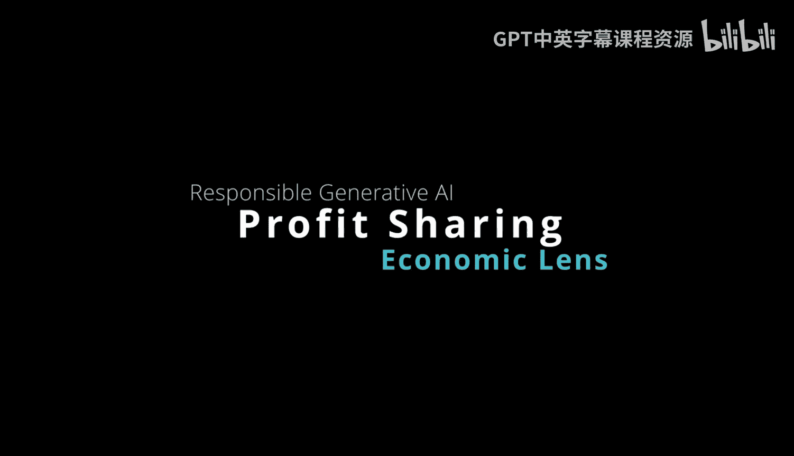
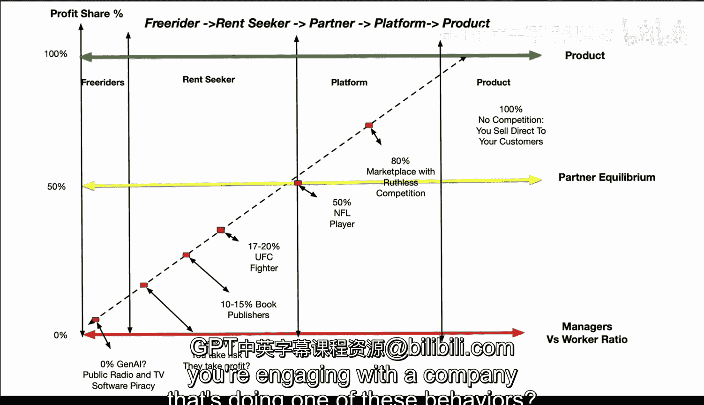

#  193：利润共享概念 💰

在本节课中，我们将要学习利润共享的不同模式及其在社会和微观经济学框架下的意义。理解这些概念有助于我们分析技术、商业机会和社会影响。

利润共享的模式多种多样，每种模式都有其优缺点。我们可以从几个核心类别来审视它们。

以下是四种主要的利润共享模式：

*   **搭便车者**：指那些享受产品或服务带来的好处，却未支付相应费用的人或实体。
*   **寻租者**：指试图通过最小化自身工作量，同时获取租金或支付的行为者。
*   **平台**：作为连接供需双方的中介，通过收取交易费用等方式获取利润。
*   **产品**：指生产者直接将商品售卖给消费者，获取全部利润的模式。

---

### 搭便车者模式 🆓

上一节我们概述了利润共享的几种模式，本节中我们首先来看看“搭便车者”模式。

一个典型的例子是公共广播和电视。许多人每天收听公共广播，但从不支付订阅费，他们就是搭便车者。他们获得了利益却没有支付任何成本。如果足够多的人不付费，公共广播将无法维持。软件盗版也是如此。如果一个软件包可以被免费下载，最终若足够多人成为搭便车者，软件将无利可图，开发者也就失去了继续开发的动力。生成式人工智能也可能面临类似问题。如果从报纸、电影到书籍、软件的所有内容都被无偿消费且没有利润分享，那么最终生产这些内容的动机将消失，可能导致所有创造性产出归零。当然，如果搭便车者只是少数，或许影响不大，但这是一个需要意识到的问题。

### 寻租者模式 🏦

了解了搭便车者可能带来的问题后，我们接下来探讨“寻租者”模式。寻租行为并非绝对，存在一个梯度，其核心是希望以尽可能少的工作获取某种租金或报酬。

风险投资是一个很好的例子。在某些情况下，一家风投公司可能投资100家公司，他们知道其中可能有95家会破产。那95家公司及其员工承担了巨大风险，他们本可以在成熟公司获得更高的薪水和奖金，但实际得到的期望价值更低。**期望价值 = 利润 × 事件发生概率**。在这个例子中，成功概率可能只有5%。因此，是创业者在承担所有风险，而风投公司则通过投资组合来对冲风险并获取利润。图书出版商在某些情况下也可能被视为一种寻租形式。有时出版商为作者做了很多，有时则做得很少，但他们通常能获得图书收入的10%到15%。在这类场景中，通常存在高度的管理控制，因为资金掌握在他们手中，他们拿走了大部分利润，并可能将其再投资回组织。至于这是否为社会或产品增加了价值，需要具体情况具体分析。

### 平台模式 📱

在寻租模式中，资金管理者可能获得大部分利润。与之不同，平台模式则扮演着中介角色。

平台也有一些好处。如果你能获得80%的利润，那对你来说很棒。但如果存在无情的竞争，这对你就不利了。经济学中有一个表述：在完全竞争下，利润最终为零。这意味着，如果平台无法限制参与者加入，甚至无法区分优劣，这确实可能导致利润被消除。平台本身则可能因为拥有大量相互竞争的参与者并通过收取交易费而赚取大量金钱。我们可以从职业体育联盟看到不同的利润分享比例。例如，UFC的选手分成比例较低，约为17%到20%。而更成熟的组织如NFL，则能达到合伙人级别的分成，即50%的收入返还给球员。篮球和棒球等联盟也有类似的比例。这展示了一种**合伙人均衡**，其中的权衡开始对劳动者和所有者双方都有意义，这可能是一个值得考虑的“甜蜜点”。

### 产品模式 🍎

最后，我们来看对所有者而言最理想的场景——“产品”模式。

假设你是一个农民，直接在路边销售水果，你获得了100%的利润。这里没有交易费用，没有中间商参与。你是直接将产品卖给客户。因此，每当你听到一个机会、一项新技术或你在思考的某些新事物时，考虑这一点很重要：上述每种模式都存在权衡。搭便车者有权衡，寻租者有权衡，平台有权衡，产品也有权衡。重要的是要睁大眼睛看清场景，并从伦理角度思考：当你与采取其中某种行为的公司打交道时，它对社会产生了什么影响。

---

本节课中，我们一起学习了利润共享的四种核心模式：搭便车者、寻租者、平台和产品。每种模式都有其特定的运作方式、潜在问题和社会影响。理解这些概念有助于我们在技术开发和商业决策中，更全面、更理性地评估利益分配及其长远后果。