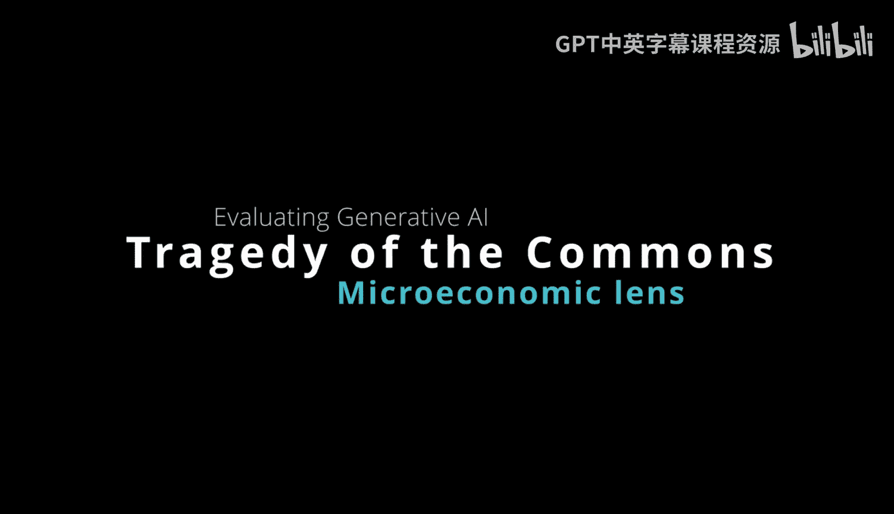
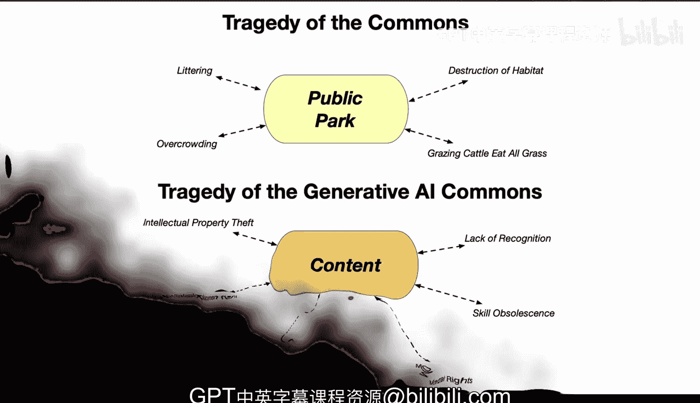

#  194：生成式AI的公共资源困境

## 概述
在本节课中，我们将要学习一个重要的经济学与社会学概念——“公地悲剧”，并探讨这一概念如何应用于生成式人工智能领域。我们将分析当一项资源被无限制地共享时可能出现的各种问题，并审视生成式AI在知识产权、就业、质量控制和伦理方面带来的具体挑战与外部性影响。

## 公地悲剧简介

上一节我们概述了课程内容，本节中我们来看看“公地悲剧”这一核心概念。

“公地悲剧”是一个经典案例，它描述了当一项免费资源被实际上无限数量的人群共享时可能发生的情况。

以下是几种可能发生的情形：

*   **乱扔垃圾**：人们可能到处乱扔垃圾，仅此一项就足以毁坏一个公共公园。
*   **过度拥挤**：如果没有管制，持续不断的人群涌入可能导致公园过度拥挤，最终使得人们无法游览公园。
*   **栖息地破坏**：例如，在国家公园内破坏某些自然景观或山体部分，会导致其不再像以往那样美丽。
*   **经典案例**：不同公司拥有牛群，一些牧场主会竞相让牛吃最多的草，因为他们担心别人会比自己消耗得更快。这演变成一场“逐底竞争”，很快草地就会被消耗殆尽，遭到破坏。

这就是“公地悲剧”的经典案例。事实上，根据各地的管制情况不同，你可以在世界范围内（包括美国）的某些公共公园看到这种现象。

## 生成式AI的公地悲剧

理解了传统公地悲剧后，本节我们来看看生成式AI领域存在的类似困境。

生成式AI的公地悲剧具有一些相似的特征。

以下是生成式AI可能引发的具体问题：

*   **知识产权盗窃**：生成式AI模型可能在未经授权的情况下，使用受版权保护的作品进行训练。这可能会贬低原作品的价值，甚至削弱创作者创作新内容的动力。如果作品会被窃取，为何还要创作更多？
*   **工作替代**：生成式AI存在风险，可能导致人类创作者的需求下降，进而引发工作替代，并产生相关的负面外部性。如果这些人无法再获得工作，社会就必须承担这种工作替代带来的负担。
*   **质量控制**：生成式AI的输出作品可能质量低劣，这甚至会贬低艺术家的价值，因为低质量作品看起来是在模仿该艺术家。这可能导致整体的质量控制问题。
*   **缺乏认可或归属**：创作者的作品可能在未经补偿的情况下被窃用，甚至他们作为原创者的身份也得不到认可。这会令人沮丧且不公，并可能严重影响该艺术家未来获得工作的机会。
*   **伦理关切或精神权利**：作者可能不希望自己的形象与吸烟、饮酒或其他恶习相关联，而生成式AI的使用者并未征得其许可。

因此，对于生成式AI而言，传统的公地悲剧场景并非神奇地不存在，这些问题同样存在。我们需要同时审视其益处（如总结、提纲生成、内容协同创作等强大功能）和负面外部性。

## 思考社会影响

上一节我们列举了生成式AI的具体问题，本节我们来思考其更广泛的社会影响。

我们需要审视对社会的影响，即社会并未从某些方面受益的情况。例如，如果是一个商业模型在获利，社会并未得到那份报酬，却必须支付成本。

这再次类似于在公园乱扔垃圾、过度拥挤或破坏公园：你必须为他人滥用资源的行为付出代价。

## 总结

本节课中，我们一起学习了“公地悲剧”的概念及其在生成式AI伦理中的体现。我们探讨了无管制共享资源导致的过度使用和破坏问题，并具体分析了生成式AI在知识产权、就业、质量控制和伦理方面引发的挑战与负面社会影响。在思考生成式AI的伦理时，考虑公地悲剧至关重要。