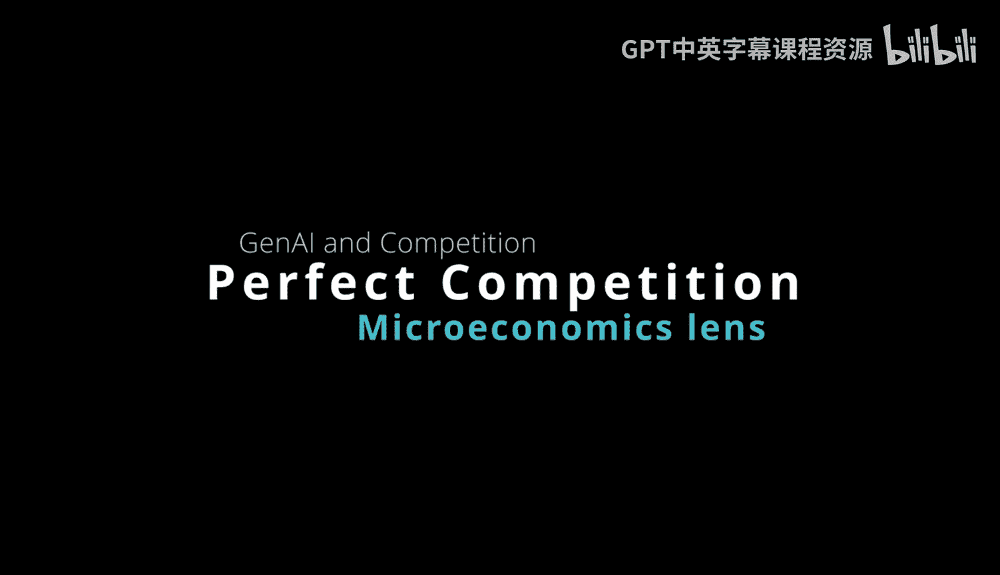
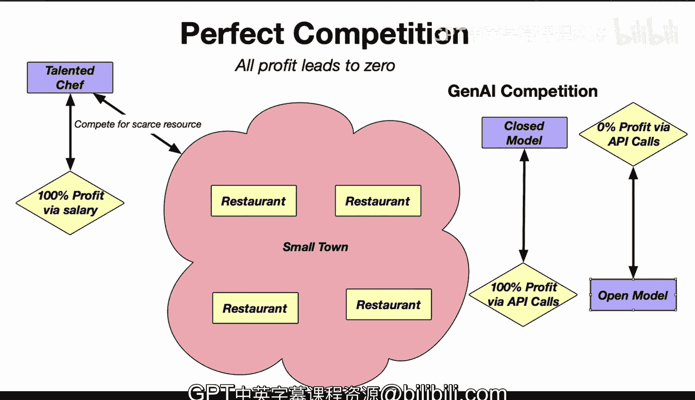
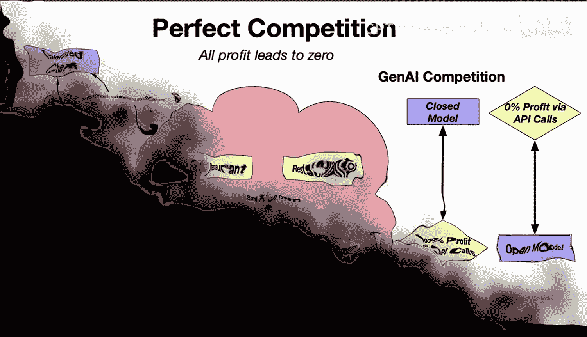

#  196：完全竞争市场中的AI战略思考 💡

在本节课中，我们将从经济学的“完全竞争市场”视角，探讨人工智能（AI）领域，特别是大语言模型（LLM）的商业策略。我们将通过类比和公式，理解为何在某些市场条件下，利润会趋于零，以及这对企业选择开源或闭源模型意味着什么。

## 完全竞争市场的核心逻辑 ⚖️

上一节我们介绍了课程背景，本节中我们来看看“完全竞争市场”的核心含义。在完全竞争市场中，长期来看，所有经济利润最终会趋向于零。

我们可以通过一个小镇餐馆的例子来理解这一点。假设一个小镇上有四家餐馆。起初，它们之间没有显著的竞争差异，直到一位才华横溢的厨师来到镇上。

这位厨师拥有稀缺且高需求的技能，能为餐馆吸引所有顾客。于是，各家餐馆开始竞相争夺这位厨师。

以下是餐馆间竞争的过程：
*   它们不断相互竞价，提供越来越高的薪水。
*   最终，厨师通过谈判获得了极高的薪酬。
*   厨师作为稀缺资源，捕获了所有的经济利润。

这意味着，雇佣厨师的餐馆老板最终可能面临破产，因为他们必须将所有利润支付给厨师，自身无法获得超额收益。

## 经济利润的定义与公式 📊

理解了案例，我们来看看其中提到的“经济利润”具体指什么。经济利润是指总收入减去总经济成本后的剩余。

其核心公式为：
**经济利润 = 总收入 - 总经济成本**

其中，总经济成本包含显性成本（如原料、工资）和隐性成本（如投资者期望的正常回报）。因此：
*   **正常利润**：是吸引投资所必需的最低回报，已被计入经济成本中。
*   **经济利润**：是超过正常利润的超额部分。在完全竞争下，这部分利润最终会被稀缺资源方（如案例中的厨师）获取，导致企业方经济利润为零。

## AI领域的类比：闭源模型的竞争 🏢

将上述逻辑应用到AI领域，我们可以观察到类似的情景。假设市场上存在一个性能卓越的闭源模型（如某个领先的专有LLM）。

就像所有餐馆都需要那位天才厨师一样，所有公司为了保持竞争力，都可能被迫使用这个最优的闭源模型。

在这种情况下：
*   使用该模型的公司之间无法凭借模型本身获得竞争优势。
*   公司的利润可能会大量转移至模型提供方，通过API调用费的形式被获取，正如餐馆利润被厨师获取一样。
*   模型提供方成为了稀缺资源，捕获了价值链中的大部分经济利润。

## 另一种情景：开源模型的竞争 🔓

另一方面，我们也可以设想另一种极端情景。如果所有模型都开源且性能相当，市场会变成怎样？

在这种情况下：
*   模型本身成为一种可自由获取的“商品”，就像Linux操作系统一样。
*   由于没有使用壁垒，公司无法通过拥有或使用某个特定模型来赚取超额利润。
*   训练和开发这些开源模型的公司可能难以盈利，最终面临倒闭风险。
*   竞争将转向其他维度，例如数据质量、工程落地能力、特定场景优化或用户体验等。

## 战略启示与总结 🎯

本节课中，我们一起学习了完全竞争市场理论及其在AI战略中的映射。我们通过厨师与餐馆的类比，理解了**经济利润**如何被稀缺资源方获取。进而，我们探讨了AI领域可能出现的两种情景：

1.  **闭源模型主导**：利润可能向模型提供商集中，使用者需支付高额API费用。
2.  **开源模型普及**：模型本身商品化、免费化，利润空间被挤压，竞争转向其他技术或服务层面。

这对于评估你的AI战略至关重要：是全力投入某个闭源模型以寻求短期性能优势，还是预见未来模型可能像基础设施一样普及，从而提前布局数据、工程化能力或垂直场景应用等更能构建长期壁垒的领域？这需要从经济学视角进行审慎思考。