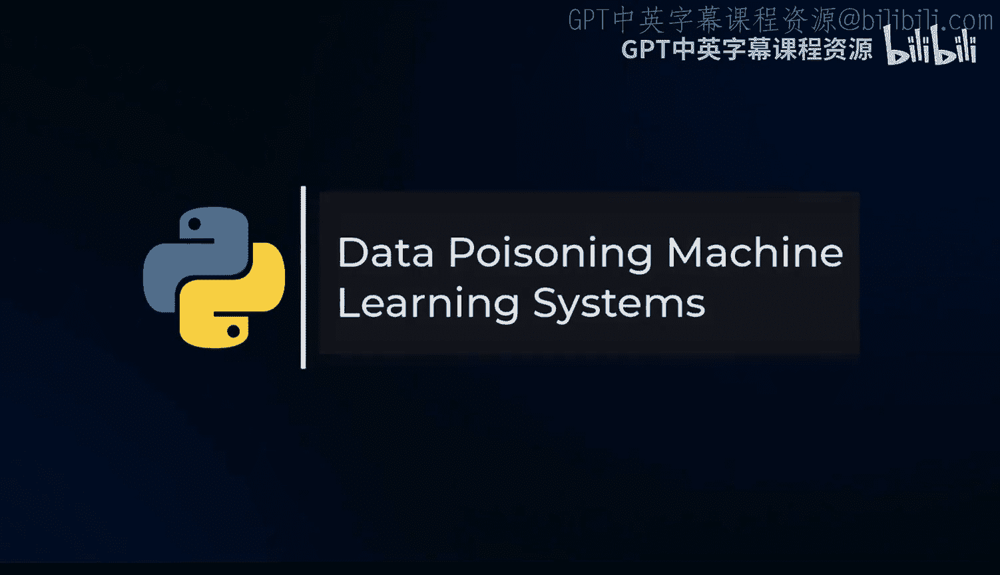
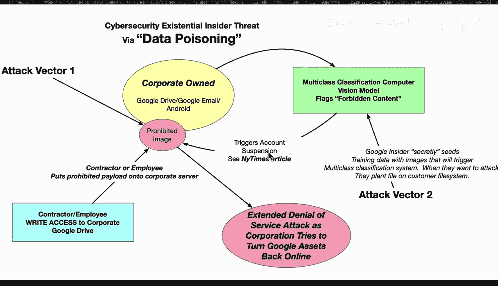

# 杜克大学｜机器学习运维｜DevOps⧸DataOps、Azure、MLFlow和抱脸｜MLOps ｜ Machine Learning Operations p01 08_01_10_机器学习系统中的数据投毒.zh_en -BV1yE421c7uA_p1-

Let's take a look at some insider threats that could occur via data poisoning。

 This is often not looked at in terms of a threat as what could an insider do into your organization。

 And this is why it's important to carefully consider the concept of principle of least privilege。

 So let's say in this first attack vector here。 we have a corporateown system。

 let's say Google Drive， email， etc cetera。 And we know that there's a particular type of image that could cause your Google Drive to go offline。

 So what could happen is that someone inside a corporation could willfully put a prohibited image inside of the Google Drive。

 which would then make sure that the corporation is offline。

 and it would take some time for that organization to be able to contact Google and explain exactly what happen。

 So this could be an extended。Deenial of service attack on a corporation as the corporation tries to turn the Google assets back online。

 So this is actually pretty sneaky but easy to do， depending on what privileges a employee has in an organization They know that。

 in fact， they could even put something that is very hard to find out that as a prohibited image。

 maybe it's a World War I image or something like that。 Now。

 a second one that is an attack vector is that potentially an insider could secretly seed training data with images that are known to trigger some kind of forbidden attack。

 And so in this case， they could plant a file on a customer system。

 and that system would train the data and eventually the multiclass classification model would see something that wasn't really there。

 they could plant essentially a false flag of forbidden。

And that particular organization could constantly get a denial of service attack because an insider was explicitly trying to take out another organizations。

 so in both cases here the training data that's planted or in the case of the prohibited image one of the ways that this could be mitigated is through regular auditing。

 reducing the principle of least privilege approach so making sure that people don't have more access than they need to。

 these are not theoretical attacks， it's very important to consider data poisoning as a real threat to many organizations as data NL gets more popular。

