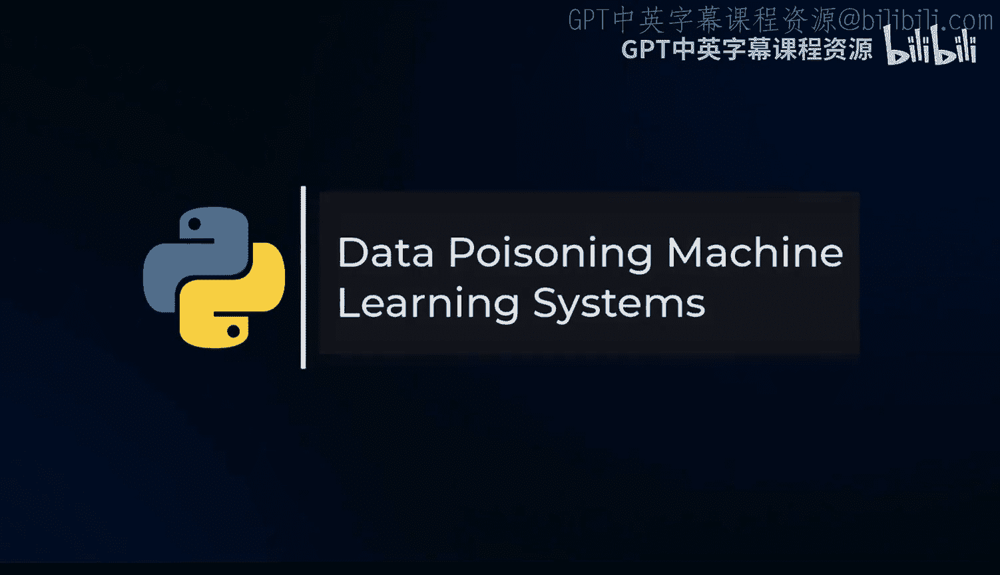
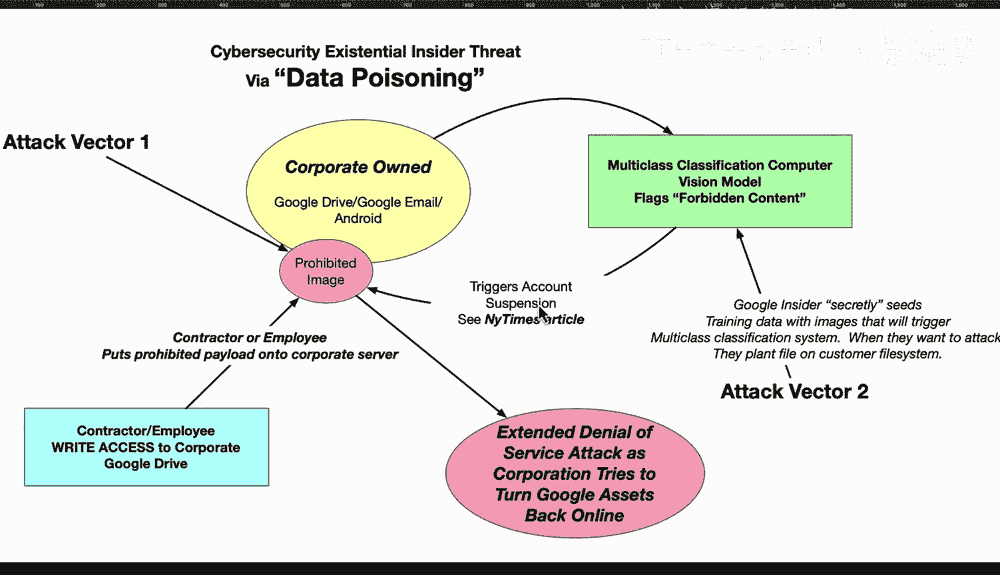

# 机器学习运维：01：机器学习系统中的数据投毒

在本节课中，我们将要学习机器学习系统中一种特定的安全威胁——数据投毒。我们将探讨其攻击向量、潜在影响以及关键的缓解策略。

## 概述

数据投毒是一种安全威胁，攻击者通过向训练数据中注入恶意样本，来破坏机器学习模型的性能或行为。这种攻击可能来自外部，也可能来自组织内部。本节我们将重点分析由内部人员发起的两种数据投毒攻击场景。

## 内部威胁与数据投毒

上一节我们介绍了数据投毒的基本概念，本节中我们来看看两种具体的内部攻击向量。

### 攻击向量一：利用企业系统漏洞

第一种攻击向量涉及利用企业自有系统的已知漏洞。例如，攻击者可能知道某种特定类型的图片会导致Google Drive等服务离线。

以下是这种攻击可能发生的步骤：
1.  企业内部人员蓄意将一个被禁止的图片上传至公司的Google Drive。
2.  该图片触发系统漏洞，导致整个公司的Google Drive服务离线。
3.  公司需要花费时间联系Google并解释情况以恢复服务。
4.  这实质上构成了一次针对公司的持续性拒绝服务攻击。

这种攻击方式相当隐蔽，其可行性取决于员工在组织内拥有的权限。攻击者甚至可能使用难以被识别为违规内容的图片，例如一张一战时期的图片。

### 攻击向量二：污染训练数据

第二种攻击向量是内部人员秘密地向训练数据中“播种”恶意样本。这些样本被设计用来触发某种被禁止的攻击模式。

以下是这种攻击可能发生的步骤：
1.  攻击者将一个特定文件植入客户系统中。
2.  该系统使用被污染的数据进行训练。
3.  最终训练出的多分类模型会“看到”实际上并不存在的模式，本质上植入了一个虚假的“违规”标志。
4.  由于内部人员蓄意破坏，目标组织可能因此持续遭受拒绝服务攻击。

## 缓解策略

在了解了上述两种攻击方式后，我们来看看如何缓解这些威胁。

以下是关键的缓解措施：
*   **定期审计**：对数据和系统访问进行定期审查，及时发现异常。
*   **实施最小权限原则**：确保员工只拥有完成工作所必需的最低权限，避免过度授权。

这些并非理论上的攻击。随着机器学习和数据应用的普及，将数据投毒视为对许多组织的真实威胁至关重要。

## 总结

本节课中我们一起学习了机器学习系统中的数据投毒威胁。我们分析了两种由内部人员实施的攻击向量：一是利用企业系统漏洞发起拒绝服务攻击；二是通过污染训练数据来破坏模型。最后，我们探讨了通过**定期审计**和贯彻**最小权限原则**来缓解这些风险的重要性。