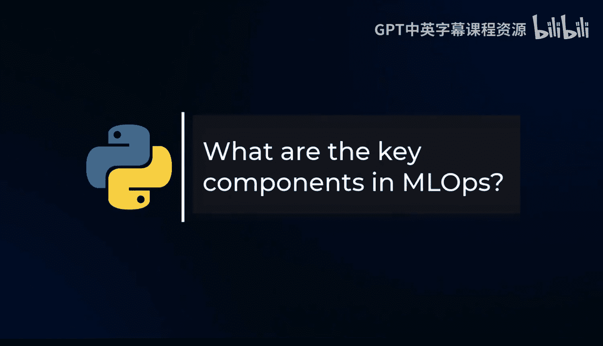
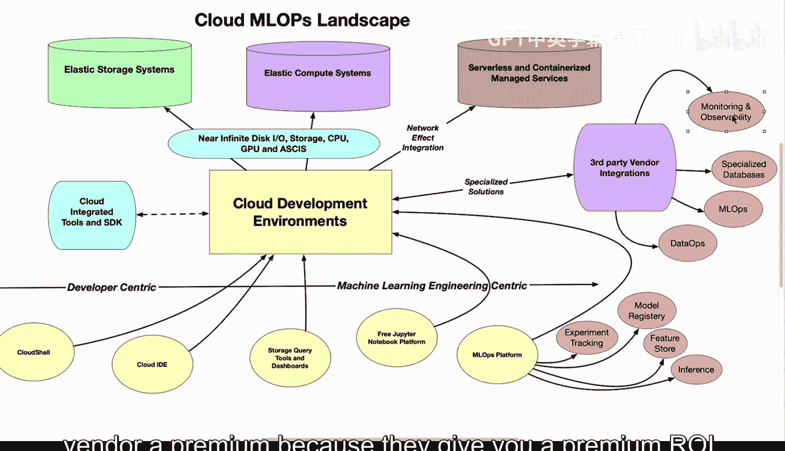

# 杜克大学｜机器学习运维｜DevOps⧸DataOps、Azure、MLFlow和抱脸｜MLOps ｜ Machine Learning Operations p02 09_01_02_MLOps关键组件是什么.zh_en -BV1yE421c7uA_p2-

Let's take a look at this cloud MLopps landscape here。

 It's important to know all of the key factors when doing MLops really if you are doing machine learning operations。

 you're gonna to most likely use something in the cloud even if you don't use their cloud MLOps platform let's take a look at some of the things that are available One。

 you have elastic storage system so you can scale up and down， do object storage。

 maybe mounted storage using a file system this is now becoming an emerging thing， in fact。

 is that many cloud providers are actually giving you mount pointss that the whole cluster can actually read and write to that don't have to actually use behind the scenes some kind of a Hadoop or sparkbased system。

 I think this is a trend we're gonna to see more and more of and as a result you get near infinite access to disko storage。

 CPU GPs， even specialized chips， Asics that allow you to do things like maybe。

A runun Tensorflow inference on a TPU。The elasticastic compute systems here again have the ability to expand according to your needs。

 you also have built on top of these are these serverless and containerized managed services。

 So this is the network effect and that cloud providers can provide things like AWS apprunner or AWs Lambda or Google Cloud functions and these built on top of the existing compute and storage。

 There's also these integrated tools and SDK。 you'll see that they're available in cloud shelllls or cloudbased development of Ormin。

 and these are tightly integrated with the vendor， and they allow you to build things very quickly using cloud computing。

And there's really a shift of developer centric， and this would be things to the left here on AWS。

 for example， or Azure or GCP， they have these Cloud shells， they also have cloud IDEs。

 more like a visual studio type environment。And then as you get a little bit more into the data and the machine learning side。

 you'll see that every vendor has a storage query tool and a dashboard。

 a good example would be Amazon has Athena where you can do SQL queries against object storage。

 Google has Bigquery， where you can do SQL queries against their distributed storage system。

And then finally as you get into the machine learning phase here you'll see that there's Jupyter notebookbased platforms。

 there's MLOps platforms， almost all cloud providers have this concept of in MLOs platform experiment tracking。

 model registry， feature store inference Now it may not be exactly what you'd like and so that's why there are also specialized solutions so you can think of these as the kind of the core building blocks and a lot of times the thirdparty vendors will then tap into those core capabilities so there's data ops you know you can look at things like databs or snowflakes MLOs as well there's lots of MLOps platforms。

 specialized databases， maybe graph databases or time series databases。

 monitoring and observability things like Datadog or new relic these are all thirdparty vendors that fit really tightly into the cloud environment but also allow you to expand beyond it to make。

Specialized solutions so really when someone is thinking of MLOs。

 they need to also be aware of the entire ecosystem behind MLOs and choose what are the things that are more commodity that you want to actually use and what are the specialized services where you want to pay a vendor。

 you a premium because they give you a premium ROI。

