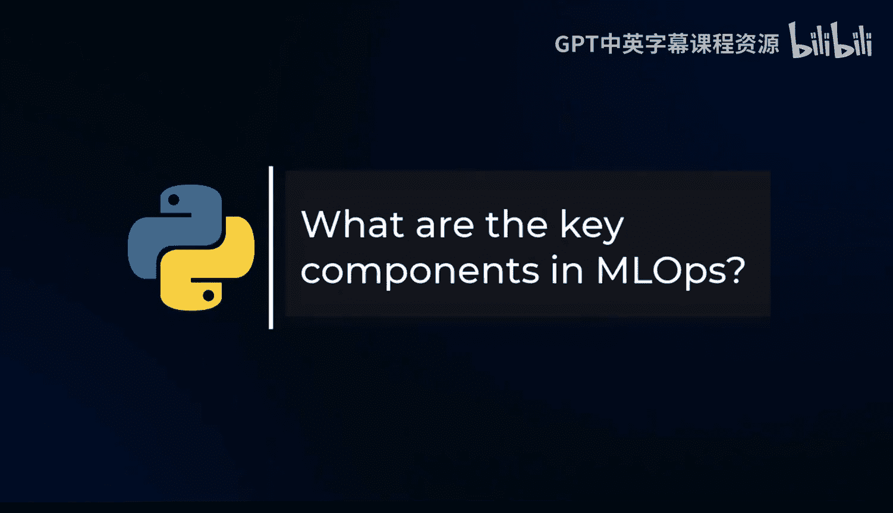
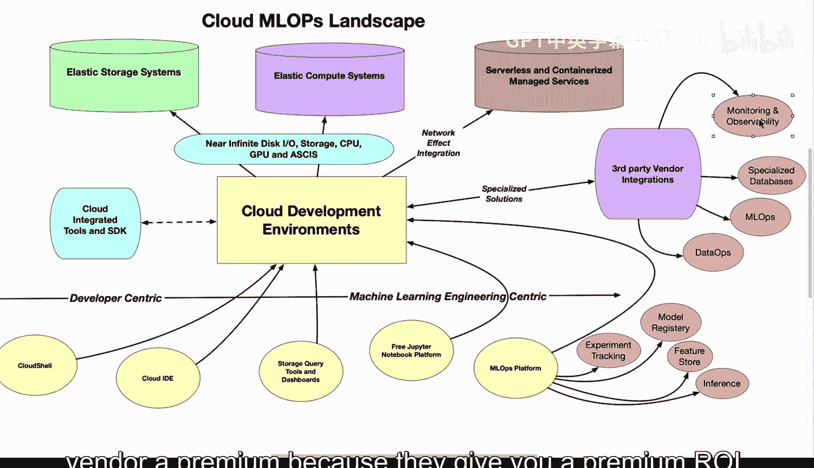

# 机器学习运维：02：MLOps关键组件是什么

在本节课中，我们将探讨构成现代机器学习运维（MLOps）生态系统的关键组件。我们将了解云服务商提供的核心基础设施、工具和服务，以及如何根据需求选择通用服务或专业解决方案。

## 云环境下的MLOps全景图

进行机器学习运维时，了解所有关键要素至关重要。即使不使用云服务商提供的完整MLOps平台，也很可能用到云环境中的某些服务。让我们来看看一些可用的核心组件。

## 核心基础设施组件

以下是构成MLOps基础的核心云服务。

### 弹性存储系统

弹性存储系统允许你根据需求扩展存储容量。这包括对象存储，以及使用文件系统的挂载存储。目前一个新兴趋势是，许多云提供商提供整个集群都可以读写、无需依赖Hadoop或Spark等系统的挂载点。这一趋势带来了近乎无限的磁盘存储访问能力。

### 弹性计算系统

弹性计算系统同样可以根据你的需求进行扩展。这包括CPU、GPU，甚至允许你在TPU等专用芯片上运行TensorFlow推理的ASIC。

### 无服务器与容器化托管服务

建立在上述计算和存储基础之上的是无服务器和容器化托管服务。这是云提供商利用网络效应提供的服务，例如AWS App Runner、AWS Lambda或Google Cloud Functions。

## 集成开发工具与SDK

云服务商提供了紧密集成的工具和软件开发工具包（SDK）。

这些工具通常以云Shell或基于云的开发环境（如AWS Cloud9、Azure Cloud Shell、Google Cloud Shell）的形式提供。它们与供应商平台深度集成，使你能够利用云计算快速构建应用。

开发体验正日益以开发者为中心。例如，在AWS、Azure或GCP上，你可以找到云Shell和类似Visual Studio的云端集成开发环境。

## 数据与机器学习专用服务

随着工作重心转向数据和机器学习，你会发现每个供应商都提供了相应的工具。

### 存储查询工具与仪表板

每个主流云服务商都提供了针对其存储系统的查询工具和可视化仪表板。
*   **Amazon Athena**：允许你对对象存储执行SQL查询。
*   **Google BigQuery**：允许你对其分布式存储系统执行SQL查询。

### 机器学习与MLOps平台

进入机器学习阶段后，你会看到基于Jupyter Notebook的平台和专门的MLOps平台。

几乎所有云提供商都提供了集成了实验跟踪、模型注册、特征存储和模型推理等功能的MLOps平台。虽然这些平台功能全面，但有时可能无法完全满足特定需求。

## 第三方专业解决方案

正因为云平台的原生服务可能无法满足所有需求，市场上也涌现了许多第三方专业解决方案。你可以将这些云核心能力视为基础构建块，而第三方供应商则在此基础上提供更专业的服务。

以下是主要的第三方解决方案类别：
*   **DataOps平台**：例如Databricks或Snowflake，专注于数据工程和数据分析流水线。
*   **专用MLOps平台**：提供更灵活或更强大的机器学习生命周期管理工具。
*   **专用数据库**：如图数据库或时序数据库，用于处理特定类型的数据。
*   **监控与可观测性工具**：例如Datadog或New Relic，用于监控系统性能和健康状况。

这些第三方供应商不仅能够紧密融入云环境，还能帮助你超越单一云平台的能力，构建更专业、更定制化的解决方案。

## 总结

本节课中，我们一起学习了现代MLOps生态系统的关键组件。我们了解到，MLOps不仅依赖于云服务商提供的弹性计算、存储、无服务器服务和集成开发工具等核心基础设施，还涵盖了从数据查询到机器学习平台的全套服务。同时，第三方专业解决方案在特定领域提供了更深度的功能。因此，在规划MLOps时，需要全面了解整个生态系统，明智地选择哪些需求可以使用通用的云服务来满足，哪些则需要投资于能带来更高投资回报率的专业供应商服务。

