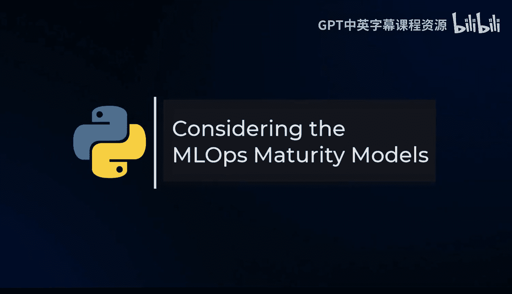
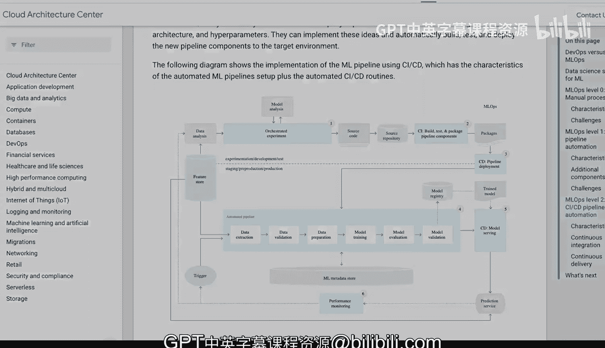

# 杜克大学｜机器学习运维｜DevOps⧸DataOps、Azure、MLFlow和抱脸｜MLOps ｜ Machine Learning Operations p03 10_01_03_MLOps成熟度模型考量.zh_en -BV1yE421c7uA_p3-

All major vendors in the MLopp space have the concept of an MLops maturity model。 Really。

 what it means is there are several different phases of going from a crudeed working where you can barely get things into production and things are error prone and manual all the way to a very sophisticated system that has really in automation and users the next generation of features。

 So let's go ahead and dive into how these different vendors compare against their MLl maturity models。

First up， we have the AWS platform here。 and let's take a look at how they think about MLops maturity。

 you can see that in terms of getting models into production or operationalizing thing that the more you have these capabilities。

 the more models are going to be in production， the faster you can go the more mature your organization is。

 So initially you have to have the ability to experiment， if you can't experiment。

 it's going be very difficult to put anything into production。 Next step。

 you have repeatability are you able to standardize your code， your reos。

 make sure that there's maybe a platform that you're using that can actually deploy the solution and this is critical to get to the next level。

 and then in terms of reliable then you'd want to go into testing can you actually test the production capabilities are you monitoring for data drift for new versions。

 Can you actually have multiple accounts， for example。

 a isolated account for production and isolated account。

Staging an isolated account for development then finally at the final you know stages here you have scalable。

 you're able to tempize and productionize a lot of different email solutions， not just one。

 but actually have a scalable system that you can repeat over and over again。

Now let's go ahead and move on to Microsoft here and with Microsoft they also have the concept of a maturity model and they consider phase1。

 no MLOs and you can see it's difficult to deploy the teams are all broken up It's a black box system you have no idea if it works or not the next would be you have some Devops so some organizations are really in a good spot in that they at least have Devops but they're still painful releases because they don't have the key capabilities of machine learning。

 like for example， feature stores and data drift detection next step in level two there's automated training。

 So the whole thing is able to be done for example。

 you can retrain the model if there's a datad that's been detected and then finally in these last two phases we have automated model deployment so releases are trivial it's easy to have a training environment。

 a testing environment and a production environment and then finally everything is fully on。

There's no downtime。 you can keep on making new models。

 So key key points here in both the AWS and the Microsoft is the automation factor。

 Now let's go ahead and take a look at Google and Google's view the world ML ops level 0 is a manual process there's many teams that have data scientists and ML researchers and you can see here that there's a separation though between machine learning and ops。

 everything is entirely manual So if we go to the next level which is a pipeline automation level。

 The goal here is that you're continuously trained the model because things are automated so you have some level of automation because potentially there's a data drift detected and you have all of your features and a feature store and you're able to automatically train the model when it's appropriate。

 Finally we have the CICD pipeline automation。 So finally the last phase here is not only do you have the model training automatically but you're continuous。

Integration， your continuous delivery system is able to fully deploy the system。

 It's packaged up correctly。 And so you've got 100% end to end automation。

 So this is really the key with three of these vendors is the concept of continuously deploying systems through automation and having enough integration so that you have a production first mindset。

