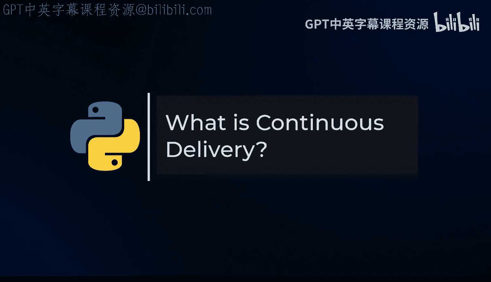
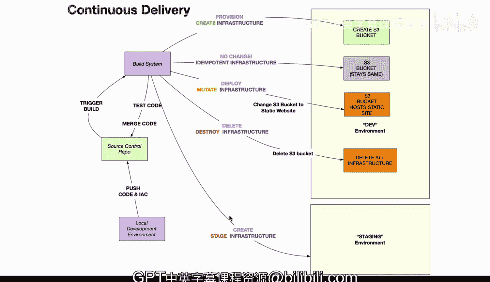

# 机器学习运维：05：什么是持续交付 🚀

在本节课中，我们将学习持续交付的核心概念。我们将通过一个使用现代云原生工具的持续交付工作流程，来理解如何自动化地将代码变更安全、可靠地部署到多个环境。

---

上一节我们介绍了持续交付的基本理念，本节中我们来看看一个具体的工作流程示例。

工作流程通常始于开发环境。开发人员经常使用基于云的环境，例如 AWS 的 Cloud9 或 Azure 平台的 GitHub Codespaces。使用这些云原生环境的原因是，它们提供了与后续生产环境一致的开发工具链。

因此，你拥有一个与生产环境高度相似的一对一开发环境。

在构建应用时，你不仅会推送软件代码，还会推送“基础设施即代码”。基础设施即代码允许你定义在云环境或 Kubernetes 环境中运行的每一个细节。

请注意，当你推送变更时，构建系统将自动执行以下操作：测试你的代码、合并代码。随后，这个构建版本会自动进入“资源调配”阶段。

基础设施即代码的强大之处在于它是**幂等**的。

这意味着它只在必要时才做出更改，并且始终确保环境处于预期的相同状态。

例如，如果你最初创建了基础设施，在进行第二次构建时，它不会再次创建基础设施，因为它会检测到（比如这里的 S3 存储桶）已经存在，因此无需重复操作。

同样地，如果你修改了基础设施即代码的配置，做了一个小改动，系统会检测到差异并为你创建一个新的存储桶。

最后，如果需要清理资源，使用基础设施即代码可以轻松完成。

以下是你可以执行的几种强大操作：

*   **删除操作**：清理不再需要的资源。
*   **创建新环境**：你可以选择不删除，而是基于代码和基础设施配置创建一个新的“预发布”环境。这个环境用于进行负载测试。
*   **创建生产环境**：同样地，你可以再次复制代码和基础设施配置，以创建一个“生产”环境。

这种使用代码来定义系统、并进行幂等变更的理念，是持续交付的重要组成部分。它使你能够持续地将变更推送到新环境。

这并不意味着无需人工干预就能直接推送到生产环境，但它确实允许你向多个环境进行自动化推送。这正是持续交付的关键概念。

---

本节课中我们一起学习了持续交付的工作流程。我们了解到，通过结合云原生开发环境和“基础设施即代码”的幂等性，可以实现代码的自动化测试、构建以及向多个环境（如预发布、生产）的安全、可靠部署。这是实现高效、可控软件交付的核心。