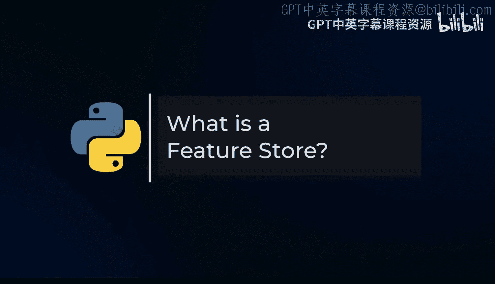
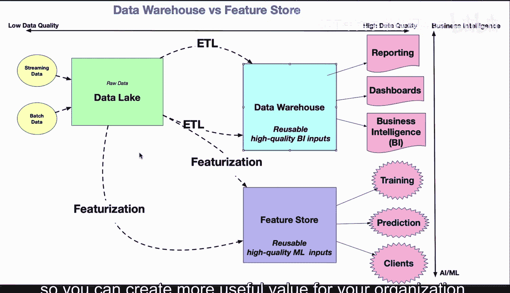

# 杜克大学｜机器学习运维｜DevOps⧸DataOps、Azure、MLFlow和抱脸｜MLOps ｜ Machine Learning Operations p06 13_01_06_什么是特征存储.zh_en -BV1yE421c7uA_p6-

Data warehouse and a feature store have different characteristics， on one hand。

We can look at this picture from a low quality data angle。 So if you take a look at a data lake here。

 it could be a combination of streaming data， batch data， unstructured data， structure data。

 So you really have to do a lot of work to clean this up。 Now， in this particular problem。

 What could you do， Well， you could take that data that's raw inside of the data lake and do feturization and put together high quality cacheable reusable features inside of a feature store that would then be used for training prediction clients also going through an auditing。

pottentiialally developing automatic correlations， all of these things are a component of a feature store。

 so really it's a refinement of what's in the data lake so that the machine learning systems have this high quality access to features that will be used to train models。

Another different kind of resource is a data warehouse。

 and so the idea here is it's more shifted for reporting dashboards， business intelligence。

 but in both categories， either feature store or a data warehouse。

 you can see that it's high quality data。The one difference here is that the business intelligence side is on the data warehouse component and the AIMl side is on the feature store。

 so there isn't necessarily a hard or fast rule there could be some overlap between a feature store and a data warehouse。

 but really the idea here is you're migrating the lower quality data that's unstructured and not cleaned and converting automation tools like ETL pipelines and featturization pipelines into these high quality resources so you can create more youthful value for your organization。

