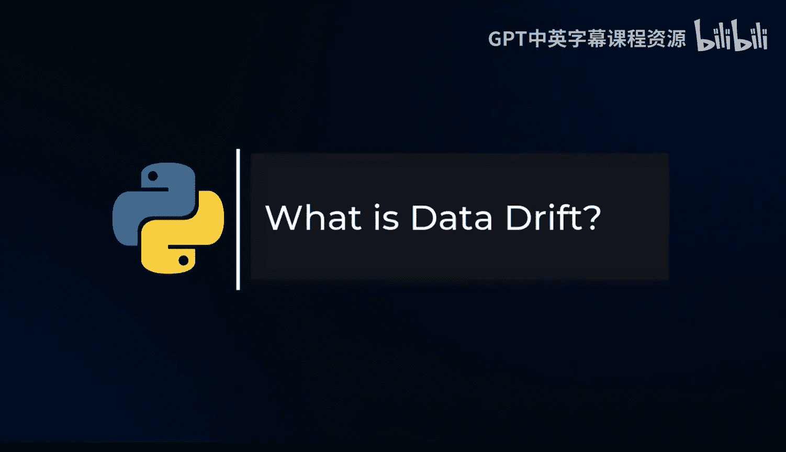
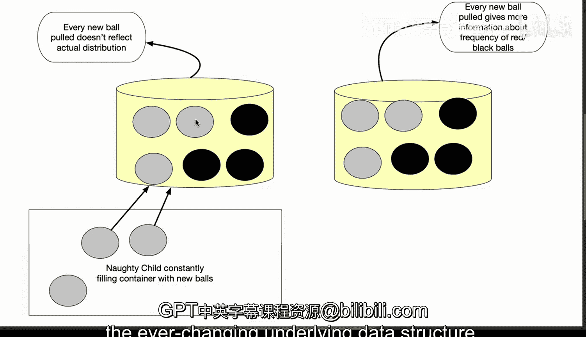

# 杜克大学｜机器学习运维｜DevOps⧸DataOps、Azure、MLFlow和抱脸｜MLOps ｜ Machine Learning Operations p07 14_01_07_什么是数据漂移.zh_en -BV1yE421c7uA_p7-

Here's a great example of one of the problems with data drift in the real world。

 This is from Nassum Teb， who is the author of the Black Swwaan and also other books on probability。

 one of the examples he gives in his books is this concept of。

 you know when you grab more balls out of a container。

Each new ball gives you more information about the frequency of the red Va versus the black ball。

 right， And so in this case， we see things are static。 And so the more information you get。

 the better it is。But in the real world， because data is dynamically changing。

 it isn't necessarily the case that you're always going to get an accurate representation of what the state of the world is and one example it brings up is imagine the same scenario where the bottom has an access panel and there's a child in there that's constantly filling the access panel with new balls it could potentially be disrupting your knowledge even though you're grabbing more and more balls out of the container。

 it actually doesn't give you any more information because the distribution of the black balls versus red balls is constantly changing and so this is really the corerk idea with data drift is that if the data is constantly changing you may not actually have the information you think you have and this is why retraining a model constantly in many scenarios is the best situation to address this concept of the ever changing underlying data structure。

