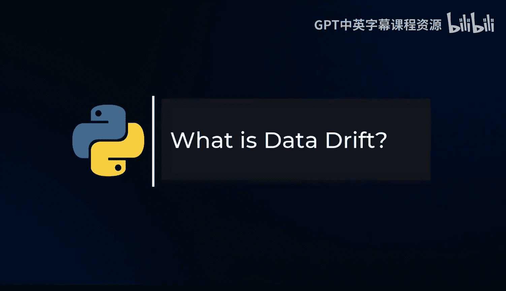
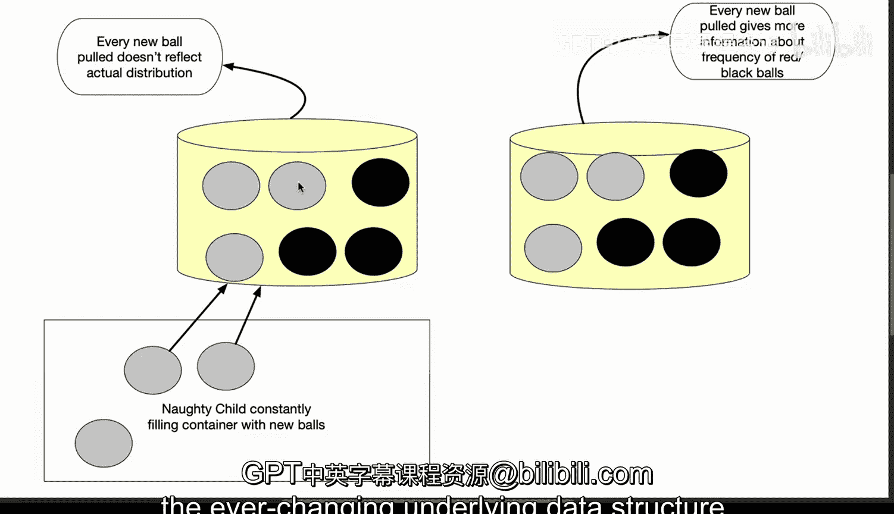

# 机器学习运维：07：什么是数据漂移 📊



在本节课中，我们将要学习机器学习中的一个核心挑战：数据漂移。我们将通过一个生动的比喻来理解其概念、成因以及应对策略。

## 概述

数据漂移是指模型在生产环境中运行时，其输入数据的统计属性随时间推移而发生变化，导致模型性能下降的现象。理解数据漂移对于维护机器学习系统的长期有效性至关重要。

## 核心概念：一个生动的比喻

上一节我们介绍了数据漂移的重要性，本节中我们来看看一个经典的比喻，它清晰地阐释了数据漂移的核心问题。

这是一个来自现实世界的绝佳例子，说明了数据漂移带来的问题之一。这个例子源于纳西姆·塔勒布，他是《黑天鹅》及其他概率论相关书籍的作者。

他在书中给出的一个例子是关于这个概念的：想象你从一个容器中不断取出球。每个新取出的球都能让你更了解红球与黑球的出现频率。在这种情况下，我们看到事物是静态的。因此，你获得的信息越多，情况就越好。

但在现实世界中，由于数据是动态变化的，你并不一定能总是获得对世界真实状态的准确反映。他提出的一个例子是：想象同样的场景，但容器底部有一个活动面板，里面有一个小孩在不断地向活动面板里填充新球。这可能会破坏你的认知，即使你从容器中取出的球越来越多，实际上也并未给你带来更多信息，因为黑球与红球的分布一直在变化。

所以，这确实是数据漂移的核心思想：如果数据不断变化，你可能并不拥有你认为自己所拥有的信息。这就是为什么在许多场景下，持续重新训练模型是应对这种不断变化的底层数据结构的最佳方案。

## 关键要点与应对策略

以下是关于数据漂移的几个关键要点：

*   **静态与动态的差异**：在静态环境中，更多的数据样本（`n`）会带来更准确的估计。公式可以表示为：`估计准确度 ∝ √n`。但在动态变化（数据漂移）的环境中，这个关系不成立。
*   **分布变化是核心**：数据漂移的本质是底层数据概率分布 `P(X)` 或 `P(Y|X)` 发生了变化。
*   **持续监控与再训练**：应对数据漂移的标准做法是建立监控系统，当检测到显著漂移时，触发模型的再训练流程。伪代码如下：
    ```python
    if detect_data_drift(current_data, training_data):
        retrain_model(new_training_data)
        deploy_new_model()
    ```

## 总结



本节课中我们一起学习了数据漂移的概念。我们通过“取球”的比喻理解了，在数据动态变化的世界里，简单地收集更多数据并不总能改善我们的模型，因为数据的统计特性本身可能已经改变。因此，在机器学习运维中，建立对数据漂移的持续监控和模型更新机制，是保证系统长期健康运行的关键。