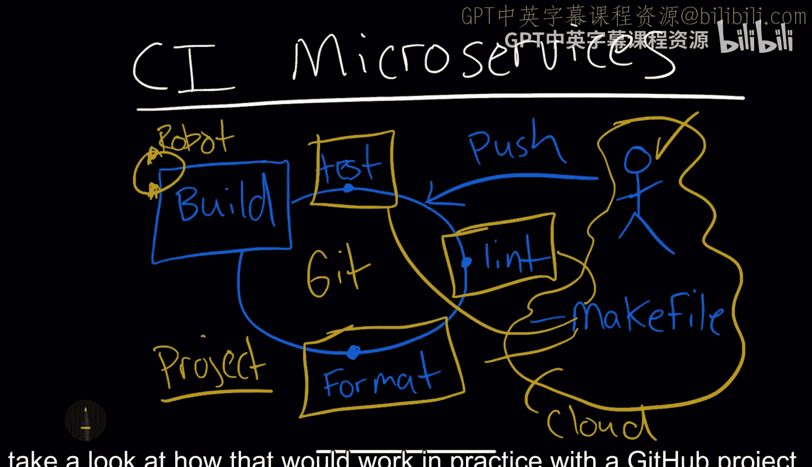
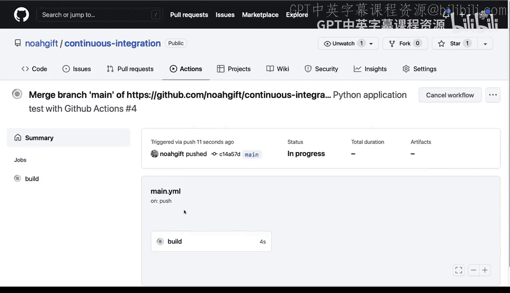
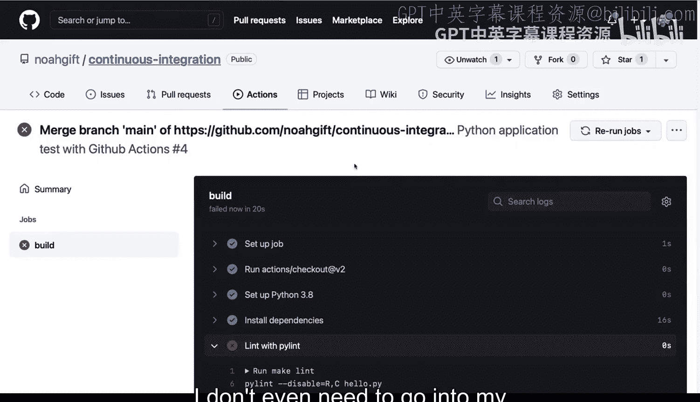
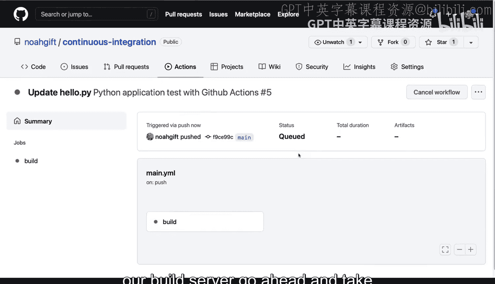
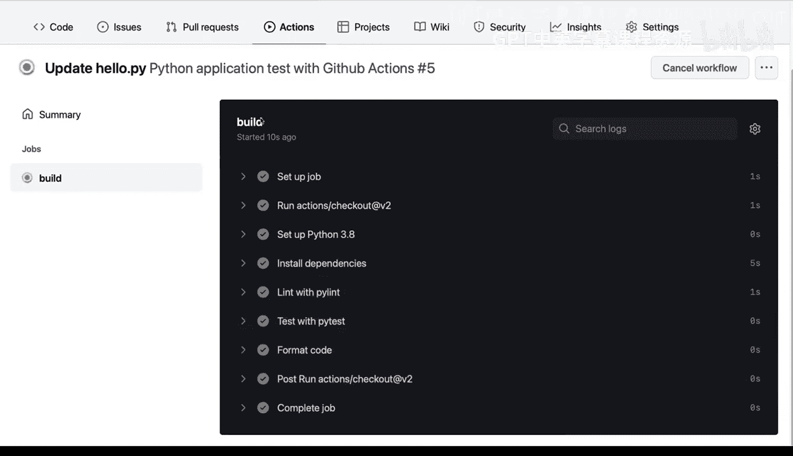
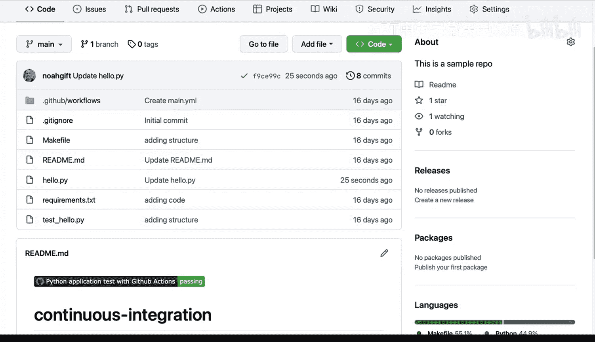

# 机器学习运维：P09：微服务持续集成

## 概述
在本节课中，我们将学习如何为微服务项目建立一个持续集成生态系统。我们将从项目结构开始，了解如何通过本地和自动化流程来测试、检查代码格式和运行代码，确保每次代码提交都保持高质量。

---

## 项目结构与核心概念
首先，我们来看一个为持续集成和后续持续交付设置好的项目结构。一个配置得当的项目是成功的第一步。

以下是此类项目的关键组成部分：

1.  **Github工作流目录**：此目录包含构建系统的配置文件。在本例中，我们使用Github Actions，但你也可以使用Jenkins、AWS Code Build等其他系统。
2.  **主配置文件**：通常是 `.github/workflows/main.yml` 文件，它定义了在每次代码推送时自动执行的操作序列。
3.  **Makefile**：这是一个核心文件，它包含了一系列“配方”，用于在本地或构建服务器上执行标准化命令，如安装依赖、代码检查、测试和格式化。
4.  **源代码与测试文件**：包含项目的主代码文件以及对应的单元测试文件。
5.  **依赖管理文件**：例如 `requirements.txt`，它固定了项目依赖包的版本，确保开发环境与构建环境的一致性。
6.  **README文件**：提供项目说明，通常包含构建状态徽章。

这种结构的核心优势在于，开发者可以在本地使用 `make` 命令执行所有质量检查，而构建服务器（机器人）会在代码推送后自动重复这些步骤，确保持续的质量保障。

---

## 实践：在Github项目中工作
上一节我们介绍了项目结构，本节中我们来看看它在Github项目中的实际运作。

我们进入一个基于云的开发环境（Github Codespaces）来查看和操作这个项目。在这里，我们可以运行命令并观察当代码出现问题时，系统如何快速检测到失败。

在终端中，我们运行 `make all` 命令。这个命令会依次执行：
*   `make install`：安装项目依赖。
*   `make lint`：运行代码检查工具。
*   `make test`：运行单元测试。
*   `make format`：格式化代码。

如果所有步骤都通过，我们会收到一切正常的反馈。现在，我们故意在代码中引入一个错误，例如将一个变量赋值给它自身（这是一个无操作且可能导致问题的代码）。当我们再次运行 `make lint` 时，代码检查工具会立即捕获这个“错误”或“警告”。

接着，我们将这个有问题的代码推送到Git仓库。

---

## 自动化构建与修复流程
当我们推送代码后，Github Actions构建服务器（机器人）会自动开始工作。它会拉取最新代码，在一个干净的Ubuntu虚拟环境中，按照 `main.yml` 的指示，依次执行 `make install`， `make lint`， `make test` 和 `make format`。

由于我们推送的代码存在代码检查问题，构建流程会在 `make lint` 这一步失败，并在Github上明确标记此次构建为失败状态。

修复问题非常简单。我们甚至不需要打开本地开发环境，可以直接在Github的网页界面上编辑有问题的文件，删除多余或错误的代码行。提交这次修复后，构建服务器会再次启动。这次，所有步骤（安装、检查、测试、格式化）都将顺利通过，构建状态恢复为成功。

这个过程展示了持续集成的核心价值：它是一个自动化的质量守门员，持续地清理和检查代码，确保只有符合标准的代码才能被集成。

---

## 总结
本节课中，我们一起学习了为微服务建立持续集成系统的关键步骤。我们了解了标准的项目结构，其核心是一个能统一执行安装、代码检查、测试和格式化的 **`Makefile`**。我们看到了如何在本地使用这些命令，以及如何通过 **Github Actions** 配置自动化构建服务器，使其在每次代码推送时自动执行相同的质量检查流程。这种实践能显著提升代码质量和开发效率，是软件工程，特别是Python微服务开发中的推荐做法。