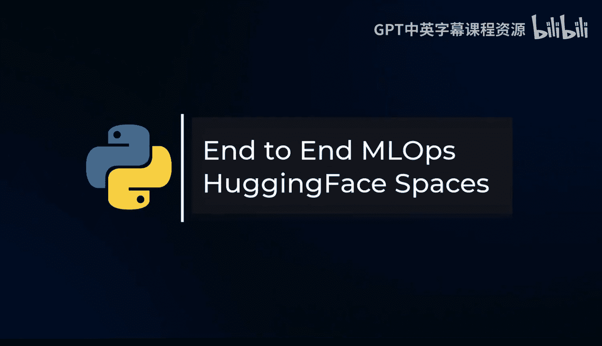
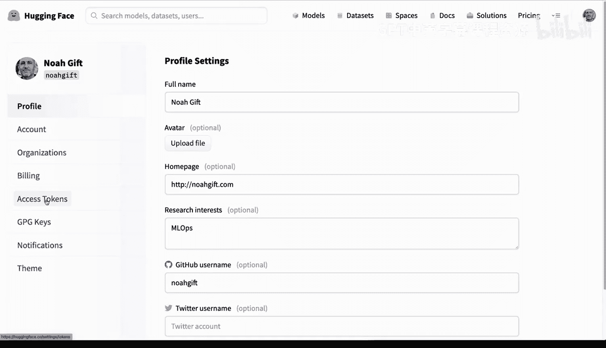
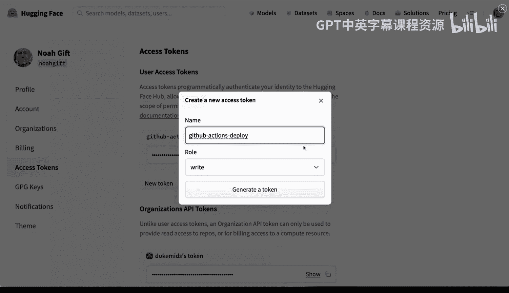
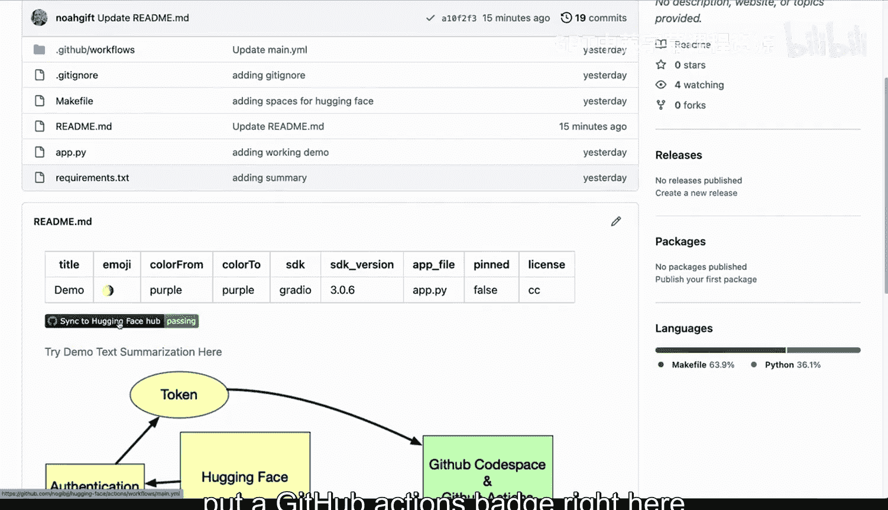
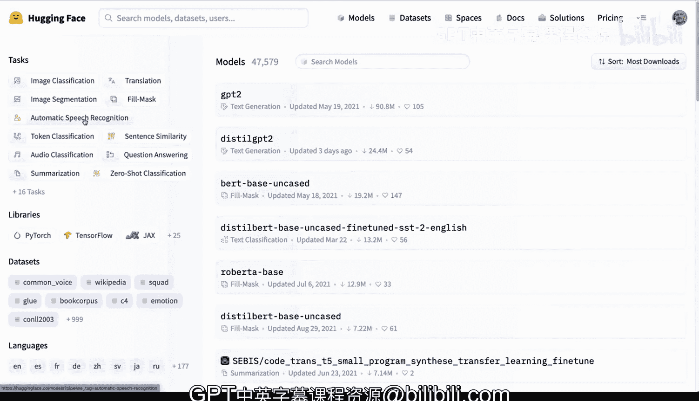

# 杜克大学｜机器学习运维｜DevOps⧸DataOps、Azure、MLFlow和抱脸｜MLOps ｜ Machine Learning Operations p10 17_01_04_端到端MLOps-HuggingFace-Spaces实践.zh_en -BV1yE421c7uA_p10-

Hi， my name is Noah Giift， and I'm the author of Pra M L Ops。

 and I'm going to talk a little bit about an M L ops recipe next by taking hugging face a popular pre train model site。

 and I'm going to build a end end solution using Github actions to push a model directly into their spaces location and then demo out a working application。

 Allright， let's go and get started。Let's take a look at this application of a Huging face MLopps workflow。

 First up， I'm going to go to Huging face and I'm going to require a authenticated account so that I can have a token here。

 Once I have this token， I'm going go over to GiHub and I'm going to launch a Github codespace so I can develop my application locally。

 and once I've developed it， I'll programmatically push it using Github actions。

 This will be able to use a hugging face model that it was actually able to pull from Huging face it'll go into hugging face spaces and use a technology called radio。

 I'll build on an app and then I'll be able to do text summarization using that application。

 Let's go ahead and get started。All right， we're in Huging face and the first thing to do is make sure you have an account。

 so go ahead and create an account at Huging face and then I'll give you a brief overview we have models。

 data sets， spaces， doc solutions， pricing。Really what we care about is models here and spaces。

 we click on models。 you can see there's many different things that you can do。

 and this is one of the powerful things about this platform。

 there's 45 or 47000 models and we go to spaces This is where you would go ahead and host your ML app and even further we can actually do this via continuous delivery。

 So first up what I would do is I would create a new space and I'm going to call this demo to and inside of here we can put some kind of a license like Creative Commons and then I would select radioio as my solution for serving out the MLops application and I'll go ahead and say create space at this point is pretty straightforward all I need to do is clone this repo and start working on it somewhere else。

 So my favorite place to work is the Github codespaces environment and later I'm going to push this using。

😊，Gtub code spaces， so let's go ahead and head over there What I'm going to do is I'm going to say new repo。

And we'll go ahead and call this hugging。Face。Demo 2。And I will go ahead and just add a readme file。

 put a Python get ignore here and Creative Commons as well。

 there we go C the repo Now what's great about my environment here is that I'm going to go ahead and I'm going to click on code。

And I'm going to enable a different environment called create codespaces。

 And so what codespaces will allow me to do。Is code spaces will actually let me select a larger environment so this is handy for machine learning。

 look at this 16 core 32 gigs of Ram， 128 gigs of storage。

 let's go ahead and select that and let's go ahead and launch it inside of this environment。

Now next all I really need to do here is build out a scaffold for a project。

 this is something I recommend in any project is to build out a structure for it so you can get started。

 make this a little bit bigger so the first part that I would build out would be that I would create a virtual environment and this is a helpful thing to do for our project virtually in V。

Here we go and then next up， what I will do is I will edit my Bshar C file here。

And this Bar sea file。At the very bottom， I'll just source things。

 so I'll say source tilde dot V E and V。Been activate。And now。Every time I open up a shell。

 it will have a virtual environment great we got that working and then I'll create a requirements file。

I'll also create a app。t py and I'll also go ahead and create。A make file as well there we go。

 This looks pretty good and because I've already done some of this stuff earlier。

 I'm just going to copy this inside and so I'm going to take a make file here and I'm going to paste some things inside really the big takeaway for the make file is that it it's a nice way to deal with dependencies and then I'll also go through here and I'll put in a requirements file which will have the requirements that I need for my project that the main ones to be aware of。

Is radioio also the transformers and in my case I prefer to use TensorFlow。

 so I'll go ahead and use TensorFlow next up what I will do is put my application code inside of here。

And in this case this application will use the transformers。

 which allows me to load any model from TensorFlow。

 will also use radio which will be the user interface I'll go ahead and make my model right here I'll have a predict function and this case it'll grab the output from the model and it will summarize the text and I use this piece of code here with GR。

 blocks as demo and I go through here and I create a text block and then I launch my interface。

 so only a few lines of code to make a full working application that summarizes text。

 how do I get this working I'll just say make install。

There we go and once I go ahead and I do a make install。

 this will allow me to use the super powerful environment I have。

 which is again why I like codespaces， I like developing the cloud in general because I can pick very powerful machines to work with temporarily。

All right， so we're able to get that answer， it's able to summarize the text into just a few sentences and it looks logical to me。

Now， this is great because this is something I can play around with， but for me。

 MLops is about getting it into production。 So in order to do this。

 we'll need to do a couple other steps。 First， we'll have to go over to Huging face。

And we'll go over to your profile in this case and you can see that this is my profile and then I want to go to the settings once I go to settings I can create access tokens I'll want to create a new access token right here and it'll be a read and write token this would be for doing Github actions deploy just like that and then this will go through here and deploy a token in this case there we go。

 I can grab that token。

And I can copy it and then all I would need to do is go back to this application and go over to repository。

and go to settings and go to secrets and I would create a secret right here for actions and we'll say there's no secrets yet。

 so we'll go ahead and do this and I would paste that in there so I'm going to first call this HG hugging face。

 paste the secret in here， add the secret and now that's all I need to do to get the deploy working other than editing an action so next I'll go ahead and create an action right here and let's go ahead and set up workflow ourselves。

And what I'll do is since I already have a working actions， I will go through here and take my。

Mean here。And I will go ahead and paste it in， so let's go ahead and take a look at this and let's paste this in right here。

And if if we go through here， we can see that all this looks good and what it's going to do iss going to take that secret and it's going to do a get remote ad space right here and it's going to push this in this case this would be to demo to and then this one would be to demo to as well so this would just need to match whatever your。

Whatever your code space is inside of hugging face。

 and then you would just go ahead and commit that once you've committed it。

Then it's basically ready to go and it'll start synchronizing remotely so that's really the steps necessary to push this out so I've already got a version of this working so let's go ahead and go over to a working version and let's take a look at it。

This is this hugging face repo it's got all the things we talked about。

 one thing I did not mention that is important is if you go back to Huging F here and you go to your spaces。

 which is here， notice that this has to have an application file and so it's important。

To make sure that you also have some information inside of your hugging face environment and so what I would first start with is this get clone。

And notice the difference here is that this one is now working， everythings ready。

 you can see all the different files， and this Readme file in particular。

 it has this structure so you must have this structure inside so that you can configure your application once you've got all that working。

 then every time you make a change it'll go ahead and push that into production and you can even put a Gaub actions badge right here that shows you exactly what's occurring。

So let's go back to Huging face and I'm going to go to my profile。 I'm going to select it。

 you'll see that there's the original space and then the space that does continuous delivery for this space that does continuous delivery。

 I'll go ahead and click it and you'll see that I can enter blocks of text inside of here so again。

 I can go ahead and grab this。Grab this text， go ahead and put it inside and then it will be working inside of the Huging face interface so it's a fully deployed application that I can share with other people and you can actually see this thing running when it's finished you'll see the output right here that'll show me that it's actually working successfully so I could go and do this to any other model that exists on their platform again I could do auto classification token speech recognition whatever it is I want to do all through this spaces interface。

