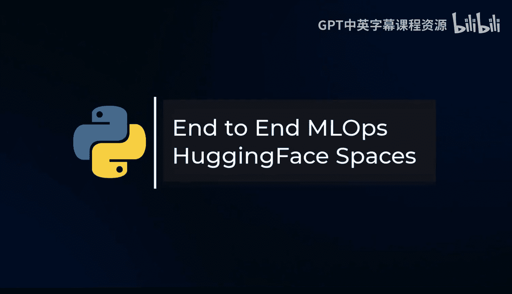
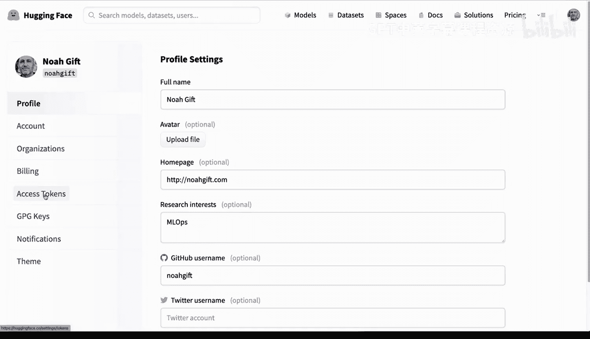
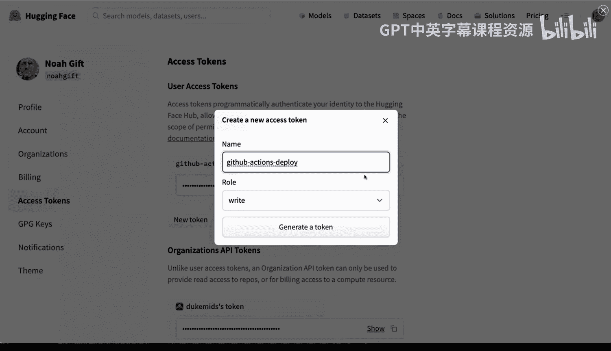
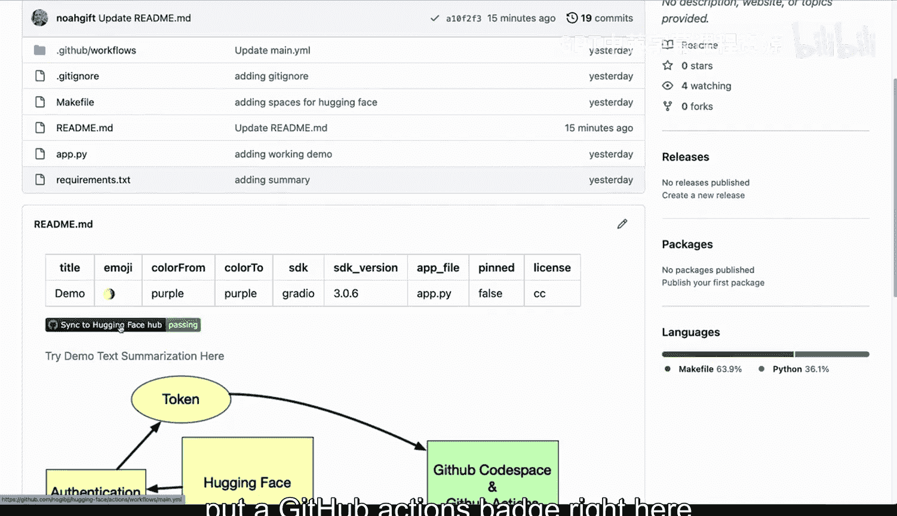
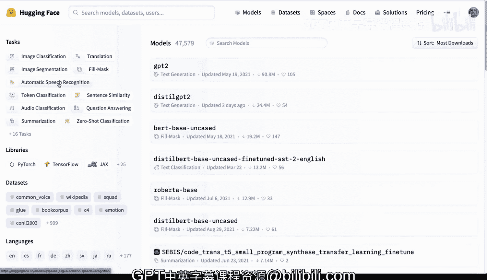

# 机器学习运维：P10：端到端MLOps - Hugging Face Spaces实践 🚀



在本节课中，我们将学习如何构建一个端到端的机器学习运维（MLOps）工作流。我们将使用Hugging Face平台上的预训练模型，通过GitHub Actions实现自动化部署，最终在Hugging Face Spaces上创建一个可运行的文本摘要应用。

---

## 概述

我们将分步完成以下任务：首先在Hugging Face上创建账户和访问令牌；接着在GitHub Codespaces中开发一个基于Gradio的简单应用；然后配置GitHub Actions工作流，实现代码的自动部署；最后验证部署的应用功能。整个过程将展示如何将机器学习模型快速、自动化地投入生产环境。

---

## 准备工作

在开始构建应用之前，我们需要完成一些基础配置。这包括在Hugging Face上创建账户和访问令牌，以及在GitHub上创建代码仓库和开发环境。

### 1. 创建Hugging Face账户与访问令牌

首先，访问Hugging Face官网并创建一个账户。登录后，进入个人设置页面，生成一个具有读写权限的访问令牌。这个令牌将用于后续的自动化部署。

**操作步骤：**
1.  登录Hugging Face。
2.  点击右上角个人头像，进入“Settings”。
3.  在左侧菜单选择“Access Tokens”。
4.  点击“New token”，为其命名（例如 `github-actions-deploy`），并选择“Write”权限。
5.  复制生成的令牌字符串，妥善保存。

### 2. 创建GitHub仓库与Codespaces环境

接下来，我们将在GitHub上创建一个新的代码仓库，并利用GitHub Codespaces功能开启一个云端开发环境。Codespaces允许我们选择配置强大的虚拟机，非常适合机器学习项目的开发。

**操作步骤：**
1.  在GitHub上点击“New repository”创建新仓库，命名为 `hugging-face-demo-2`。
2.  初始化时，可以添加一个README文件、`.gitignore`（选择Python模板）和许可证（如Creative Commons）。
3.  仓库创建后，点击“Code”按钮，选择“Create codespace on main”。
4.  在Codespaces配置中，选择一台性能较强的机器（例如16核CPU、32GB内存），然后启动环境。

---

## 项目开发

现在，我们已经在云端开发环境中准备就绪。本节将搭建项目的基本结构，并编写核心的应用代码。

### 1. 搭建项目脚手架

一个清晰的项目结构有助于管理和维护代码。我们首先创建虚拟环境，并初始化项目所需的文件。

以下是需要创建的核心文件列表：
*   `requirements.txt`: 列出项目依赖的Python包。
*   `app.py`: 应用的主程序文件。
*   `Makefile`: 用于定义常用的项目命令，简化工作流程。
*   `.bashrc` 修改：确保每次打开终端时自动激活虚拟环境。

在终端中执行以下命令来创建这些文件：
```bash
python -m venv .venv
echo "source ~/.venv/bin/activate" >> ~/.bashrc
source ~/.bashrc
touch requirements.txt app.py Makefile
```

### 2. 编写应用代码

我们的应用将使用Hugging Face `transformers`库加载一个预训练的文本摘要模型，并使用`gradio`库构建一个简单的Web界面。

核心逻辑在 `app.py` 文件中实现，主要步骤如下：
1.  从Hugging Face模型库加载预训练的文本摘要模型和分词器。
2.  定义一个`predict`函数，该函数接收输入文本，使用模型进行摘要生成，并返回结果。
3.  使用Gradio的`Interface`类快速创建包含输入文本框和输出区域的Web界面。

以下是 `app.py` 的示例代码框架：
```python
import gradio as gr
from transformers import pipeline

# 加载预训练的文本摘要模型
summarizer = pipeline("summarization", model="facebook/bart-large-cnn")

def predict(input_text):
    # 使用模型生成摘要
    summary = summarizer(input_text, max_length=130, min_length=30, do_sample=False)
    return summary[0]['summary_text']

# 创建Gradio界面
demo = gr.Interface(
    fn=predict,
    inputs=gr.Textbox(lines=10, placeholder="请输入需要摘要的文本..."),
    outputs="text",
    title="文本摘要演示"
)

demo.launch()
```

### 3. 定义项目依赖与命令

为了确保环境一致性，我们需要在`requirements.txt`中明确列出所有依赖包。同时，`Makefile`可以帮助我们标准化安装和运行命令。

`requirements.txt` 文件内容示例：
```
gradio
transformers
torch  # 或 tensorflow，根据模型需求选择
```

`Makefile` 文件内容示例：
```makefile
install:
	pip install -r requirements.txt

run:
	python app.py
```
在终端中运行 `make install` 即可安装所有依赖。

---

## 自动化部署





开发并测试好本地应用后，下一步是实现自动化部署。我们将使用GitHub Actions，在代码推送到仓库时，自动将应用部署到Hugging Face Spaces。

### 1. 配置GitHub Secrets

为了安全地在GitHub Actions工作流中使用Hugging Face令牌，我们需要将其设置为仓库的加密Secret。

**操作步骤：**
1.  进入你的GitHub仓库页面。
2.  点击“Settings” -> “Secrets and variables” -> “Actions”。
3.  点击“New repository secret”。
4.  名称填写 `HF_TOKEN`，值粘贴之前复制的Hugging Face访问令牌。
5.  点击“Add secret”。

### 2. 创建GitHub Actions工作流

GitHub Actions工作流由YAML文件定义。我们需要在仓库的 `.github/workflows/` 目录下创建一个文件，例如 `deploy.yml`。

该工作流的主要步骤是：
1.  在代码发生推送（如到main分支）时触发。
2.  使用 `actions/checkout` 动作检出代码。
3.  使用 `huggingface/huggingface_hub` 动作，借助我们配置的 `HF_TOKEN`，将代码推送到指定的Hugging Face Space。

以下是 `deploy.yml` 的示例内容：
```yaml
name: Deploy to Hugging Face Space
on:
  push:
    branches: [main]

jobs:
  deploy:
    runs-on: ubuntu-latest
    steps:
      - name: Checkout code
        uses: actions/checkout@v3

      - name: Push to Hugging Face
        uses: huggingface/huggingface_hub@v3
        with:
          hf_token: ${{ secrets.HF_TOKEN }}
          git_user: "GitHub Action"
          git_email: "action@github.com"
          # 修改为你的Hugging Face用户名和Space名称
          space: "your-hf-username/your-space-name"
          # 设置推送方式为强制推送，以同步GitHub仓库的更改
          force: true
```

创建并提交这个工作流文件后，后续任何对main分支的推送都会触发自动部署。

---

## 验证与总结

完成以上所有步骤后，整个MLOps流水线就已经搭建完毕。现在，让我们来验证成果并进行总结。

### 1. 验证部署结果



部署成功后，你可以访问你的Hugging Face Space页面（格式通常为 `https://huggingface.co/spaces/your-username/your-space-name`）。


在Space页面上，你应该能看到与本地开发时一样的Gradio界面。尝试输入一段长文本，点击提交，应用应该能返回一个连贯的摘要。这证明你的模型已经成功部署并运行在云端。

同时，在GitHub仓库的“Actions”标签页下，你可以看到每次部署的工作流运行记录，绿色对勾表示部署成功。

### 2. 课程总结

在本节课中，我们一起学习并实践了一个完整的端到端MLOps工作流：

1.  **环境与资源准备**：我们在Hugging Face创建了账户和访问令牌，在GitHub创建了仓库并利用Codespaces搭建了开发环境。
2.  **应用开发**：我们构建了一个基于Hugging Face模型和Gradio库的文本摘要应用，并定义了项目依赖。
3.  **自动化部署**：我们通过配置GitHub Secrets和编写GitHub Actions工作流，实现了代码变更到Hugging Face Spaces的自动部署。
4.  **成果验证**：我们最终验证了部署的应用可以正常运行。



这个流程的核心价值在于**自动化**和**可重复性**。它展示了如何将机器学习项目的开发、测试和部署环节串联起来，减少手动操作，提高迭代效率，是MLOps理念的一个具体实践。你可以将此模式扩展到其他类型的模型和更复杂的应用场景中。