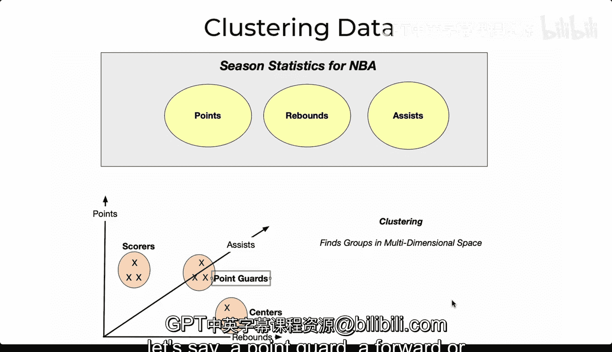

# 杜克大学｜机器学习运维｜DevOps⧸DataOps、Azure、MLFlow和抱脸｜MLOps ｜ Machine Learning Operations p100 23_02_03_数据聚类.zh_en -BV1yE421c7uA_p100-

Let's talk through the core mathematical principles of clustering。

The way we can look at this in a very straightforward way is to look at the seasoned statistics for the NBA。

 We have points， rebounds and assists。In a typical game where someone does an amazing job and they get 10 points。

 10 rebounds and  ten assistesis， this is called a triple double because it's so rare。

But we can look at these three values and find natural groupings if we plot them in a multidimensal space。

 So if we see here on one axis， we have points， another axis， we have assists， another。

 we have rebounds。And we assign essentially a cluster to each natural grouping where the points rebounds and assists are close to each other。

 You'll see that natural grouping appear。 So in this case。

 we have some scores here that score a lot of points。

 but also have a reasonable amount of assists because they're so far away from the basket they're not going to get a lot of rebound。

 So you can see that they're naturally over here。 Meanwhile。

 the point guards are going to lead in assists。 And so you see they're all grouped together here。

 And they get a decent amount of rebounds， but they're not as much of a rebounder as the centers who are down towards the basket and getting the rebounds and really focused on that particular job。

 So you can see here that when you cluster things in multidimensional space。

There'll be an emergent label that appears and it could be the scores， the point guards， the centers。

 it really depends on the data set， but this is really the core intuition。

 and in fact you can try it yourself by going to an MBA data and doing cameens cluster and you'll find that there'll be really easy natural groupings that will apply to what you commonly would think someone would be。

 let's say a point guard a forward or some other position on the court。

