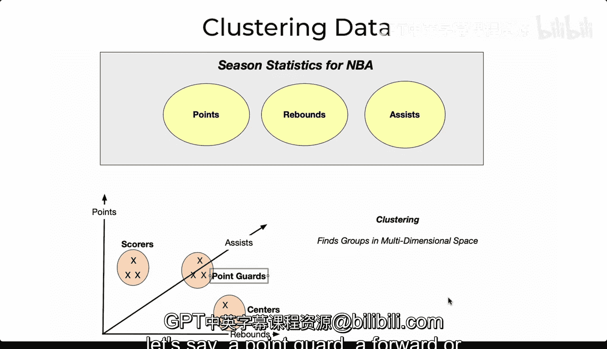

# 机器学习运维：100：数据聚类

## 概述
在本节课中，我们将要学习数据聚类的核心数学原理。我们将通过一个直观的篮球数据例子，来理解如何在多维空间中寻找数据点的自然分组。

## 核心数学原理
让我们来探讨聚类的核心数学原理。

我们可以用一个非常直观的方式来理解它，那就是观察NBA的赛季统计数据。

我们拥有得分、篮板和助攻三项数据。在一场典型的比赛中，如果一名球员表现出色，取得了10分、10个篮板和10次助攻，这被称为“三双”，因为它非常罕见。

但是，我们可以观察这三个数值，并将它们绘制在多维空间中，从而发现自然的群组。

因此，如果我们在这里看到，在一个坐标轴上我们有点数，另一个坐标轴上有助攻，还有一个坐标轴上有篮板。我们本质上为每个自然群组分配一个聚类，其中得分、篮板和助攻彼此接近。

你会看到自然群组出现。在这种情况下，这里有一些球员得分很高，但同时也有相当数量的助攻，因为他们距离篮筐很远，所以不会抢到很多篮板。因此，你可以看到他们自然地聚集在这里。

与此同时，控球后卫的助攻数会领先。所以你会看到他们都聚集在这里。他们也能抢到一定数量的篮板，但不如中锋那么多，中锋靠近篮筐，专注于抢篮板这项特定工作。

因此，你可以看到，当你在多维空间中对事物进行聚类时，会出现一个浮现的标签，它可能是得分手、控球后卫或中锋。这实际上取决于数据集，但这确实是核心的直觉。

事实上，你可以自己尝试，通过访问NBA数据并使用K-means聚类算法，你会发现会出现非常容易的自然分组，这些分组会与你通常认为的球员场上位置（例如控球后卫、前锋或其他位置）相对应。

## 总结
本节课中，我们一起学习了数据聚类的核心思想。我们了解到，通过将拥有多个特征（如得分、篮板、助攻）的数据点置于多维空间中，并计算它们彼此间的“距离”，可以自动发现数据中存在的自然分组或“簇”。这种方法无需预先定义标签，就能从数据本身的结构中识别出有意义的类别，例如篮球运动员的不同角色。