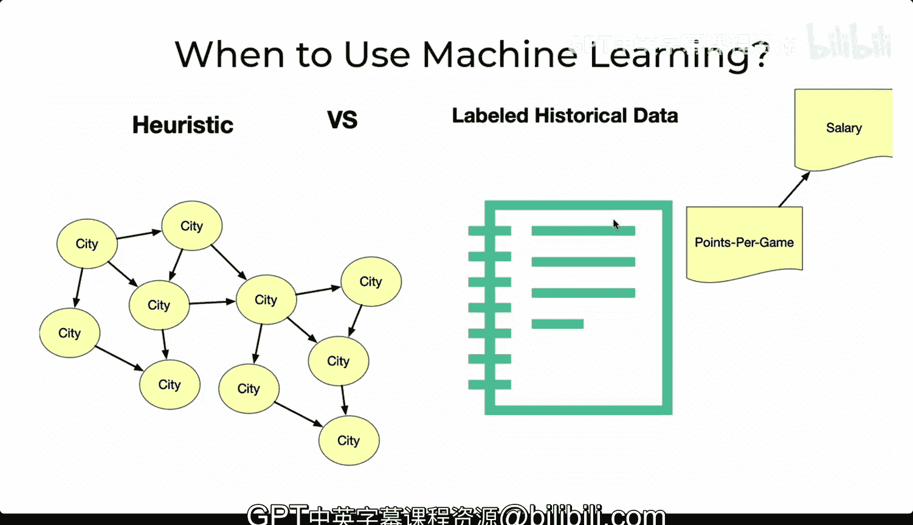

# 杜克大学｜机器学习运维｜DevOps⧸DataOps、Azure、MLFlow和抱脸｜MLOps ｜ Machine Learning Operations p101 24_03_02_何时使用机器学习.zh_en -BV1yE421c7uA_p101-

When do you use machine learning versus another technique。

One of the easy ways to take a look at this scenario is if the problem can be solved by heuristic。

 you should use a heuristic first here's a good example。

 we have a maybe a location based problem where a shipping company needs to visit the shortest distance to travel to series of cities。

 this is called the travel and salesman problem， a classic problem in a computer science。

This would be much better served as a heuristic and there are many known solutions here and it's easy to debug what's happening。

 you could say I want to do a random greedy start， run multiple simulations and then minimize for the shortest distance between the route that you would travel。

Likewise， if you have labeled historical data， in this case， let's say you have a notebook。

 you pull together and you have the labeled points per game and you have the label salary and you wanted to predict the salary in the future of what you would pay a MBA player based on how many points per game they scored。

 this would be a great use case for machine learning， in general。

 if you can solve a problem with a heuristic， it's best to start with that first and see if that is a good solution versus jumping directly into machine learning and trying to do some complicated approach likewise if you have tabular data for example。

 and it's labeled and you want to predict one thing based on the results of another column。

 this would be a great use case for doing machine learning in a business scenario。

