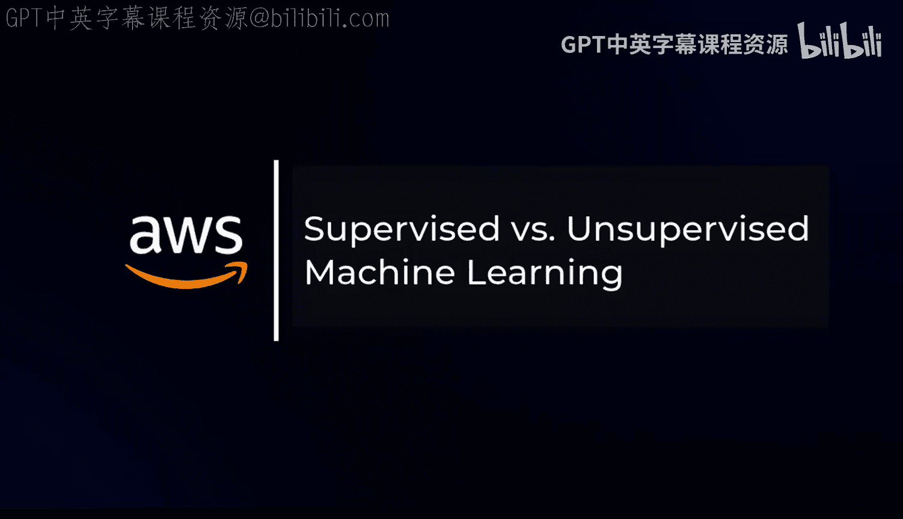
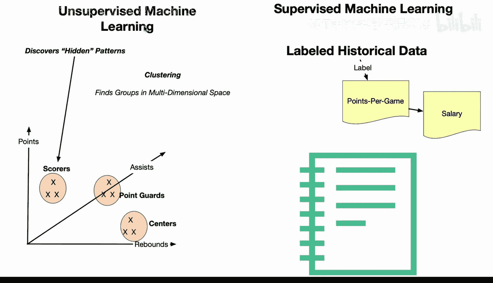
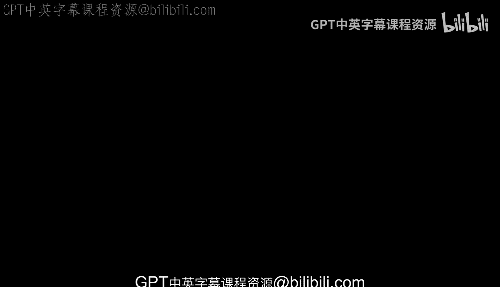

# 杜克大学｜机器学习运维｜DevOps⧸DataOps、Azure、MLFlow和抱脸｜MLOps ｜ Machine Learning Operations p102 25_03_03_监督式与非监督式机器学习.zh_en -BV1yE421c7uA_p102-

There are some key differences between unsupervised machine learning and supervised machine learning。

Let's first take a look at supervised machine learning。

It works by taking labeled historical data and using that historical data to make a prediction in the case of a regression problem here we have points per game if we wanted to use that to predict a salary。

We would be able to create a supervised machine learning prediction based on that label of points。

 which would predict the target of salary。So in any scenario where you have labeled data。

 especially tabular data like this， that's in a numerical form。

 you can solve it by doing supervised machine learning in the case of unsupervised machine learning。

 the key idea here is that you're going to discover hidden patterns。

And those could then become the labels。Here's a great scenario that we could take a look at by using clustering。

 and we would cluster on points， assists and rebounds。

You would be able to discover these hidden patterns， For example。

 who are the highest scores in the National Basketball Association， Who are the point guards。

 Who are the centers， And you could figure this out， because when you cluster。

 they'll naturally group together in multidimensal space， so。Between these three axis。

 these values will be the nearest to each other， and then the domain expert will be able to discover these hidden patterns。

 typically with unsupervised machine learning， it's best to have a domain expert there to really put a notation on the hidden pattern so that you can then apply that label to the data。

that's really the key difference， discovery versus working on a problem where you already have the label data and you're doing a prediction now the two can work together as well because in the case of unsupervised machine learning。

 this could be the first step is find the labels for the data and then the next step would be to use that data to do a prediction。

