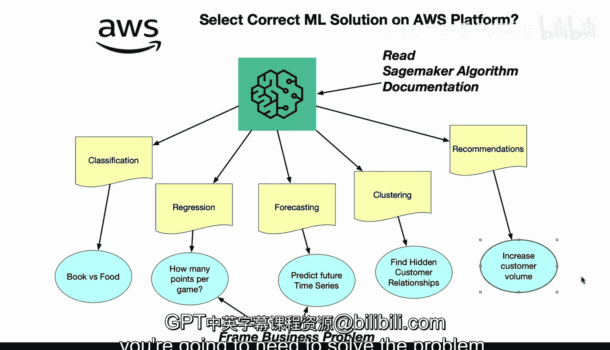

# 杜克大学｜机器学习运维｜DevOps⧸DataOps、Azure、MLFlow和抱脸｜MLOps ｜ Machine Learning Operations p103 26_03_05_选择机器学习解决方案.zh_en -BV1yE421c7uA_p103-

How do you select the correct machine learning solution on the AWS platform？Well。

 a very easy way to start would be to read the sageMaker algorithm documentation。

 AWS has great documentation about how an algorithm works that is included with sageMaker。

 and that's a good starting point， right， Look at the classification algorithms they have。

 the regression algorithms， the forecasting algorithms。

A second way to pick the correct ML solution would be to make sure you're framing the problem in a business sense。

 so for example， if your organization wants to classify between a book versus food。

 that would be one of the ways to frame the problem and then you would say， oh。

 I need to build a classification problem。And then likewise。

 if you wanted to select a business problem that's framed in how many points per game。

 you could then go back and say， okay， this is a regression problem if you wanted to predict a future time series event。

 for example， inventory forecast， you could look at that as a forecasting problem and use potentially a builtin sageMaker forecasting tool or even another forecasting tool on the AWs platform and then in terms of finding hidden customer relationships。

 you could identify that that's in fact， a caings clustering problem and then use let's say sageMaker k's clustering and then finally。

 if you wanted to increase customer volume one of the things you could look at would be to give customers better recommendations and you could frame that as a recommendation problem。

 So a lot of the correct machine learning solution problem is a framing problem if you frame it correctly。

 it's easier to identify the appropriate M solution。That you're going to need to solve the problem。

