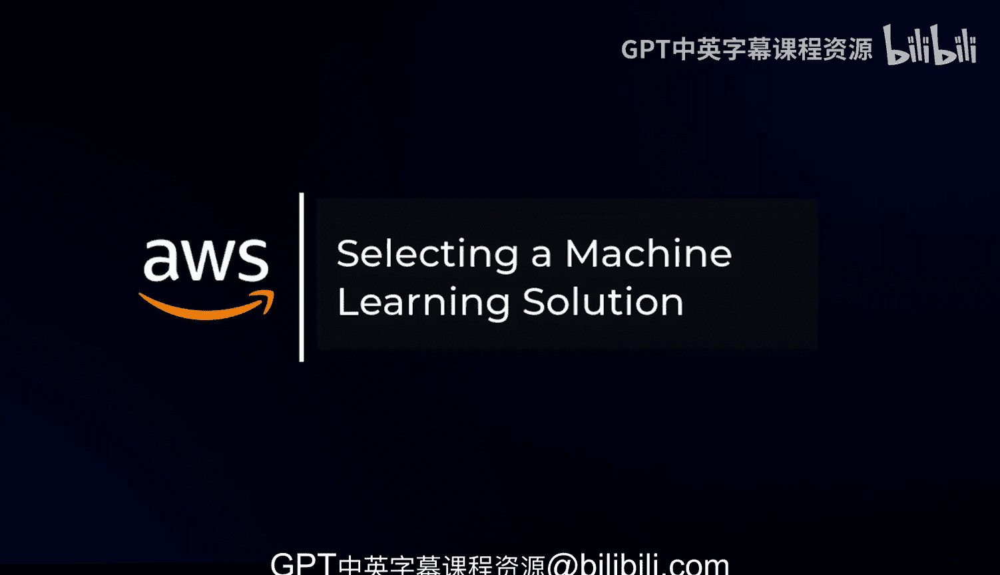
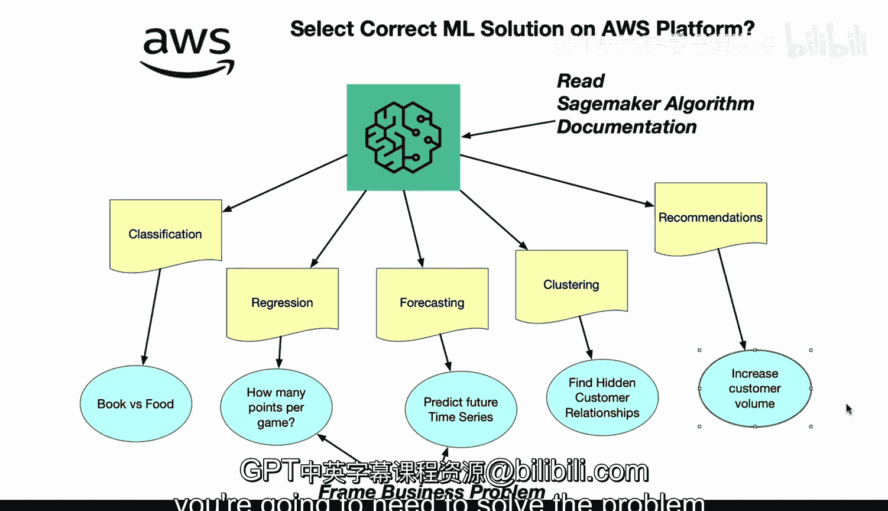

# 杜克大学｜机器学习运维｜MLOps：p103：如何选择机器学习解决方案 🧠

在本节课中，我们将学习如何在AWS平台上选择正确的机器学习解决方案。我们将探讨几种实用的方法，帮助你根据业务需求和技术特性，为项目匹配合适的算法或工具。

## 概述

选择正确的机器学习解决方案是项目成功的关键一步。本节将介绍两种核心方法：一是查阅官方技术文档，二是从业务角度正确定义问题。通过这两种方法，你可以更系统地为你的机器学习项目找到合适的起点。

## 方法一：查阅官方文档 📚

一个非常简单的入门方法是阅读**SageMaker算法文档**。AWS提供了关于SageMaker内置算法工作原理的详细文档，这是一个很好的起点。

以下是查阅文档时可以参考的算法类别：
*   **分类算法**：用于区分不同类别，例如判断一张图片是书还是食物。
*   **回归算法**：用于预测连续数值，例如预测球员每场比赛的得分。
*   **预测算法**：用于预测未来时间序列事件，例如库存预测。

## 方法二：正确定义业务问题 🎯

上一节我们介绍了如何利用技术文档，本节中我们来看看如何从业务角度切入。选择正确机器学习解决方案的第二种方法是确保你从**业务层面**正确定义了问题。

许多时候，选择解决方案本身就是一个“问题定义”的过程。如果你能正确定义问题，就更容易识别出解决该问题所需的合适机器学习方案。

以下是几种常见业务问题及其对应的机器学习任务类型：
*   **分类问题**：如果你的组织想要区分书籍和食品，这就是一个分类问题。
*   **回归问题**：如果你想预测一个连续值，例如每场比赛的得分，这就是一个回归问题。
*   **预测问题**：如果你想预测未来的时间序列事件，例如库存预测，你可以将其视为预测问题，并可能使用SageMaker内置的预测工具或AWS平台上的其他预测工具。
*   **聚类问题**：如果你想发现隐藏的客户关系，这实际上是一个聚类问题，例如可以使用SageMaker的K-Means聚类算法。
*   **推荐问题**：如果你想通过提供更好的推荐来增加客户量，你可以将其定义为一个推荐问题。

## 总结

本节课中我们一起学习了在AWS平台上选择机器学习解决方案的两种主要方法。首先，我们可以通过查阅详尽的SageMaker算法文档来了解技术选项。其次，更重要的是从业务出发，正确定义问题（如分类、回归、预测等），这能直接指引我们找到合适的机器学习任务类型和工具。将业务目标清晰转化为机器学习问题，是成功构建解决方案的第一步。