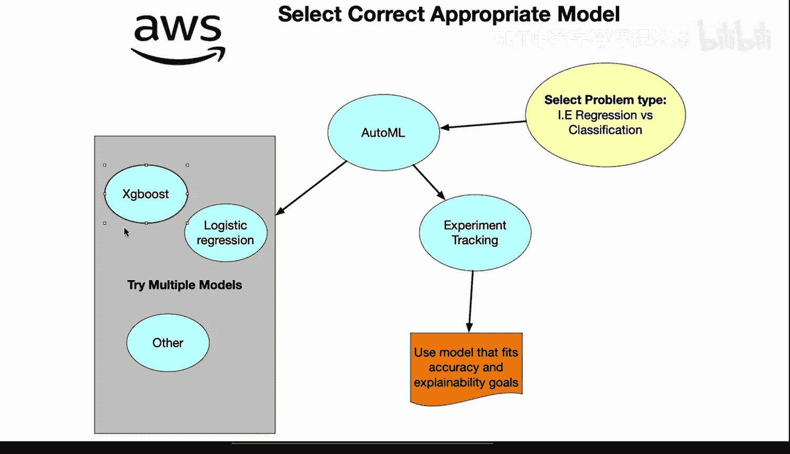

# 杜克大学｜机器学习运维｜DevOps⧸DataOps、Azure、MLFlow和抱脸｜MLOps ｜ Machine Learning Operations p104 27_03_03_选择机器学习模型.zh_en -BV1yE421c7uA_p104-

How do you select the correct appropriate model for the problem you're solving There is no perfect solution for this。

 and there are many different techniques that you can think about。

 but one that's a very interesting technique is to first use an AutoM tool Now you can't just throw an Autom tool at a problem without selecting a problem type first you need to pick between regression。

 let's say or a classification， let's say we picked classification。

 you can then say I'd like the AutoM system to pick from a variety of models and a variety of hyperparameters a bunch of different experiments and once it goes through and it tries。

 let's say XG boost logistic regression tries a bunch of other classification models with lots of different hyperparameters。

 maybe using a grid search to do that。All of those experiments will show up in SageMaker experiment tracking and or another tool like for example。

 ML flow experiment tracking。Once you've got that experiment tracking。

 you can then use the model that fits the accuracy and explainability goals for the problem you're solving。

 So really AutoM in a way isn't necessarily the only use case for selecting appropriate models。

 but it can be very helpful in the discovery of what particular models and hyperparameters could work for the problem you're trying to solve。

 So I think using AutoM is one of the solutions to select the appropriate model。

 Another solution is if you already have experience with a particular problem you can just go right to the problem itself。

 And let's say you know that X boost works very well with a problem you're solving。

 you can dive right into it， but in general， AutoM can be a very good exploratory tool to help you nail down what are some of the options that you can select。

