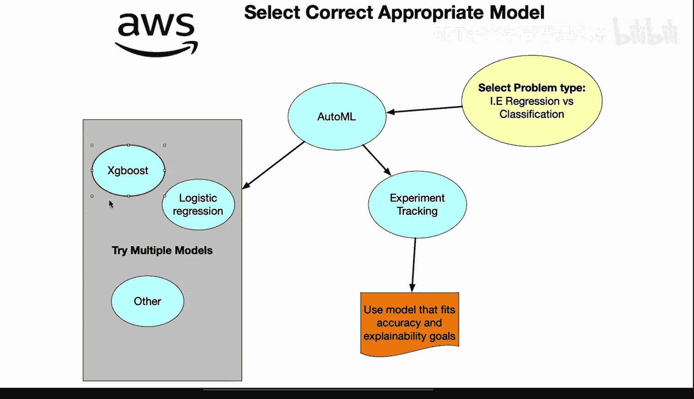

# 机器学习运维：104：选择机器学习模型 🧠

在本节课中，我们将学习如何为待解决的特定问题选择合适的机器学习模型。我们将探讨两种主要方法：利用自动化机器学习工具进行探索，以及基于先验经验直接选择模型。

## 概述

为特定问题选择正确的模型没有完美的解决方案。存在多种不同的技术可以考虑。其中一种非常有趣的技术是首先使用自动化机器学习工具。

## 利用AutoML工具进行探索

然而，你不能在不首先确定问题类型的情况下，就直接对问题使用AutoML工具。你需要在回归或分类等问题类型中进行选择。

假设我们选择了分类问题。接下来，你可以指示AutoML系统从一系列模型和超参数中，通过大量不同的实验来进行选择。例如，系统可能会尝试XGBoost、逻辑回归以及其他多种分类模型，并使用大量不同的超参数，可能通过网格搜索来完成这个过程。

所有这些实验都会出现在SageMaker实验跟踪或MLflow实验跟踪等工具中。一旦你获得了这些实验跟踪结果，就可以选择符合你解决问题所要求的准确性和可解释性目标的模型。

因此，从某种意义上说，AutoML不一定是选择合适模型的唯一用例，但它在探索哪些特定模型和超参数可能适用于你试图解决的问题时，会非常有帮助。所以，使用AutoML是选择合适模型的解决方案之一。

## 基于经验直接选择模型

另一种解决方案是，如果你对特定问题已有经验，可以直接针对问题本身进行选择。例如，如果你知道XGBoost在你解决的问题上效果很好，就可以直接深入使用它。

## 总结

总而言之，AutoML可以作为一个非常好的探索性工具，帮助你确定可以选择的一些选项。本节课中，我们一起学习了通过AutoML工具探索模型选项以及基于已有经验直接选择模型这两种策略。