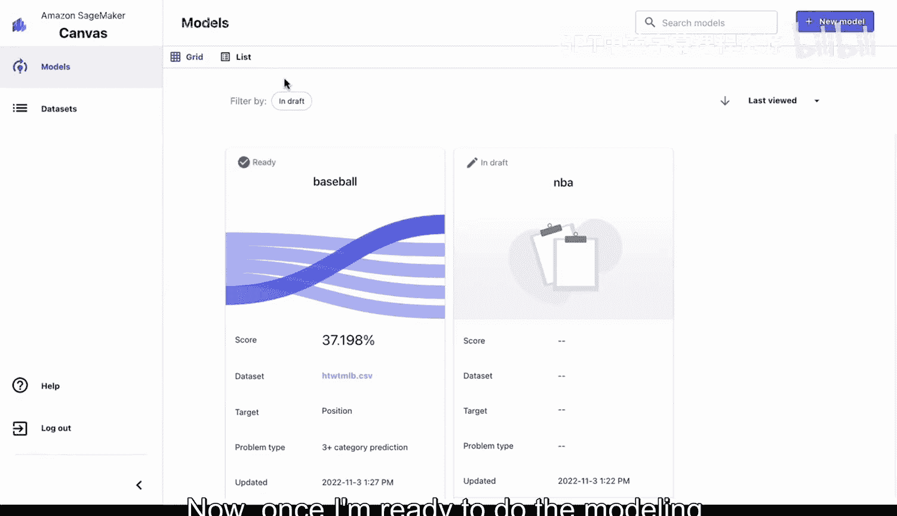
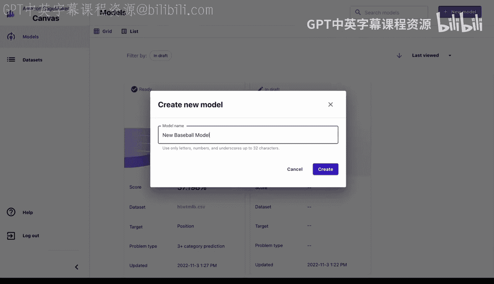
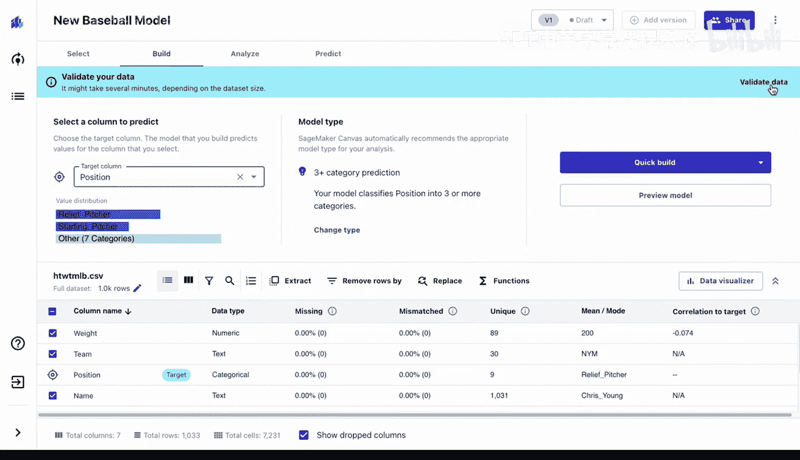
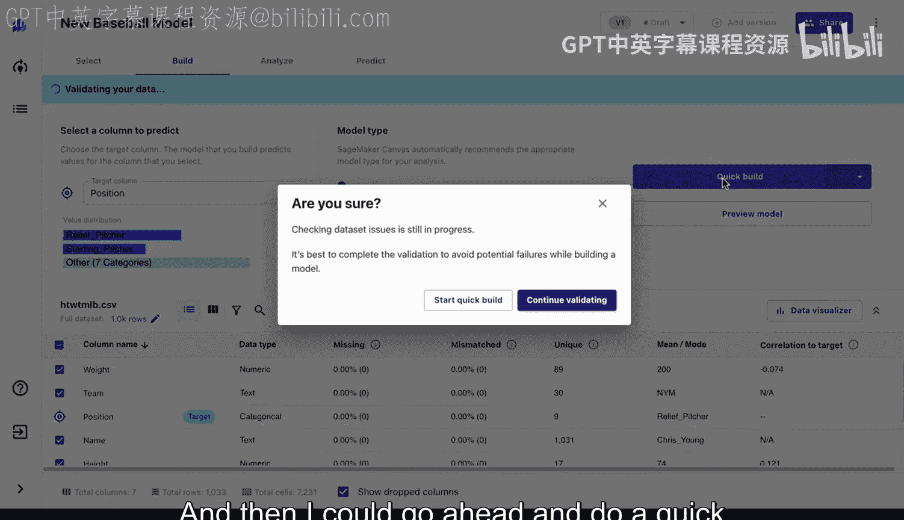
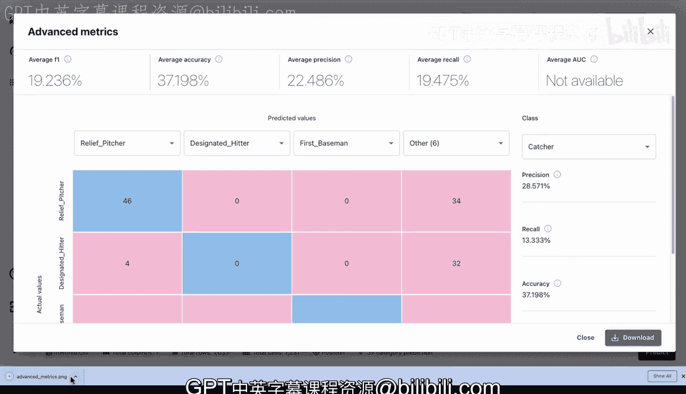

# 杜克大学｜机器学习运维｜DevOps⧸DataOps、Azure、MLFlow和抱脸｜MLOps ｜ Machine Learning Operations p105 28_03_04_使用SageMaker Canvas进行建模演示.zh_en -BV1yE421c7uA_p105-

Here we have Amazon sagemakerr， which is a low code or no code machine learning tool。

 and it is a good tool to show you the foundational components of modeling。

 really the first phase is ingestion。 So if we go to import here。

 I could either drag something from my computer or if I go to S3， I could pull something in from S3。

 So for example， I've got some data instead of here。

 I could grab one of these files like this is Major League Baseball。

 which I'm going to analyze in a little bit if I wanted to import it。

 I could just select import and it'll go through and import that data。 Now。

 once I'm ready to do the modeling。

Then all I would need to do is say what I wanted to create， like in this case， we'll say， you know。

 new baseball model。And then once I've gone through and created this model。

 I have to tell it what data set I want to use in this case I could select this Major League baseballaseball data and what's really nice initially about this particular system is it shows me what kind of data type it is。

 if there's missing data or not， whether it's mismatched。

 how many unique values are there and then the mean in the mode as well。

 and then if I wanted to visualize it I could select visualize and for example。

 we know that height and weight have a relationship and of course the data visualization tells us that。

And if I want to go through and I want to write some kind of a function。As well。

 I could do some kind of a form function that could be applied to this。

 So it really has some of those Excel type features。

But it's built for machine learning So really a nice little tool here that does give me a lot of really good data visualization capabilities。

 Now if I want to go through here and go back to models to create a model again I would just go ahead and select the model or if I already have started the process I can pick which column I want to predict so do I want to predict the height。

 the weight， the age or the or the team the position let's go ahead and pick position here and if we look here。

 we see there's relief picture there's starting pitch and there's another seven categories。

And I could first validate it to make sure that my data is correct。

 and then I could go ahead and do a quick build and this quick build would go through and try to create a model that would predict that particular position Now since I've already done this。

 I can go back to a model that I've already created and one of the things it does show me is that it has this model has 37% correct position prediction here and if we want to look through here。

We can see， actually。For each of the particular positions how well they're able to predict and if we look down at。

 let's say a relief picture as well， we can see that that's actually one of the the better predictions so we look here we see the model accuracy insights it gives us some nice insights into predicted versus actual and you can see that in the case of a relief picture it's able to predict based on just height and weight 41% of the time the correct position and for the values that are the relief picture in the data the model is able to predict 73% of them so if we want to look at the advanced metrics here as well。

 we can look at F1 we can look at the average accuracy so out of all the predictions what percent were correct we can look at the average precision we can look at the average recall and the average area under the under the curve here so these are all different metrics that show us know。

Different accuracy metrics。 So， for example， if we select on precision。

 it even tells us what that means， it says of all the times the catcher was predicted。

 the prediction was correct 28% of the time。 And we go to recall。

 it says the model correctly predicted013% to be catcher when the position was actually the catcher so。

It it's able to actually give us even the details of what this particular metric is。

 so what is accuracy， it's out of all the predictions。

 what percentage were correct F1 as this is the balance measure of accuracy that takes into account class balances so can you can actually go through here and and look through this to learn about different types of metrics and this is I think a great way to learn about data science。

 learn about machine learning is to look at a tool like this and actually dive into each one of them in this case we have the relief picture and we have the catcher and we can see these you know basically the confusion matrix here of when it was able to successfully predict and when were there false predictions right so true positives and false positives。

And then finally， if you wanted to， you can actually download the model or you can download the visualizations and put those into a dashboard。

